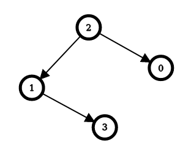

# DFS + Memoization with explained thought process

**Author:** maxim-dovydenok
**Votes:** 2
**Link:** [https://leetcode.com/problems/minimum-edge-reversals-so-every-node-is-reachable/solutions/4052665/](https://leetcode.com/problems/minimum-edge-reversals-so-every-node-is-reachable/solutions/4052665/)

---

# Intuition
Most important thing in the problem description is that we don't have cycles:
> The graph would form a tree if its edges were bi-directional.

First thing that I noticed is that for each node the result is equal to the `in-degree (number of edges ending at this node) + results on each branch of the tree (as if current node is root node)`. We add in-degree because to move from this node to the neighbour using this in-edge we have to reverse this edge.
So I started to think if I can calculate results for each branch separately, and then we can combine these results to get final answer.

In this example we have following state

| |0|1|2|3|
|-|-|-|-|-|
|in edges from|2|2|-|1|
|out edges to|-|3|0, 1|-|

Let's review all nodes:

---
Imagine 0 is a root node, it has only 1 branch (starting with 2) and 2-0 is an in-edge for node 0, then result is equal to:
- 1 (to reverse 2-0 edge)
- result of all branches of 2 (except branch that starts with 0)
---
Imagine 1 is a root node, it has 2 branches (2-branch and 3-branch) and one of the edges is an in-edge, then result is equal to::
- 1 (to reverse 2-1 edge)
- 0 (no need to reverse 1-3 edge)
- result of all branches of 2 (except branch that starts with 1)
- result of all branches of 3 (except branch that starts with 1)
---
Imagine 2 is a root node, it has 2 branches (0-branch and 1-branch) and no in-edges, then result is equal to:
- 0 (no need to reverse 2-1 edge)
- 0 (no need to reverse 2-0 edge)
- result of all branches of 0 (except branch that starts with 2)
- result of all branches of 1 (except branch that starts with 2)
---
Imagine 3 is a root node, it has 1 branch (1-branch) and 1 in-edge, then result is equal to:
- 1 (to reverse 1-3 edge)
- result of all branches of 1 (except branch that starts with 3)
---

We can notice that starting from any node, we can continue calculating results for neighbour nodes and never have an infinite loop (because it's a tree, and we never explore parent branch).


# Approach
Let's first move edges into easier to work with data structure - list of in and out edges for each node.

Our recursive calculate function will take 2 argument: node to calculate and parent node (edge starting/ending on parent node should be ignored).

We'll call our recursive function for each of our N nodes, and save return values in the answer array.

Our recursive function should return number of in-edges plus results of recursively calling itself for nodes connected to the current node (in other words for each of the branches).

Even without memoization this would return a correct answer, but we can memoize almost everything on the first pass. To do that we keep HashMaps for each of the nodes, these hash maps should contain answers for each of the branches of the node, it means that once we calculated result for branches of node 2 (1-branch and 0-branch) we won't need to calculate 0-branch again as part of node 1 calculation.

Final memoization would look like:
|0|1|2|3|
|-|-|-|-|
|2-branch = 1|2-branch = 0, 3-branch = 1|0-branch = 0, 1-branch = 0|1-branch = 2|

# Complexity
- Time complexity:
$$O(N + M)$$ - where N is number of nodes, M is number of edges. We call our recursive function N times, and recursive function calls itself `2*M` times, twice for each edge (once in each direction), everything else is taken from memoization maps. Without memoization it would be $$O(N*M)$$ I think :)

- Space complexity:
$$O(N + M)$$ - needed to store memoization maps.

# Code
```
/**
 * @param {number} n
 * @param {number[][]} edges
 * @return {number[]}
 */
var minEdgeReversals = function(n, edges) {
    const ins = new Array(n).fill(null).map(_ => []);
    const outs = new Array(n).fill(null).map(_ => []);
    
    for (let i = 0; i < edges.length; i++) {
        ins[edges[i][1]].push(edges[i][0])
        outs[edges[i][0]].push(edges[i][1])
    }
    
    const vals = new Array(n).fill(null).map(_ => ({}));
        
    const calculate = (node, except) => {
        let total = 0;

        for (const from of ins[node]) {
            if (from === except) {
                continue;
            }

            if (typeof vals[node][from] === 'undefined') {
                vals[node][from] = calculate(from, node) + 1;
            }

            total += vals[node][from];
        }
        
        for (const to of outs[node]) {
            if (to === except) {
                continue;
            }

            if (typeof vals[node][to] === 'undefined') {
                vals[node][to] = calculate(to, node);
            }

            total += vals[node][to];
        }
        
        return total;
    }
    
    return new Array(n).fill(null).map((_, i) => calculate(i, null))
};
```