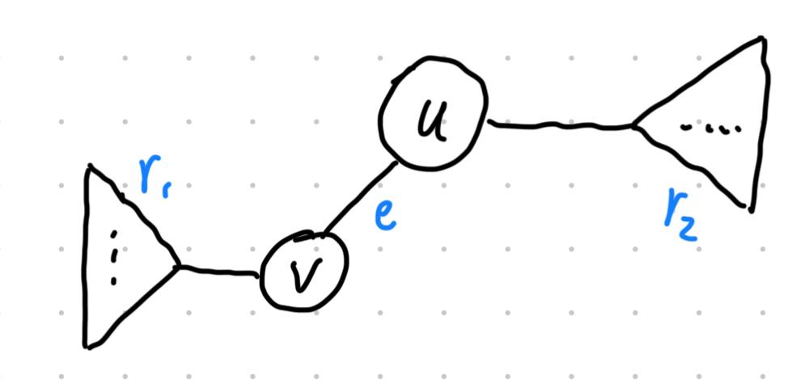

# Method using two DFS with explanation

**Author:** Star-Lord-PHB
**Votes:** 0
**Link:** [https://leetcode.com/problems/minimum-edge-reversals-so-every-node-is-reachable/solutions/5316089/](https://leetcode.com/problems/minimum-edge-reversals-so-every-node-is-reachable/solutions/5316089/)

---

# Intuition

A very important premise is the sentense "The graph would form a tree if its edges were bi-directional", which means for each pair of nodes $u$ and $v$, there is only one possible path between them. (I fail to get this point initially and try to solve it using Floyd-Warshall, which is correct but exceed the time limit)

Consider the following example where: 

* $u$, $v$ are two nodes
* $e$ is the edge between them whose direction can be $u \\rightarrow v$ or $v \\rightarrow u$
* The 2 triangles are the remaining parts of the graph. $r_1$ denotes the minimum required reversals for node $v$ to reach all the other nodes in the left triangle while $r_2$ is the minimum required reversals for node $u$ to reach all the other nodes in the right tirangle.

Let $r_u$ and $r_v$ to be the minimum required reversals for node $u$ and $v$ to reach all the other nodes in the graph, respectively. 

$$
\\begin{cases}
r_u = r_2 + r_{uv} + r_1 \\\\
r_v = r_2 + r_{vu} + r_1
\\end{cases}
$$

where:

$$
r_{uv} = \\begin{cases}
0 & \	ext{if } e \	ext{ has direction } u \\rightarrow v \\\\
1 & \	ext{otherwise}
\\end{cases}
$$

$$
r_{vu} = \\begin{cases}
0 & \	ext{if } e \	ext{ has direction } v \\rightarrow u \\\\
1 & \	ext{otherwise}
\\end{cases}
$$



It is clear that $r_u$ and $r_v$ are very similar and the only difference is affected by the direction of edge $e$.

Assume that we already know $r_u$, then 
* if the direction of $e$ is $u \\rightarrow v$, then $r_{uv} = 0$ and $r_{vu} = 1$, so $r_v = r_u + 1$
* if the direction of $e$ is $v \\rightarrow u$, then $r_{uv} = 1$ and $r_{vu} = 0$, so $r_v = r_u - 1$

That menas once we have the required minimum reversals for a node to reach all the other nodes, we can calculate the required minimum reversals for all its child nodes. 


# Approach

With the intuition above, we can simply calculate the required minimum reversals for node 0 to reach all the other nodes, then recursively calculate the required minimum reversals for all its child nodes (can be done with a DFS). As for the node 0, its minimum reversals can also be calculated with another DFS. 


# Complexity
- Time complexity: $O(n)$

- Space complexity: $O(n)$
<!-- Add your space complexity here, e.g. $$O(n)$$ -->

# Code
```
class Solution {

    var biDirectionalEdges: [Set<Int>] = []
    var directionalEdges: [Set<Int>] = []


    func minEdgeReversals(_ n: Int, _ edges: [[Int]]) -> [Int] {

        biDirectionalEdges = .init(repeating: .init(), count: n)
        directionalEdges = .init(repeating: .init(), count: n)
        
        for edge in edges {
            directionalEdges[edge[0]].insert(edge[1])
            biDirectionalEdges[edge[0]].insert(edge[1])
            biDirectionalEdges[edge[1]].insert(edge[0])
        }

        let rootResult = rootDfs(0, parent: -1)

        var result = [Int](repeating: 0, count: n)
        result[0] = rootResult

        resultDfs(0, parent: -1, result: &result)

        return result

    }


    func rootDfs(_ node: Int, parent: Int) -> Int {

        var result = 0

        for child in biDirectionalEdges[node] where child != parent {
            result += rootDfs(child, parent: node)
            if !directionalEdges[node].contains(child) {
                result += 1
            }
        }

        return result

    }


    func resultDfs(_ node: Int, parent: Int, result: inout [Int]) {

        for child in biDirectionalEdges[node] where child != parent {
            result[child] = if !directionalEdges[child].contains(node) {
                result[node] + 1
            } else {
                result[node] - 1
            }
            resultDfs(child, parent: node, result: &result)
        }

    }

}
```