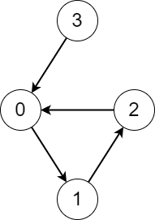
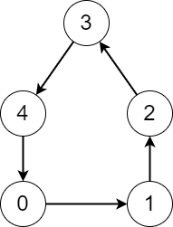

# [2876. Count Visited Nodes in a Directed Graph](https://leetcode.com/problems/count-visited-nodes-in-a-directed-graph/)

| Category | Difficulty | Likes | Dislikes |
| :------: | :--------: | :---: | :------: |
| Algorithms | Hard | 356 | 7 |

**Tags:** [`dynamic-programming`](https://leetcode.com/tag/dynamic-programming), [`graph`](https://leetcode.com/tag/graph), [`memoization`](https://leetcode.com/tag/memoization)

**Companies:** `amazon`, `bny-mellon`

## Description

There is a **directed** graph consisting of `n` nodes numbered from `0` to `n - 1` and `n` directed edges.

You are given a **0-indexed** array `edges` where `edges[i]` indicates that there is an edge from node `i` to node `edges[i]`.

Consider the following process on the graph:

	- You start from a node `x` and keep visiting other nodes through edges until you reach a node that you have already visited before on this **same** process.

Return *an array *`answer`* where *`answer[i]`* is the number of **different** nodes that you will visit if you perform the process starting from node *`i`.

 

**Example 1:**


```

Input: edges = [1,2,0,0]
Output: [3,3,3,4]
Explanation: We perform the process starting from each node in the following way:
- Starting from node 0, we visit the nodes 0 -&gt; 1 -&gt; 2 -&gt; 0. The number of different nodes we visit is 3.
- Starting from node 1, we visit the nodes 1 -&gt; 2 -&gt; 0 -&gt; 1. The number of different nodes we visit is 3.
- Starting from node 2, we visit the nodes 2 -&gt; 0 -&gt; 1 -&gt; 2. The number of different nodes we visit is 3.
- Starting from node 3, we visit the nodes 3 -&gt; 0 -&gt; 1 -&gt; 2 -&gt; 0. The number of different nodes we visit is 4.

```

**Example 2:**


```

Input: edges = [1,2,3,4,0]
Output: [5,5,5,5,5]
Explanation: Starting from any node we can visit every node in the graph in the process.

```

 

**Constraints:**

	- `n == edges.length`

	- `2 <= n <= 10^5`

	- `0 <= edges[i] <= n - 1`

	- `edges[i] != i`

---

**Links:** [Submissions](https://leetcode.com/problems/count-visited-nodes-in-a-directed-graph/) | [Solutions](https://leetcode.com/problems/count-visited-nodes-in-a-directed-graph/)
