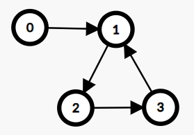
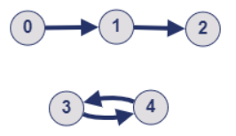
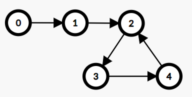

# [C++, Java, Python] Topological Sort | Intuition With Examples | Queue + Stack

**Author:** shivamaggarwal513
**Votes:** 131
**Link:** [https://leetcode.com/problems/count-visited-nodes-in-a-directed-graph/solutions/4112173/](https://leetcode.com/problems/count-visited-nodes-in-a-directed-graph/solutions/4112173/)

---

# Intuition
Every node has one and only one outgoing edge. We have total of $n$ edges.



Every node belonging to a cycle will visit $cycleSize$ number of nodes. In above example, nodes $[1, 2, 3]$ will visit $cycleSize = 3$ number of nodes.

So, it's easier to first calculate for nodes that are present in some cycle because there answer is known. And later we can calculate for the remaining nodes that are not a part of any cycle.

One thing to note here is that each node will be either a part of a cycle or will be going in a cycle eventually after traversing. Why? Let's try to make a counter example, where a component will not have any cycle.



Here, the component $[3, 4]$ has two edges, one outgoing edge for each node, and has a cycle. The component $[0, 1, 2]$ has no cycle. But it contradicts the constraints because $2$ has no outgoing edge and we want every node to have one and only one outgoing edge.
Now, if we try to create an outgoing edge from $2$ to any of the node $[0, 1, 2]$, it will create a cycle. Or if we try to create an edge from $2$ to any of $[3, 4]$, then every node $[0, 1, 2]$ will be going in the cycle of $[3, 4]$ eventually after traversing. This proves the above statement.

Why was this statement important?



Because, now we know that we can first safely calculate the answers for nodes that are a part of a cycle.
> $[2, 3, 4]$ in above example.
$answer[2] = answer[3] = answer[4] = cycleSize = 3$

Then we can calculate the answer for the node(s) that were not a part of the cycle but they were **directly** connected to a cycle.
> Node $1$ in above example.
$answer[1] = answer[2] + 1 = 4$

Then we can calculate the answer for the node(s) that were not a part of the cycle but they were connected to a node which was directly connected to a cycle.
> Node $0$ in above example.
$answer[0] = answer[1] + 1 = 5$

And so on...

# Approach
- Use topological sorting to find cycles in the directed graph.
  - First calculate indegree of each node.
  - Maintain a queue and insert the nodes that have indegree $0$.
  - Then process the nodes one by one removing from queue, marking them visited.
    - Decrease the neighbour's indegree by $1$.
    - If it becomes $0$, push it into the queue too.
  - At last, we would have visited all the nodes that were not a part of any cycle. We will be left to visit the nodes that are a part of a cycle.
- For each node which is not visited, calculate it's cycle length and fill the answer for each node that is a part of that cycle. Mark them visited, so we don't traverse on the same cycle again.
- Now we are left to calculate answers for the nodes that were not a part of cycle. How to do that? We need these nodes in reverse order of which they were visited. Because we would have stopped inserting new nodes in the topological sorting's queue right when we would have encountered the first node that was a part of cycle (non-zero indegree). And we first want to calculate the answer for the node that was directly connected to it. So, we can insert them in a stack so that we will have the top of stack as the last node that was visited just before finding a cycle. And the second last node as the next element of stack and so on.

# Code
```C++ []
class Solution {
private:
    void fillCycle(vector<int>& edges, vector<bool>& visited, vector<int>& result, int start) {
        int length = 0;
        for (int x = start; !visited[x]; x = edges[x]) {
            visited[x] = true;
            length++;
        }
        result[start] = length;
        for (int x = edges[start]; x != start; x = edges[x]) {
            result[x] = length;
        }
    }
    
public:
    vector<int> countVisitedNodes(vector<int>& edges) {
        int n = edges.size();
        vector<int> indegree(n), result(n);
        vector<bool> visited(n);
        queue<int> q;
        stack<int> s;
        for (int e: edges) {
            indegree[e]++;
        }
        for (int i = 0; i < n; i++) {
            if (!indegree[i]) {
                q.push(i);
            }
        }
        while (!q.empty()) {
            int x = q.front(); q.pop();
            s.push(x);
            visited[x] = true;
            if (!--indegree[edges[x]]) {
                q.push(edges[x]);
            }
        }
        for (int i = 0; i < n; i++) {
            if (!visited[i]) {
                fillCycle(edges, visited, result, i);
            }
        }
        while (!s.empty()) {
            int x = s.top(); s.pop();
            result[x] = result[edges[x]] + 1;
        }
        return result;
    }
};
```
```Java []
class Solution {
    private void fillCycle(List<Integer> edges, boolean[] visited, int[] result, int start) {
        int length = 0;
        for (int x = start; !visited[x]; x = edges.get(x)) {
            visited[x] = true;
            length++;
        }
        result[start] = length;
        for (int x = edges.get(start); x != start; x = edges.get(x)) {
            result[x] = length;
        }
    }

    public int[] countVisitedNodes(List<Integer> edges) {
        int n = edges.size();
        int[] indegree = new int[n];
        int[] result = new int[n];
        boolean[] visited = new boolean[n];
        Queue<Integer> q = new LinkedList<>();
        Stack<Integer> s = new Stack<>();
        for (int e : edges) {
            indegree[e]++;
        }
        for (int i = 0; i < n; i++) {
            if (indegree[i] == 0) {
                q.add(i);
            }
        }
        while (!q.isEmpty()) {
            int x = q.remove();
            s.push(x);
            visited[x] = true;
            if (--indegree[edges.get(x)] == 0) {
                q.add(edges.get(x));
            }
        }
        for (int i = 0; i < n; i++) {
            if (!visited[i]) {
                fillCycle(edges, visited, result, i);
            }
        }
        while (!s.isEmpty()) {
            int x = s.pop();
            result[x] = result[edges.get(x)] + 1;
        }
        return result;
    }
}
```
```Python []
class Solution:
    def fillCycle(self, edges: List[int], visited: List[bool], result: List[int], start: int):
        x, length = start, 0
        while not visited[x]:
            visited[x] = True
            length += 1
            x = edges[x]
        result[start] = length
        x = edges[start]
        while x != start:
            result[x] = length
            x = edges[x]
    
    def countVisitedNodes(self, edges: List[int]) -> List[int]:
        n = len(edges)
        indegree, result, visited, q, s = [0] * n, [0] * n, [False] * n, deque(), []
        for e in edges:
            indegree[e] += 1
        for i in range(n):
            if indegree[i] == 0:
                q.append(i)
        while q:
            x = q.popleft()
            s.append(x)
            visited[x] = True
            indegree[edges[x]] -= 1
            if indegree[edges[x]] == 0:
                q.append(edges[x])
        for i in range(n):
            if not visited[i]:
                self.fillCycle(edges, visited, result, i)
        while s:
            x = s.pop()
            result[x] = result[edges[x]] + 1
        return result
```

# Complexity
- Time complexity: $O(n)$
- Space complexity: $O(n)$

Find the solution helpful? Try the previous problem of same contest, [2875. Minimum Size Subarray in Infinite Array](https://leetcode.com/problems/minimum-size-subarray-in-infinite-array/description/). Refer to my solution post [[C++, Java Python] Sliding Window | Example Image Explanation](https://leetcode.com/problems/minimum-size-subarray-in-infinite-array/solutions/4124360/c-java-python-sliding-window-example-image-explanation/).