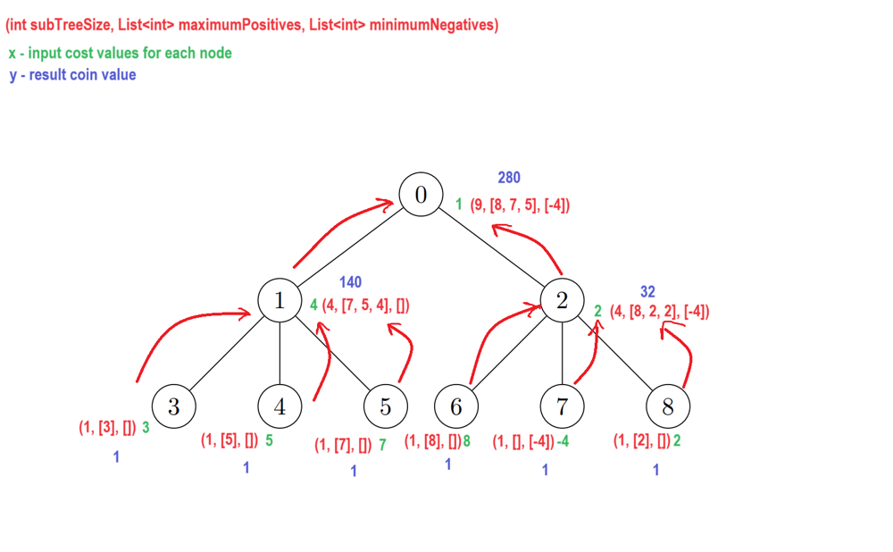

# DFS O(n) time complexity. Detailed explanation with example.

**Author:** DzmitryKotuseu
**Votes:** 1
**Link:** [https://leetcode.com/problems/find-number-of-coins-to-place-in-tree-nodes/solutions/4501324/](https://leetcode.com/problems/find-number-of-coins-to-place-in-tree-nodes/solutions/4501324/)

---

# Intuition
The intuition is the following: we should go through the tree visiting each node and calculate the coins value for the node based on the **data** provided to us by all the child nodes of the current node. So by the time we need to calculate the answer for the current node all the required data for its children should already be calculated. This gives us a hint of using DFS for solving this problem. This DFS skeleton logic will look smth like this:

```
DFS(int node)
{
    if (node is Leaf)
    {
        // Base case. If have a leaf node the answer is obvious
        ...
    }    

    // Calculate the data for all children
    foreach (var childNode in childNodes[node])
    {
        DFS(childNode);
    }

    // Calculate the answer based on the data we calculated for children
    ...
}
```

Another question is what kind of **data** should be calculated.
Of course we need to store the result coin value for the node in the **result array**, that we will return in the end:
```
long[] result
```
But unfortunately there is no way this specific data will help us finding the solution for other nodes, so there is smth else that needs to be stored.
The additional data we require is for sure the size of the current node subtree. We can easily calculate it knowing the size of each child's subtree:

`int subtreeSize = 1 + child1Size + child2Size + ... + childKSize;`

Other data that needs to be stored is 2 arrays: one for containing the 3 maximal posivitive elements in the subtree, another for containing 3 minimal negative (in fact 2 is enough, but for code simplicity we will store 3 as well as for the first case).
Why do we need this data? Think of the value we need to find for each node in case its' subtree size is more than 2: ***the maximum product of cost values assigned to 3 distinct nodes in the subtree of the current node***.
So the main idea is that there are 2 values this ***maximum product*** could be equal to: its either the product of 3 maximal positive costs in the subtree or a product of 2 minimal negative costs and 1 highest positive one. And nothing else.

We can apply our logic to one of the examples given by leetcode:



As you can see we first calculate the values for the leafs, then its parents and so on till the root. **Pay attention that the maximumPositives list contains elements in descending order. The minimumNegatives - vise versa.**

# Approach
- First we innialize basic variables and build the adjacency list to be able to go throw the tree during DFS:
    ```
    adjacencyList = new Dictionary<int, List<int>>();
    n = cost.Length;
    result = new long[n];
    costs = cost;
    for (int i = 0; i < edges.Length; i++)
    {
        int node1 = edges[i][0];
        int node2 = edges[i][1];
        AddNodePairToAdjacencyList(node1, node2);
        AddNodePairToAdjacencyList(node2, node1);
    }
    ```
- Then we launch DFS for the node 0. After the DFS is complete the result array should contain the valid answer, we return it.

Our DFS method will have the following signature:

`private (int size, List<int> positive, List<int> negative) DFSTreeSearch(int node, int previousNode)`,

where node is the current node and the previousNode is passed in order to avoid infinite loop because our **tree is undirected**.
The method returns 3 data parameteres: size (size of the subtree for the passed node), positive (list of 3 maximum positive costs for the passed node subtree), negative (list of 3 minimum negative costs for the passed node subtree, **it could be 2 as well**, but **I left 3 for code simplicity**).

The base case of our DFS method is a leaf node: we can check if the current node is leaf with the following code:
```
    List<int> positive = new List<int>();
    List<int> negative = new List<int>();
    int subTreeSize = 1;

    if (costs[node] < 0)
    {
        negative.Add(costs[node]);
    }
    else
    {
        positive.Add(costs[node]);
    }

    if (adjacencyList[node].Count == 1 && adjacencyList[node][0] == previousNode)
    {
        result[node] = 1;
        return (subTreeSize, positive, negative);
    }
```

As you can see in the beginning of the method we define positive and negative lists and a subTreeSize variable, that we should return in the end when we finish the required calculations.
In the base case (leaf node) we set result[node] to 1, subTreeSize remains equal to 1 and its returned positive and negative lists contain either node itself or are empty.

Then if the base case is not the case we go through all the child nodes and call the DFS method for each of them (meanwhile adjusting data for the negative and positive lists as well as calculating the current subtree size):
```
for (int i = 0; i < adjacencyList[node].Count; i++)
{
    int nextNode = adjacencyList[node][i];
    if (nextNode == previousNode)
    {
        continue;
    }

    var nodeData = DFSTreeSearch(nextNode, node);

    subTreeSize += nodeData.size;

    positive = MergeTwoLists(positive, nodeData.positive, PositiveComparer);
    negative = MergeTwoLists(negative, nodeData.negative, NegativeComparer);
}
```

Pay attention to **MergeTwoLists** helper method. It accepts two **sorted lists** of maximum size 3 and returns **another sorted list** of maximum size 3 containing either maximum positive elements or minimal negative elements of the passed lists depending on the comparer method (the 3rd parameter of the method). **Because of the maximum size 3 we can assume that its time complexity is constant**:

```
private List<int> MergeTwoLists(List<int> first, List<int> second, Func<int, int, bool> comparer)
{
    List<int> newList = new List<int>();
    int firstIndex = 0;
    int secondIndex = 0;

    while (firstIndex < first.Count && secondIndex < second.Count && newList.Count < 3)
    {
        if (comparer(first[firstIndex], second[secondIndex]))
        {
            newList.Add(first[firstIndex]);
            firstIndex++;
        }
        else
        {
            newList.Add(second[secondIndex]);
            secondIndex++;
        }
    }
    if (newList.Count == 3)
    {
        return newList;
    }
    if (firstIndex >= first.Count)
    {
        while (secondIndex < second.Count && newList.Count < 3)
        {
            newList.Add(second[secondIndex]);
            secondIndex++;
        }
        return newList;
    }
    while (firstIndex < first.Count && newList.Count < 3)
    {
        newList.Add(first[firstIndex]);
        firstIndex++;
    }
    return newList;
}
```

After all the required child data is collected we can calculate the final result data for the current node and return:

```
if (subTreeSize < 3)
{
    result[node] = 1;
    return (subTreeSize, positive, negative);
}
long onePosTwoNegSum = (positive.Count >= 1 && negative.Count >= 2) ? (long)positive[0] * negative[0] * negative[1] : 0;
long threePosSum = (positive.Count >= 3) ? (long)positive[0] * positive[1] * positive[2] : 0;

result[node] = Math.Max(onePosTwoNegSum, threePosSum);
return (subTreeSize, positive, negative);
```

# Complexity
- Time complexity:
**The time complexity should be O(V + E), where V is the amount of tree nodes and E - edges. We know that V is equal to n and E to n - 1. So the final time complexity is equal to O(n).**
We spend O(E) time building our graph and initializing basic variables.
Then in the DFS we go through every node (V nodes) and do some constant time operations (MergeTwoLists is constant as we discussed earlier) E times in sum for all nodes. That all sums up to O(V + E).

- Space complexity:
**O(n) because of recursion which maximum depth is n and adjacencyList which is also n sized.**

# Code

Final code:
```
public class Solution
{
    private Dictionary<int, List<int>> adjacencyList;
    int n;
    int[] costs;

    long[] result;

    public long[] PlacedCoins(int[][] edges, int[] cost)
    {
        adjacencyList = new Dictionary<int, List<int>>();
        n = cost.Length;
        result = new long[n];
        costs = cost;

        for (int i = 0; i < edges.Length; i++)
        {
            int node1 = edges[i][0];
            int node2 = edges[i][1];

            AddNodePairToAdjacencyList(node1, node2);
            AddNodePairToAdjacencyList(node2, node1);
        }

        DFSTreeSearch(0, -1);

        return result;
    }

    private (int size, List<int> positive, List<int> negative) DFSTreeSearch(int node, int previousNode)
    {
        List<int> positive = new List<int>();
        List<int> negative = new List<int>();
        int subTreeSize = 1;

        if (costs[node] < 0)
        {
            negative.Add(costs[node]);
        }
        else
        {
            positive.Add(costs[node]);
        }

        if (adjacencyList[node].Count == 1 && adjacencyList[node][0] == previousNode)
        {
            result[node] = 1;
            return (subTreeSize, positive, negative);
        }

        for (int i = 0; i < adjacencyList[node].Count; i++)
        {
            int nextNode = adjacencyList[node][i];

            if (nextNode == previousNode)
            {
                continue;
            }

            var nodeData = DFSTreeSearch(nextNode, node);

            subTreeSize += nodeData.size;

            positive = MergeTwoLists(positive, nodeData.positive, PositiveComparer);
            negative = MergeTwoLists(negative, nodeData.negative, NegativeComparer);
        }

        if (subTreeSize < 3)
        {
            result[node] = 1;
            return (subTreeSize, positive, negative);
        }

        long onePosTwoNegSum = (positive.Count >= 1 && negative.Count >= 2) ? (long)positive[0] * negative[0] * negative[1] : 0;
        long threePosSum = (positive.Count >= 3) ? (long)positive[0] * positive[1] * positive[2] : 0;

        result[node] = Math.Max(onePosTwoNegSum, threePosSum);
        return (subTreeSize, positive, negative);
    }

    private List<int> MergeTwoLists(List<int> first, List<int> second, Func<int, int, bool> comparer)
    {
        List<int> newList = new List<int>();

        int firstIndex = 0;
        int secondIndex = 0;

        while (firstIndex < first.Count && secondIndex < second.Count && newList.Count < 3)
        {
            if (comparer(first[firstIndex], second[secondIndex]))
            {
                newList.Add(first[firstIndex]);
                firstIndex++;
            }
            else
            {
                newList.Add(second[secondIndex]);
                secondIndex++;
            }
        }

        if (newList.Count == 3)
        {
            return newList;
        }

        if (firstIndex >= first.Count)
        {
            while (secondIndex < second.Count && newList.Count < 3)
            {
                newList.Add(second[secondIndex]);
                secondIndex++;
            }

            return newList;
        }

        while (firstIndex < first.Count && newList.Count < 3)
        {
            newList.Add(first[firstIndex]);
            firstIndex++;
        }

        return newList;
    }

    private bool PositiveComparer(int first, int second)
    {
        return first > second;
    }

    private bool NegativeComparer(int first, int second)
    {
        return first < second;
    }

    private void AddNodePairToAdjacencyList(int node1, int node2)
    {
        if (adjacencyList.ContainsKey(node1))
        {
            adjacencyList[node1].Add(node2);
        }
        else
        {
            adjacencyList.Add(node1, new List<int>() { node2 });
        }
    }
}
```