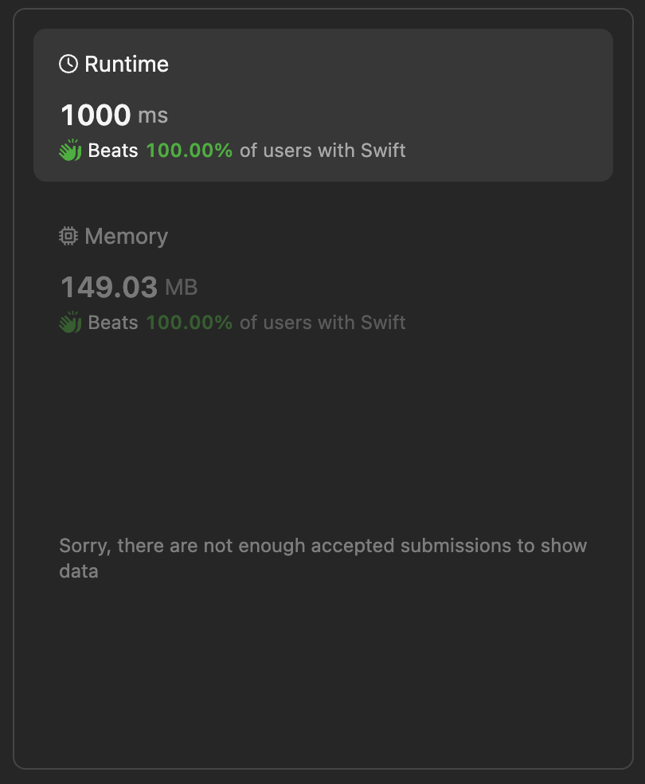

# Find all possible stable binary arrays 🚦 Best swift solution

**Author:** lebon
**Votes:** 0
**Link:** [https://leetcode.com/problems/find-all-possible-stable-binary-arrays-i/solutions/5081364/](https://leetcode.com/problems/find-all-possible-stable-binary-arrays-i/solutions/5081364/)

---


## Intuition
The goal of this problem is to determine the number of stable binary arrays given constraints on the number of zeros (`zero`), ones (`one`), and the limit of subarray size (`limit`). A stable binary array must satisfy specific conditions regarding the counts of zeros and ones, as well as the structure of subarrays.

## Approach
The solution uses a recursive approach with memoization to compute the number of stable arrays. The main idea is to recursively construct valid binary arrays while keeping track of the counts of zeros and ones, as well as the previous state (`prev`) and the current length of consecutive elements (`cnt`).

1. **rec Function**: This recursive function calculates the number of stable arrays starting from a given state (`z` zeros and `o` ones) with a specified previous state (`prev`) and consecutive count (`cnt`). It leverages memoization using a 4D DP table (`dp`), where:
   - `z`: Remaining count of zeros.
   - `o`: Remaining count of ones.
   - `prev`: Previous state (0 for zeros, 1 for ones, 2 for neither).
   - `cnt`: Length of the current consecutive segment of the same element (either zero or one).

2. **Base Cases**:
   - If there are no remaining zeros (`z == 0`) and no remaining ones (`o == 0`), we have a valid stable array, and we return 1.
   - If the current state has already been computed (`dp[z][o][prev][cnt] != -1`), return the precomputed result from the DP table.

3. **Recursive Steps**:
   - If we can still place zeros (`z > 0`), recursively compute the number of stable arrays:
     - If the previous element was also zero (`prev == 0`), continue the sequence by incrementing the count (`cnt`).
     - If the previous element was not zero, reset the count (`cnt`) and switch the state to zero (`prev = 0`).
   - Similarly, if we can still place ones (`o > 0`), recursively compute the number of stable arrays:
     - Follow a similar logic as with zeros, updating the state and count accordingly.

4. **Modulo Arithmetic**:
   - Use modulo arithmetic (`% mod`) to ensure that the computed results remain within the specified bounds (`1e9 + 7`).

## Complexity
- **Time Complexity**: The time complexity primarily depends on the number of recursive calls and the memoization using the `dp` table. It's bounded by $$(O(z \	imes o \	imes 3 \	imes (limit + 3)))$$, where `z` and `o` are the counts of zeros and ones, respectively, and `limit` is the maximum subarray size allowed.
  
- **Space Complexity**: The space complexity is determined by the size of the `dp` table, which is $$(O(z \	imes o \	imes 3 \	imes (limit + 3)))$$. Additional space is used for the recursive stack and other variables in the `rec` function.




This approach efficiently computes the number of stable binary arrays by leveraging recursive memoization, allowing for dynamic programming to avoid redundant computations.


# Code
```swift []
class Solution {
let mod = 1_000_000_007
    
    func rec(_ z: Int, _ o: Int, _ prev: Int, _ cnt: Int, _ n: Int, _ m: Int, _ lim: Int, _ dp: inout [[[[Int]]]]) -> Int {
        if z == 0 && o == 0 {
            return 1
        }
        
        if dp[z][o][prev][cnt] != -1 {
            return dp[z][o][prev][cnt]
        }
        
        var ans = 0
        if z > 0 {
            if prev == 0 {
                if cnt < lim {
                    ans = (ans + rec(z - 1, o, 0, cnt + 1, n, m, lim, &dp)) % mod
                }
            } else {
                ans = (ans + rec(z - 1, o, 0, 1, n, m, lim, &dp)) % mod
            }
        }
        
        if o > 0 {
            if prev == 1 {
                if cnt < lim {
                    ans = (ans + rec(z, o - 1, 1, cnt + 1, n, m, lim, &dp)) % mod
                }
            } else {
                ans = (ans + rec(z, o - 1, 1, 1, n, m, lim, &dp)) % mod
            }
        }
        
        dp[z][o][prev][cnt] = ans
        return ans
    }
    
    func numberOfStableArrays(_ zero: Int, _ one: Int, _ limit: Int) -> Int { var z = zero, o = one
        var dp = Array(repeating: Array(repeating: Array(repeating: Array(repeating: -1, count: limit + 3), count: 3), count: o + 1), count: z + 1)
        return rec(zero, one, 2, 0, zero, one, limit, &dp)
    }
}
```