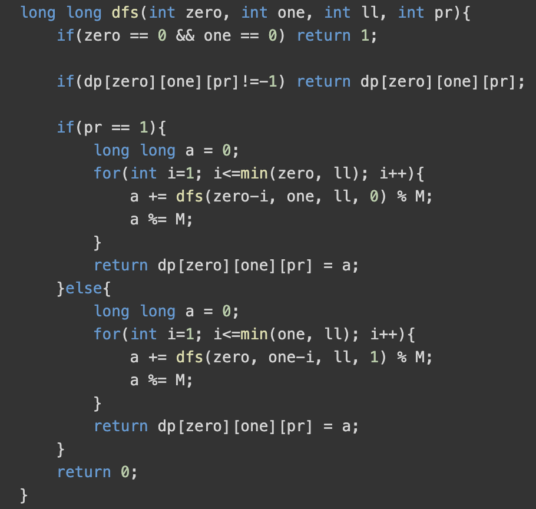
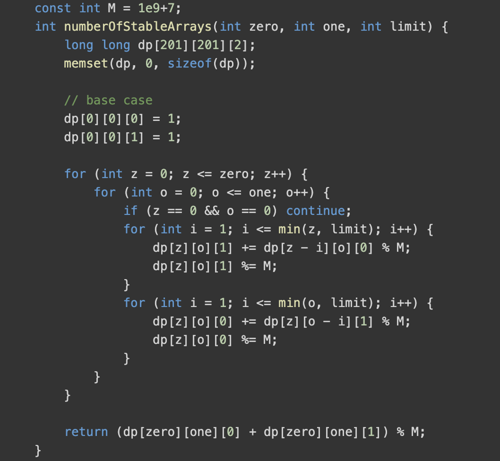
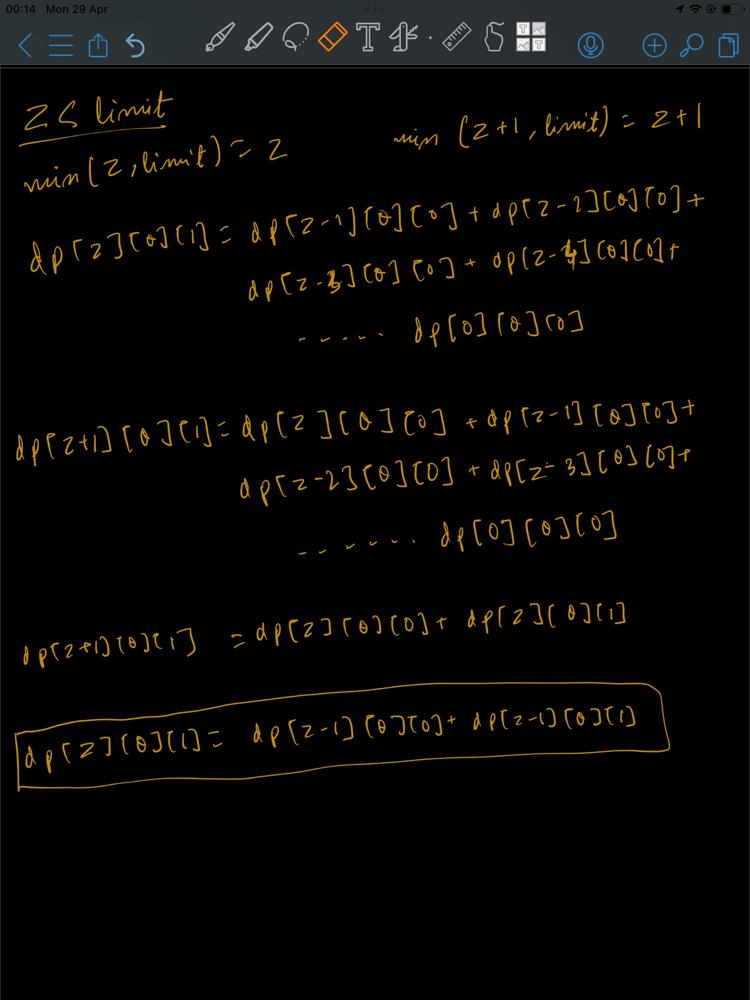
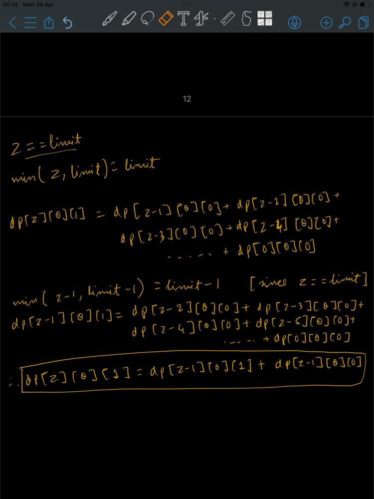
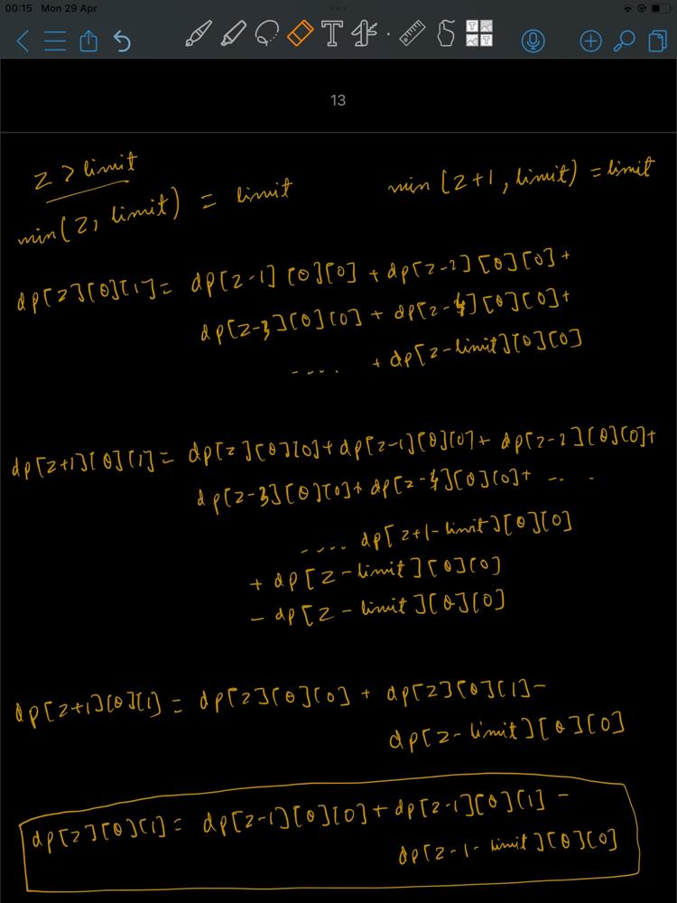

# Simple 2D DP 🧠 + Prefix Sums 🚀 | 90 ms

**Author:** looneyd_noob
**Votes:** 33
**Link:** [https://leetcode.com/problems/find-all-possible-stable-binary-arrays-ii/solutions/5084709/](https://leetcode.com/problems/find-all-possible-stable-binary-arrays-ii/solutions/5084709/)

---

# Intuition
<!-- Describe your first thoughts on how to solve this problem. -->
Oooh! Man this was one the problems where I spent a whole evening to find out the optimization with pen and tablet. So it is going to be pretty easy to understand, I won't be talking about some pre-computed formula without explaining which everyone does these days. Understand the **why?** and **how?** clearly here.

# Approach
<!-- Describe your approach to solving the problem. -->
**This part is going to be very detailed so read slowly.**


- **Part I**: Finding the `recursive` solution for the problem when constraints are small i.e., `1 <= zero <= 200` and `1 <= one <= 200` and `1 <= limit <= 200`.

    - We are required to place `zero`, `one` in an array where any subarray of size greater than `limit` should have both 0 and 1. This essentially means that any subarray of size from `1 to limit` can have all `0 's` or all `1 's`. Essentially, for example taking `zero = 5`, `one = 4` `limit = 3` the arrays will be like: `[0,0,0,1,1,0,1,0,1]`, `[0,1,1,1,0,0,0,1,0]`, `[0,0,1,1,0,0,0,1]` and `...` so on. Any consecutive sequence can have length ranging from `1 till limit`.

    - Hence we can formulate our recurrence as follows:
    `f(zero, one, limit, prev)` = the number of forming arrays with `zero` number of `0 's` , `one` number of `1 's` having maximum `limit` and the previous sequence of element being `prev`.
    Now, we can formulate the function as show below.
    
    - 

    - But here the
        - **Time Complexity** after memoizing the solution is $$O(zero * one * limit * prev)$$ ~ $$O(zero * one * limit * 2)$$
        - **Space complexity** after memoizing the solution is $$O(zero * one * prev)$$
        - This would give `TLE` when we try to solve the problem with higher constraints i.e., `1 <= zero <= 1000` and `1 <= one <= 1000` and `1 <= limit <= 1000`. The space need not to be improved.


- **Part II**: From previous part we are sure to get `TLE` given the huge constraints. To `optimize` it further it is suitable to look at the tabulated dp version of the code (after memoizing which is pretty easy).

    - The tabulated code of the `part I` will look like this as show below.
    - 
    - Here we see that the inside for loop which traverses from `1 to min(z, limit)` and `1 to min(o, limit)` computes the sum for every window of length `1 to min(z, limit)` or `1 to min(o, limit)` respectively.
    - If we notice carefully we will see that there is overlapping of sums for consecutive iterations. Like when `z` moves from some `z0` to some `z0+1` a part of the sum may be common between the two sums.
    - This is causing the `extra time overhead`. We can fix this if we can eliminate this over calculation from a `O(N)` loop to `O(1)` constant time complexity.
    - Below are the cases for which we need to handle the for loop.
        - **Case I**: `z < limit`, means `min(z, limit) = z`
            - simplify the recurrence accordingly
            - 
            - hence, `dp[z][o][1] = dp[z-1][o][0] + dp[z-1][o][1]`
            - however, one edge case that arises, is when `z == 1` then the term has expansion length of 1 and we don't require two summation terms and the recurrence becomes,
            `dp[z][o][1] = dp[z-1][o][0]`

        
        - **Case II**: `z == limit`, means `min(z, limit) = limit`
            - similarly, if we simplify the recurrence again
            - 
            - hence, 
            `dp[z][o][1] = dp[z-1][o][0] + dp[z-1][o][1]`
            - however, here another edge case occurs i.e., when `limit == 1`, the `expansion` terms are all of `length 1`; so we get
            `dp[z][o][1] = dp[z-1][o][0]`

        - **Case III**: `z > limit`, means `min(z, limit) = limit`
            - as done in above two cases, this is also similar
            - 
            - hence, `dp[z][o][1] = dp[z-1][o][0] + dp[z-1][o][1] - dp[z-1-limit][o][0]`
            - however, here we face with the same edge case i.e., `limit == 1`, the `expansion` terms are all of `length 1`; so we get
            `dp[z][o][1] = dp[z-1][o][0]`

    - **Note**: In all these steps discussed above, we have to take modulo by `M = 1000000007` which is not shown to make the recurrence concise.
    - **Note**: proceed similarly for the case of `for loop dealing with ones`.


Whoah! it was a hell lot of optimization. If not it took me a lot of time to understand and find the edge cases while optimizing it.
# Upvote
Upvote if found helpful.


# Complexity
- Time complexity: $$O(zero * one)$$
<!-- Add your time complexity here, e.g. $$O(n)$$ -->

- Space complexity: $$O(zero * one * 2)$$
<!-- Add your space complexity here, e.g. $$O(n)$$ -->

# Codes
- Playground link: https://leetcode.com/playground/SEyvrurB/shared

<iframe src="https://leetcode.com/playground/SEyvrurB/shared" frameBorder="0" width="1000" height="1250"></iframe>


<!-- # Code
```
class Solution {
public:
    const int M = 1e9+7;
    int numberOfStableArrays(int zero, int one, int limit) {
        long long dp[zero+1][one+1][2];
        memset(dp, 0, sizeof(dp));

        dp[0][0][0] = 1;
        dp[0][0][1] = 1;

        for (int z = 0; z <= zero; z++) {
            for (int o = 0; o <= one; o++) {
                if (z == 0 && o == 0) continue;

                if(z < limit){
                    if(z > 0){
                        dp[z][o][1] = dp[z-1][o][0];
                        if(z > 1){
                            dp[z][o][1] += dp[z-1][o][1];
                        }
                    }
                }else if(z == limit){
                    if(z > 0){
                        dp[z][o][1] = dp[z-1][o][0];
                        if(limit > 1){
                            dp[z][o][1] += dp[z-1][o][1];
                        }
                    }
                }else if(z > limit){
                    dp[z][o][1] = dp[z-1][o][0];
                    if(limit > 1){
                        dp[z][o][1] += dp[z-1][o][1] - dp[z-1-limit][o][0];
                    }
                }
                dp[z][o][1] %= M;
                dp[z][o][1] += M;
                dp[z][o][1] %= M;


                if(o < limit){
                    if(o > 0){
                        dp[z][o][0] = dp[z][o-1][1];
                        if(o > 1){
                            dp[z][o][0] += dp[z][o-1][0];
                        }
                    }
                }else if(o == limit){
                    if(o > 0){
                        dp[z][o][0] = dp[z][o-1][1];
                        if(limit > 1){
                            dp[z][o][0] += dp[z][o-1][0];
                        }
                    }
                }else if(o > limit){
                    dp[z][o][0] = dp[z][o-1][1];
                    if(limit > 1){
                        dp[z][o][0] += dp[z][o-1][0] - dp[z][o-1-limit][1];
                    }
                }
                dp[z][o][0] %= M;
                dp[z][o][0] += M;
                dp[z][o][0] %= M;
            }
        }
        return (dp[zero][one][0] + dp[zero][one][1]) % M;
    }
};


``` -->