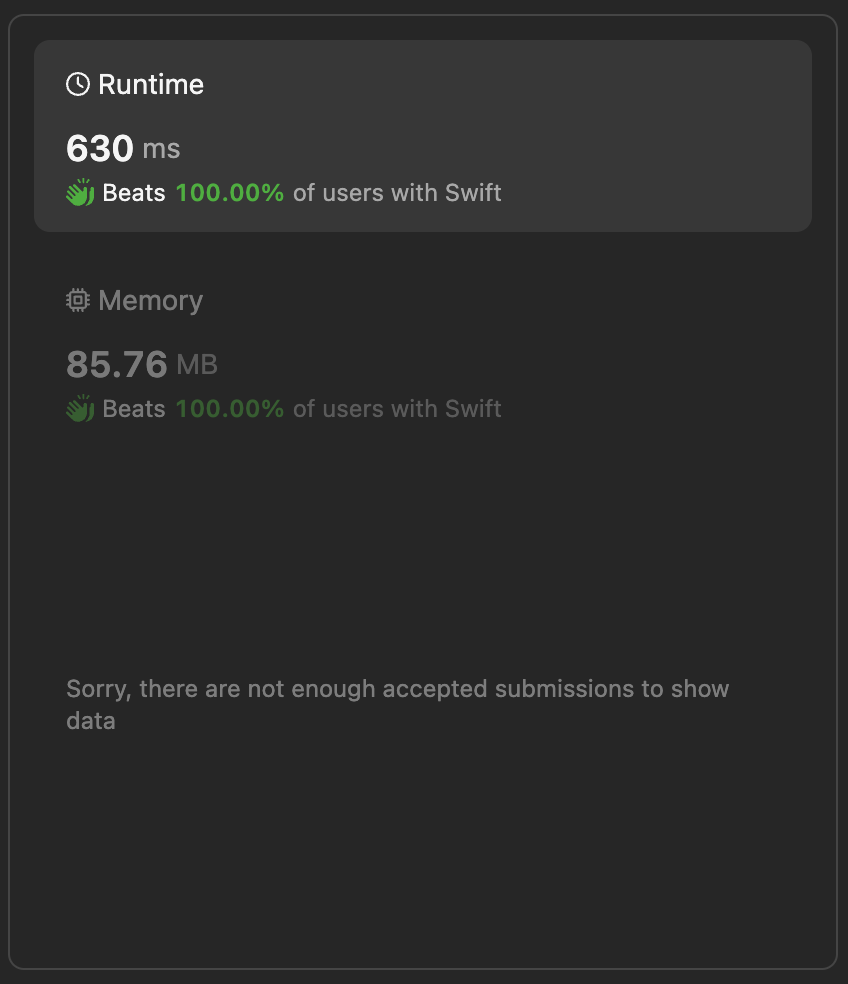

# Find all possible stable binary Arrays  II🚦 Best performing & detailed implementation using Swift

**Author:** lebon
**Votes:** 0
**Link:** [https://leetcode.com/problems/find-all-possible-stable-binary-arrays-ii/solutions/5081462/](https://leetcode.com/problems/find-all-possible-stable-binary-arrays-ii/solutions/5081462/)

---

# Intuition
The problem requires counting the number of stable binary arrays based on specific constraints. A stable binary array must have exactly one '1', zero '0's, and any subarray longer than a given limit must contain both '0' and '1'. The approach involves using dynamic programming to build up the solution incrementally based on smaller subproblems.

# Approach
- **Initialization**: 
  - Initialize a 3D array `memo` to store the dynamic programming values. This array will represent the number of stable arrays ending with different configurations of zeros and ones.
  - Populate base cases:
    - For `x` (zeros) from `1` to `min(zero, limit)`, set `memo[x][0][0]` to `1`. This represents stable arrays with exactly `x` zeros and `0` ones.
    - For `y` (ones) from `1` to `min(one, limit)`, set `memo[0][y][1]` to `1`. This represents stable arrays with `0` zeros and exactly `y` ones.

- **Dynamic Programming Calculation**:
  - Iterate through the `memo` array to calculate values for larger configurations of zeros (`x`) and ones (`y`):
    - For each `(x, y)` pair:
      - Calculate `memo[x][y][0]` by considering extending with a zero:
        - Sum the values from the previous configurations: `memo[x - 1][y][0]` and `memo[x - 1][y][1]`.
        - Adjust if `x` exceeds the `limit` by subtracting values from positions `x - limit - 1`, if applicable.
      - Calculate `memo[x][y][1]` by considering extending with a one:
        - Sum the values from the previous configurations: `memo[x][y - 1][0]` and `memo[x][y - 1][1]`.
        - Adjust if `y` exceeds the `limit` by subtracting values from positions `y - limit - 1`, if applicable.
      - Apply modulo arithmetic (`mod`) to handle potential overflows during computation.

- **Result**:
  - Return the sum of `memo[zero][one][0]` and `memo[zero][one][1]` modulo `mod`. This represents the total number of stable binary arrays satisfying the given conditions.

# Complexity
- **Time Complexity**:
  - The time complexity of the solution is $$(O(z0 \	imes o1 \	imes \	ext{limit}))$$, where `z0` and `o1` are the counts of zeros and ones, respectively. This is due to iterating through the entire 3D array to compute the dynamic programming values.
  
- **Space Complexity**:
  - The space complexity is \\(O(z0 \	imes o1)\\) since we use a 3D array `memo` to store the dynamic programming values.





# Code
```
class Solution {
    let mod = 1_000_000_007
    
    func numberOfStableArrays(_ zero: Int, _ one: Int, _ limit: Int) -> Int {
        // Initialize a 3D array to store the dynamic programming values
        var memo = [[[Int]]](repeating: [[Int]](repeating: [Int](repeating: 0, count: 2), count: one + 1), count: zero + 1)
        
        // Base cases:
        // Fill the memoization table for arrays ending with '0' zeros and '1' ones
        for x in 1...min(zero, limit) {
            memo[x][0][0] = 1
        }
        
        // Fill the memoization table for arrays ending with '0' zeros and '1' ones
        for y in 1...min(one, limit) {
            memo[0][y][1] = 1
        }
        
        // Calculate the dynamic programming values
        for x in 1...zero {
            for y in 1...one {
                // Calculate the number of arrays ending with 'x' zeros and 'y' ones without limit
                memo[x][y][0] = (memo[x - 1][y][0] + memo[x - 1][y][1]) % mod
                
                // If the current number of zeros exceeds the limit, adjust the count
                if x > limit {
                    memo[x][y][0] = (memo[x][y][0] + mod - memo[x - limit - 1][y][1]) % mod
                }
                
                // Calculate the number of arrays ending with 'x' zeros and 'y' ones without limit
                memo[x][y][1] = (memo[x][y - 1][0] + memo[x][y - 1][1]) % mod
                
                // If the current number of ones exceeds the limit, adjust the count
                if y > limit {
                    memo[x][y][1] = (memo[x][y][1] + mod - memo[x][y - limit - 1][0]) % mod
                }
            }
        }
        
        // Return the total number of stable arrays with exactly 'zero' zeros and 'one' ones
        return (memo[zero][one][0] + memo[zero][one][1]) % mod
    }
}

```