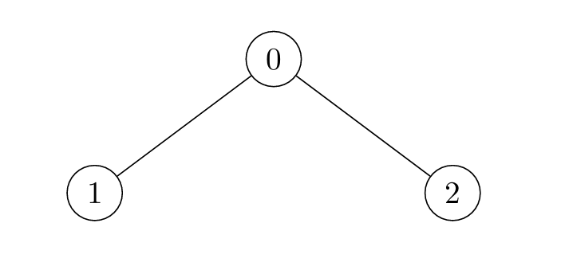

# [3241. Time Taken to Mark All Nodes](https://leetcode.com/problems/time-taken-to-mark-all-nodes/)

| Category | Difficulty | Likes | Dislikes |
| :------: | :--------: | :---: | :------: |
| Algorithms | Hard | 136 | 6 |

**Tags:** [`dynamic-programming`](https://leetcode.com/tag/dynamic-programming), [`tree`](https://leetcode.com/tag/tree), [`depth-first-search`](https://leetcode.com/tag/depth-first-search), [`graph`](https://leetcode.com/tag/graph)

## Description

There exists an **undirected** tree with `n` nodes numbered `0` to `n - 1`. You are given a 2D integer array `edges` of length `n - 1`, where `edges[i] = [u_i, v_i]` indicates that there is an edge between nodes `u_i` and `v_i` in the tree.

Initially, **all** nodes are **unmarked**. For each node `i`:

	- If `i` is odd, the node will get marked at time `x` if there is **at least** one node *adjacent* to it which was marked at time `x - 1`.

	- If `i` is even, the node will get marked at time `x` if there is **at least** one node *adjacent* to it which was marked at time `x - 2`.

Return an array `times` where `times[i]` is the time when all nodes get marked in the tree, if you mark node `i` at time `t = 0`.

**Note** that the answer for each `times[i]` is **independent**, i.e. when you mark node `i` all other nodes are *unmarked*.

 

**Example 1:**

**Input:** edges = [[0,1],[0,2]]

**Output:** [2,4,3]

**Explanation:**

	- For `i = 0`:

	
		Node 1 is marked at `t = 1`, and Node 2 at `t = 2`.

	
	
	- For `i = 1`:
	
		Node 0 is marked at `t = 2`, and Node 2 at `t = 4`.

	
	
	- For `i = 2`:
	
		Node 0 is marked at `t = 2`, and Node 1 at `t = 3`.

	
	

**Example 2:**

**Input:** edges = [[0,1]]

**Output:** [1,2]

**Explanation:**

	- For `i = 0`:

	
		Node 1 is marked at `t = 1`.

	
	
	- For `i = 1`:
	
		Node 0 is marked at `t = 2`.

	
	

**Example 3:**

**Input:** edges = [[2,4],[0,1],[2,3],[0,2]]

**Output:** [4,6,3,5,5]

**Explanation:**

 

**Constraints:**

	- `2 <= n <= 10^5`

	- `edges.length == n - 1`

	- `edges[i].length == 2`

	- `0 <= edges[i][0], edges[i][1] <= n - 1`

	- The input is generated such that `edges` represents a valid tree.

---

**Links:** [Submissions](https://leetcode.com/problems/time-taken-to-mark-all-nodes/) | [Solutions](https://leetcode.com/problems/time-taken-to-mark-all-nodes/)
