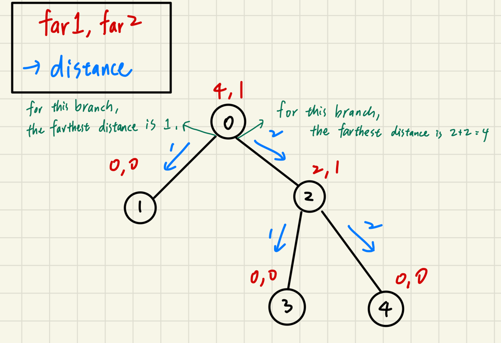
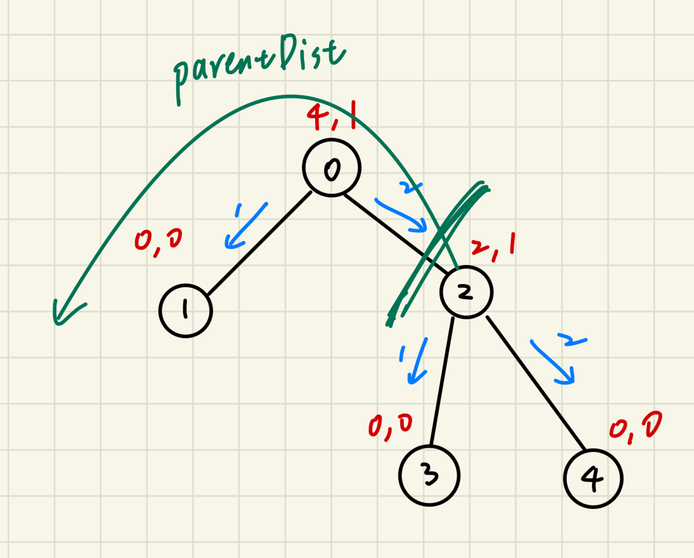

# C++ Beat 100% | Farthest and Second Farthest | With Visualization

**Author:** yt788
**Votes:** 32
**Link:** [https://leetcode.com/problems/time-taken-to-mark-all-nodes/solutions/5582119/](https://leetcode.com/problems/time-taken-to-mark-all-nodes/solutions/5582119/)

---

# Intuition
<!-- Describe your first thoughts on how to solve this problem. -->
If you understand the problem description, you will find that the problem is actually the same as: for each node, find its distance to the farthest node. Moreover, the distance from node i to node j can be defined as: `(j % 2 == 1) ? 1 : 2`

# Approach
<!-- Describe your approach to solving the problem. -->
* First, Use node 0 as the root. Do DFS. For each node:
    * Calculate the distance for each child (branch) to the farthest leaf.
    * Store the two farthest distance in two vectors: `far1` and `far2`.
    
    

* Then, do DFS again. Use `far1` and `far2` to help us calculate the answer.
    * When we traverse the tree, maintain a variable called `parentDist`, which is the farthest distance from this node back to its parent and other branches. See the photo below which is more clear.
    * Therefore, the answer for this node i would be `max(parentDist, far1[i])`.
    * You may ask how to calculate `parentDist` when we are going to visit a child of this node. Let's call them a pair (parent, child). There are two candidates which may be `parentDist` for this child, and we just take the maximum.
        1. `parentDist` of the parent + distance from parent to child
        2. The farthest distance to leaf in the parent's subtree without the branch including this child. (So that's why we need `far2`.)

    

# Complexity
- Time complexity: $$O(n)$$, as we do DFS twice
<!-- Add your time complexity here, e.g. $$O(n)$$ -->

- Space complexity: $$O(n)$$
<!-- Add your space complexity here, e.g. $$O(n)$$ -->

# Code
```
class Solution {
    void buildFar(int curr, vector<vector<int>> &adj, vector<int> &far1, vector<int> &far2) {
        int maxChild1 = 0, maxChild2 = 0;
        // Iterate through each child (branch), and find the two farthest children.
        for(int child: adj[curr]) {
            if(child <= curr) continue;

            buildFar(child, adj, far1, far2);
            int dist = ((child & 1) ? 1 : 2) + far1[child];
            if(dist >= maxChild1) {
                maxChild2 = maxChild1;
                maxChild1 = dist;
            } else if(dist > maxChild2) {
                maxChild2 = dist;
            }
        }

        far1[curr] = maxChild1, far2[curr] = maxChild2;
    }

    void calcOthers(int curr, int parentDist, vector<vector<int>> &adj, const vector<int> &far1, const vector<int> &far2, vector<int> &ans) {
        // parentDist: the farthest distance when node[parent] is the root
        
        ans[curr] = max(parentDist, far1[curr]);

        for(int child: adj[curr]) {
            if(child < curr) continue;

            int toParent = (curr & 1) ? 1 : 2;
            int tochild = (child & 1) ? 1 : 2;
            // For this child, exclude itself or it is not correct
            // (If the branch containing this child is the farthest for node curr, we should use the second farthest) 
            int farthestChildExceptThisChild = (far1[curr] == (tochild + far1[child])) ? far2[curr] : far1[curr]; 

            calcOthers(child, toParent + max(parentDist, farthestChildExceptThisChild), adj, far1, far2, ans);
        }
    }
public:
    vector<int> timeTaken(vector<vector<int>>& edges) {
        int n = edges.size() + 1;
        vector<vector<int>> adj(n);
        for(auto &edge: edges) {
            adj[edge[0]].push_back(edge[1]);
            adj[edge[1]].push_back(edge[0]);
        }

        // first, use 0 as root and calculate below:
        // far1[i]: the farthest children for the subtree with root i
        // far2[i]: the second farthest children for the subtree with root i
        vector<int> far1(n, 0), far2(n, 0);
        buildFar(0, adj, far1, far2);

        // by far1 and far2, we can use re-rooting to help us find the answer
        vector<int> ans(n, 0);
        calcOthers(0, 0, adj, far1, far2, ans);

        return ans;
    }
};

```

Actually I spent an hour on the third question during contest so that I did not have enough time to finish this one on time. \uD83E\uDEE0