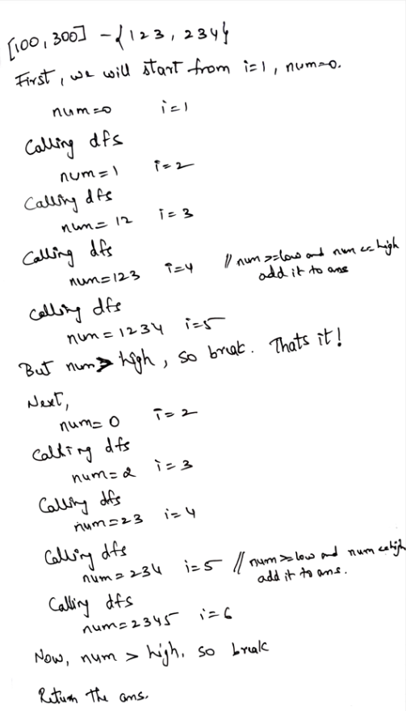
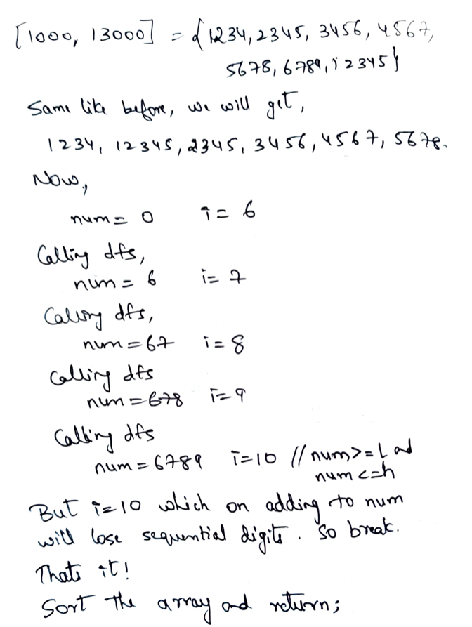

# C++ DFS with diagram | Basic - 0 ms

**Author:** NeerajDusa
**Votes:** 118
**Link:** [https://leetcode.com/problems/sequential-digits/solutions/1711942/](https://leetcode.com/problems/sequential-digits/solutions/1711942/)

---

Let's understand by taking test cases

***Test case 1:***


 
***Test Case 2:***



***Lets see the code:***
```
class Solution {
public:
    vector<int> ans;
    
    void dfs(int low, int high, int i, int num){
        
        if (num >= low and num <= high)
            ans.push_back(num);
        // case 2: [1000, 13000] if i=10 and num is 6789, then we should stop
        if (num > high or i>9) 
            return;
        dfs(low, high, i+1, num*10 + i);
    }
    
    vector<int> sequentialDigits(int low, int high) {
        for(int i=1; i<=9; i++)
            dfs(low, high, i, 0);
        sort(ans.begin(), ans.end());
        return ans;
    }
};
```

***Time Complexity:*** O(1)
***Space Complexity:*** O(1)

***Explanation for Time Complexity:***
In the for loop, 
First we take i = 1, we get num as 1, 12, 123, ..., 123456789 in worst case. (9 steps)
i = 2, we get num as 2, 23, 234, ...., 23456789 in worst case (8 steps)
like wise for i=9, we get num as only 9.
Therefore in worst case, we will get (9+8+7+...+1) = 9*10/2 = 45 steps which is constant!

Sorting in the worst case can take 45log45 which is constant. Hence, O(1).

So, we can say that time complexity is : O(1) 


Please Upvote If you liked it \u263A\uFE0F!! It keeps me motivated to post solutions like these.
If there are any suggestions / questions / mistakes in my post, comment below.