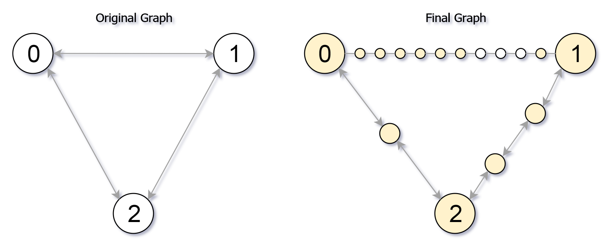

# [882. Reachable Nodes In Subdivided Graph](https://leetcode.com/problems/reachable-nodes-in-subdivided-graph/)

| Category | Difficulty | Likes | Dislikes |
| :------: | :--------: | :---: | :------: |
| Algorithms | Hard | 885 | 227 |

**Tags:** [`graph`](https://leetcode.com/tag/graph), [`heap-priority-queue`](https://leetcode.com/tag/heap-priority-queue), [`shortest-path`](https://leetcode.com/tag/shortest-path)

**Companies:** `phonepe`

## Description

You are given an undirected graph (the **"original graph"**) with `n` nodes labeled from `0` to `n - 1`. You decide to **subdivide** each edge in the graph into a chain of nodes, with the number of new nodes varying between each edge.

The graph is given as a 2D array of `edges` where `edges[i] = [u_i, v_i, cnt_i]` indicates that there is an edge between nodes `u_i` and `v_i` in the original graph, and `cnt_i` is the total number of new nodes that you will **subdivide** the edge into. Note that `cnt_i == 0` means you will not subdivide the edge.

To **subdivide** the edge `[u_i, v_i]`, replace it with `(cnt_i + 1)` new edges and `cnt_i` new nodes. The new nodes are `x_1`, `x_2`, ..., `x_cnti`, and the new edges are `[u_i, x_1]`, `[x_1, x_2]`, `[x_2, x_3]`, ..., `[x_cnti-1, x_cnti]`, `[x_cnti, v_i]`.

In this **new graph**, you want to know how many nodes are **reachable** from the node `0`, where a node is **reachable** if the distance is `maxMoves` or less.

Given the original graph and `maxMoves`, return *the number of nodes that are **reachable** from node *`0`* in the new graph*.

 

**Example 1:**


```

Input: edges = [[0,1,10],[0,2,1],[1,2,2]], maxMoves = 6, n = 3
Output: 13
Explanation: The edge subdivisions are shown in the image above.
The nodes that are reachable are highlighted in yellow.

```

**Example 2:**

```

Input: edges = [[0,1,4],[1,2,6],[0,2,8],[1,3,1]], maxMoves = 10, n = 4
Output: 23

```

**Example 3:**

```

Input: edges = [[1,2,4],[1,4,5],[1,3,1],[2,3,4],[3,4,5]], maxMoves = 17, n = 5
Output: 1
Explanation: Node 0 is disconnected from the rest of the graph, so only node 0 is reachable.

```

 

**Constraints:**

	- `0 <= edges.length <= min(n * (n - 1) / 2, 10^4)`

	- `edges[i].length == 3`

	- `0 <= u_i < v_i < n`

	- There are **no multiple edges** in the graph.

	- `0 <= cnt_i <= 10^4`

	- `0 <= maxMoves <= 10^9`

	- `1 <= n <= 3000`

---

**Links:** [Submissions](https://leetcode.com/problems/reachable-nodes-in-subdivided-graph/) | [Solutions](https://leetcode.com/problems/reachable-nodes-in-subdivided-graph/)
