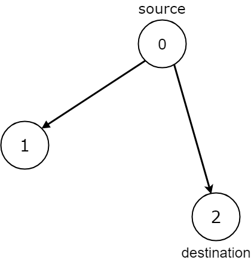
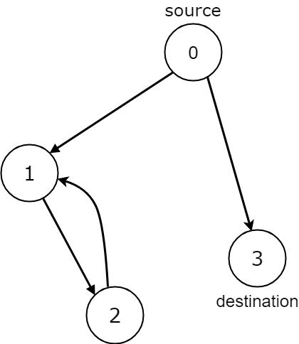
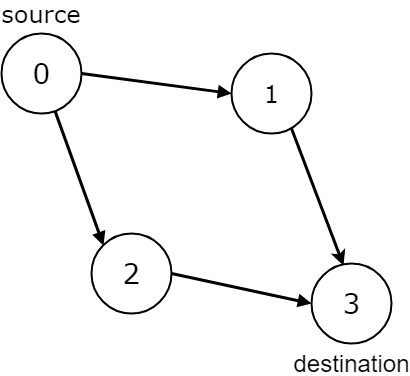

# [1059. All Paths from Source Lead to Destination](https://leetcode.com/problems/all-paths-from-source-lead-to-destination/)

| Category | Difficulty | Likes | Dislikes |
| :------: | :--------: | :---: | :------: |
| Algorithms | Medium | 757 | 430 |

**Tags:** [`graph`](https://leetcode.com/tag/graph), [`topological-sort`](https://leetcode.com/tag/topological-sort)

**Companies:** `google`

## Description

Given the `edges` of a directed graph where `edges[i] = [a_i, b_i]` indicates there is an edge between nodes `a_i` and `b_i`, and two nodes `source` and `destination` of this graph, determine whether or not all paths starting from `source` eventually, end at `destination`, that is:

	- At least one path exists from the `source` node to the `destination` node

	- If a path exists from the `source` node to a node with no outgoing edges, then that node is equal to `destination`.

	- The number of possible paths from `source` to `destination` is a finite number.

Return `true` if and only if all roads from `source` lead to `destination`.

 

**Example 1:**


```

Input: n = 3, edges = [[0,1],[0,2]], source = 0, destination = 2
Output: false
Explanation: It is possible to reach and get stuck on both node 1 and node 2.

```

**Example 2:**


```

Input: n = 4, edges = [[0,1],[0,3],[1,2],[2,1]], source = 0, destination = 3
Output: false
Explanation: We have two possibilities: to end at node 3, or to loop over node 1 and node 2 indefinitely.

```

**Example 3:**


```

Input: n = 4, edges = [[0,1],[0,2],[1,3],[2,3]], source = 0, destination = 3
Output: true

```

 

**Constraints:**

	- `1 <= n <= 10^4`

	- `0 <= edges.length <= 10^4`

	- `edges.length == 2`

	- `0 <= a_i, b_i <= n - 1`

	- `0 <= source <= n - 1`

	- `0 <= destination <= n - 1`

	- The given graph may have self-loops and parallel edges.

---

**Links:** [Submissions](https://leetcode.com/problems/all-paths-from-source-lead-to-destination/) | [Solutions](https://leetcode.com/problems/all-paths-from-source-lead-to-destination/)
