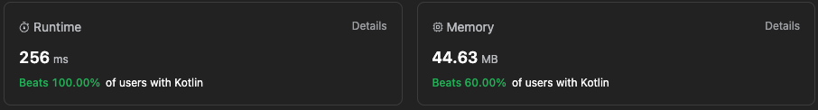

# ✅ Kotlin: solution with DFS [time: 0(V + E), space: O(V)]

**Author:** v-perfilev
**Votes:** 0
**Link:** [https://leetcode.com/problems/all-paths-from-source-lead-to-destination/solutions/4286559/](https://leetcode.com/problems/all-paths-from-source-lead-to-destination/solutions/4286559/)

---



# Approach
1. The **buildGraphMap** function constructs the graph.
2. The **dfs** function explores the graph. It returns false for paths leading to a dead end or a cycle not including the destination. It marks nodes as visited once all paths from that node are verified to lead to the destination.
<!-- Describe your approach to solving the problem. -->

# Complexity
- Time complexity: $$O(V + E)$$.
<!-- Add your time complexity here, e.g. $$O(n)$$ -->

- Space complexity: $$O(V)$$.
<!-- Add your space complexity here, e.g. $$O(n)$$ -->

# Code
```
class Solution {
    fun leadsToDestination(n: Int, edges: Array<IntArray>, source: Int, destination: Int): Boolean {
        val graphMap = buildGraphMap(n, edges)
        if (graphMap[destination]!!.isNotEmpty()) return false
        return dfs(graphMap, mutableSetOf(), mutableSetOf(), source, destination)
    }

    private fun buildGraphMap(n: Int, edges: Array<IntArray>): Map<Int, List<Int>> {
        val map = mutableMapOf<Int, MutableList<Int>>()
        for (i in 0..<n) {
            map[i] = mutableListOf()
        }
        edges.forEach { (source, destination) ->
            map[source]!!.add(destination)
        }
        return map
    }

    private fun dfs(
        graphMap: Map<Int, List<Int>>,
        visitingNodeSet: MutableSet<Int>,
        visitedNodeSet: MutableSet<Int>,
        location: Int,
        destination: Int
    ): Boolean {
        if (location == destination) return true
        if (graphMap[location]!!.isEmpty()) return false
        if (visitingNodeSet.contains(location)) return visitedNodeSet.contains(location)
        visitingNodeSet.add(location)
        graphMap[location]!!.forEach {
            if (!dfs(graphMap, visitingNodeSet, visitedNodeSet, it, destination)) return false
        }
        visitedNodeSet.add(location)
        return true
    }
}
```