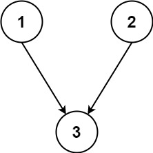
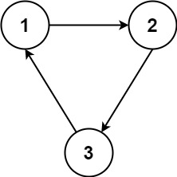

# [1136. Parallel Courses](https://leetcode.com/problems/parallel-courses/)

| Category | Difficulty | Likes | Dislikes |
| :------: | :--------: | :---: | :------: |
| Algorithms | Medium | 1210 | 27 |

**Tags:** [`graph`](https://leetcode.com/tag/graph), [`topological-sort`](https://leetcode.com/tag/topological-sort)

**Companies:** `snowflake`, `amazon`, `tiktok`, `google`, `uber`

## Description

You are given an integer `n`, which indicates that there are `n` courses labeled from `1` to `n`. You are also given an array `relations` where `relations[i] = [prevCourse_i, nextCourse_i]`, representing a prerequisite relationship between course `prevCourse_i` and course `nextCourse_i`: course `prevCourse_i` has to be taken before course `nextCourse_i`.

In one semester, you can take **any number** of courses as long as you have taken all the prerequisites in the **previous** semester for the courses you are taking.

Return *the **minimum** number of semesters needed to take all courses*. If there is no way to take all the courses, return `-1`.

 

**Example 1:**


```

Input: n = 3, relations = [[1,3],[2,3]]
Output: 2
Explanation: The figure above represents the given graph.
In the first semester, you can take courses 1 and 2.
In the second semester, you can take course 3.

```

**Example 2:**


```

Input: n = 3, relations = [[1,2],[2,3],[3,1]]
Output: -1
Explanation: No course can be studied because they are prerequisites of each other.

```

 

**Constraints:**

	- `1 <= n <= 5000`

	- `1 <= relations.length <= 5000`

	- `relations[i].length == 2`

	- `1 <= prevCourse_i, nextCourse_i <= n`

	- `prevCourse_i != nextCourse_i`

	- All the pairs `[prevCourse_i, nextCourse_i]` are **unique**.

---

**Links:** [Submissions](https://leetcode.com/problems/parallel-courses/) | [Solutions](https://leetcode.com/problems/parallel-courses/)
