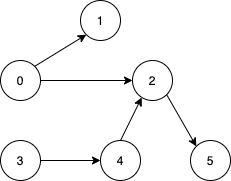
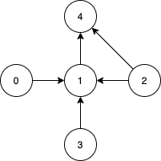

# [1557. Minimum Number of Vertices to Reach All Nodes](https://leetcode.com/problems/minimum-number-of-vertices-to-reach-all-nodes/)

| Category | Difficulty | Likes | Dislikes |
| :------: | :--------: | :---: | :------: |
| Algorithms | Medium | 3843 | 133 |

**Tags:** [`graph`](https://leetcode.com/tag/graph)

**Companies:** `facebook`, `google`, `amazon`, `airbnb`

## Description

Given a** directed acyclic graph**, with `n` vertices numbered from `0` to `n-1`, and an array `edges` where `edges[i] = [from_i, to_i]` represents a directed edge from node `from_i` to node `to_i`.

Find *the smallest set of vertices from which all nodes in the graph are reachable*. It's guaranteed that a unique solution exists.

Notice that you can return the vertices in any order.

 

**Example 1:**



```

Input: n = 6, edges = [[0,1],[0,2],[2,5],[3,4],[4,2]]
Output: [0,3]
Explanation: It&#39;s not possible to reach all the nodes from a single vertex. From 0 we can reach [0,1,2,5]. From 3 we can reach [3,4,2,5]. So we output [0,3].
```

**Example 2:**



```

Input: n = 5, edges = [[0,1],[2,1],[3,1],[1,4],[2,4]]
Output: [0,2,3]
Explanation: Notice that vertices 0, 3 and 2 are not reachable from any other node, so we must include them. Also any of these vertices can reach nodes 1 and 4.

```

 

**Constraints:**

	- `2 <= n <= 10^5`

	- `1 <= edges.length <= min(10^5, n * (n - 1) / 2)`

	- `edges[i].length == 2`

	- `0 <= from_i, to_i < n`

	- All pairs `(from_i, to_i)` are distinct.

---

**Links:** [Submissions](https://leetcode.com/problems/minimum-number-of-vertices-to-reach-all-nodes/) | [Solutions](https://leetcode.com/problems/minimum-number-of-vertices-to-reach-all-nodes/)
