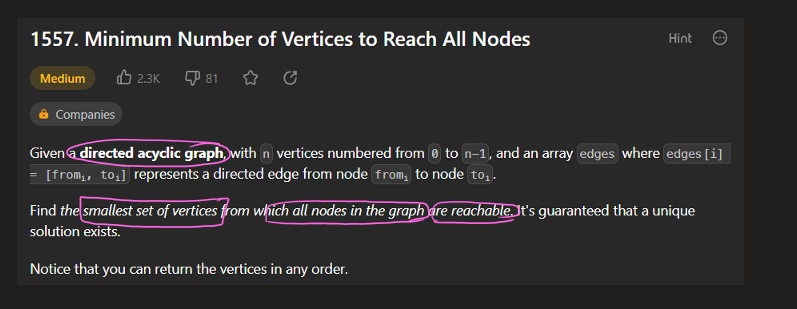
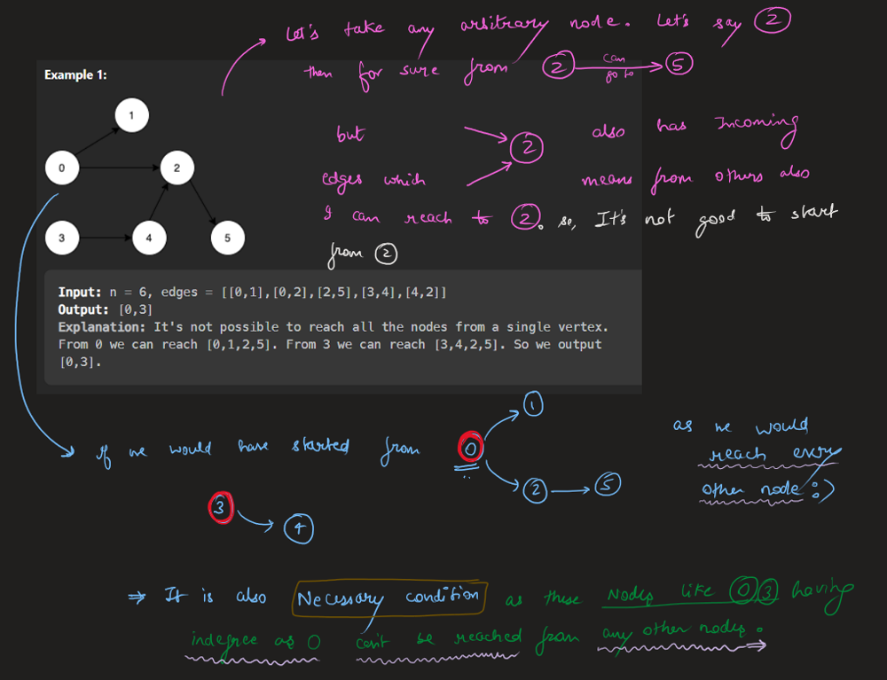
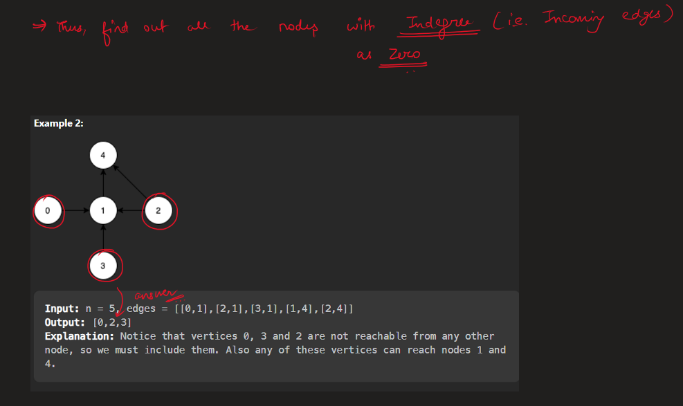
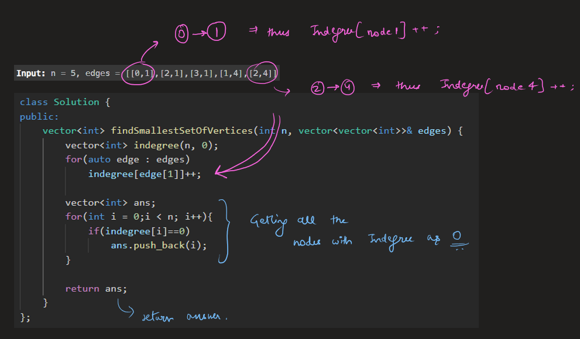
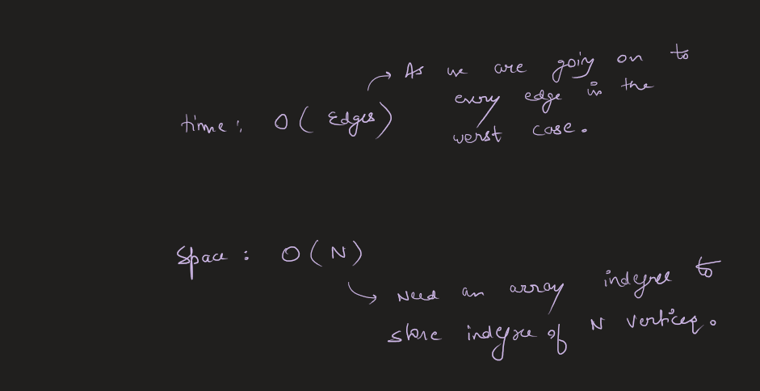

# Image Explanation🏆- [Easy & Concise - Zero Indegree] - C++/Java/Python

**Author:** aryan_0077
**Votes:** 29
**Link:** [https://leetcode.com/problems/minimum-number-of-vertices-to-reach-all-nodes/solutions/3536357/](https://leetcode.com/problems/minimum-number-of-vertices-to-reach-all-nodes/solutions/3536357/)

---

# Video Solution (`Aryan Mittal`) - Link in LeetCode Profile
`Minimum Number of Vertices to Reach All Nodes` by `Aryan Mittal`


# Approach & Intution





*time complexity : $$O(E + V)$$

# Code
```C++ []
class Solution {
public:
    vector<int> findSmallestSetOfVertices(int n, vector<vector<int>>& edges) {
        vector<int> indegree(n, 0);
        for(auto edge : edges)
            indegree[edge[1]]++;

        vector<int> ans;
        for(int i = 0;i < n; i++){
            if(indegree[i]==0)
                ans.push_back(i);
        }

        return ans;
    }
};
```
```Java []
class Solution {
    public List<Integer> findSmallestSetOfVertices(int n, List<List<Integer>> edges) {
        int[] indegree = new int[n];
        for (List<Integer> edge : edges) {
            indegree[edge.get(1)]++;
        }

        List<Integer> ans = new ArrayList<>();
        for (int i = 0; i < n; i++) {
            if (indegree[i] == 0) {
                ans.add(i);
            }
        }

        return ans;
    }
}
```
```Python []
class Solution:
    def findSmallestSetOfVertices(self, n, edges):
        indegree = [0] * n
        for edge in edges:
            indegree[edge[1]] += 1

        ans = []
        for i in range(n):
            if indegree[i] == 0:
                ans.append(i)

        return ans
```