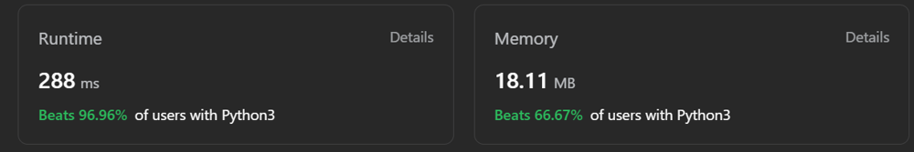

# 🔥Easy Solution🔥Python3/C/C#/C++/Java🔥With 🗺️image🗺️

**Author:** MrAke
**Votes:** 28
**Link:** [https://leetcode.com/problems/maximal-network-rank/solutions/3925629/](https://leetcode.com/problems/maximal-network-rank/solutions/3925629/)

---

# Intuition

<!-- Describe your first thoughts on how to solve this problem. -->

# Approach
<!-- Describe your approach to solving the problem. -->

# Complexity
- Time complexity:
<!-- Add your time complexity here, e.g. $$O(n)$$ -->

- Space complexity:
<!-- Add your space complexity here, e.g. $$O(n)$$ -->

# Code
```
class Solution:
    def maximalNetworkRank(self, n: int, roads: List[List[int]]) -> int:
        connections = [0] * n
        graph = [[False] * n for _ in range(n)]
        
        for a, b in roads:
            connections[a] += 1
            connections[b] += 1
            graph[a][b] = graph[b][a] = True
        
        max_rank = 0
        for i in range(n):
            for j in range(i + 1, n):
                rank = connections[i] + connections[j]
                if graph[i][j]:
                    rank -= 1
                max_rank = max(max_rank, rank)
        
        return max_rank
```