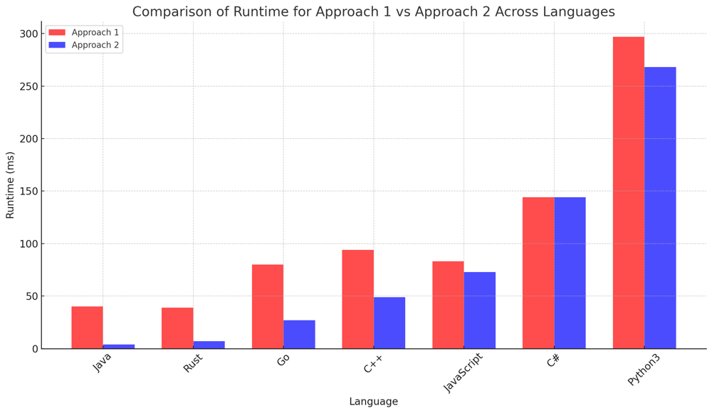
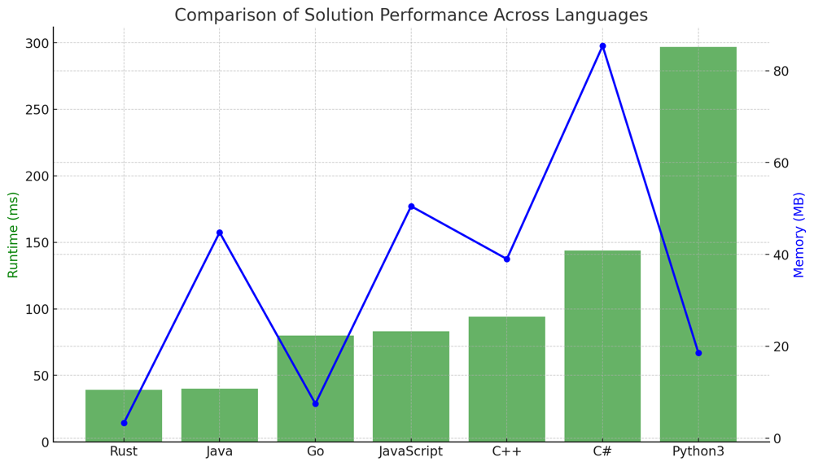
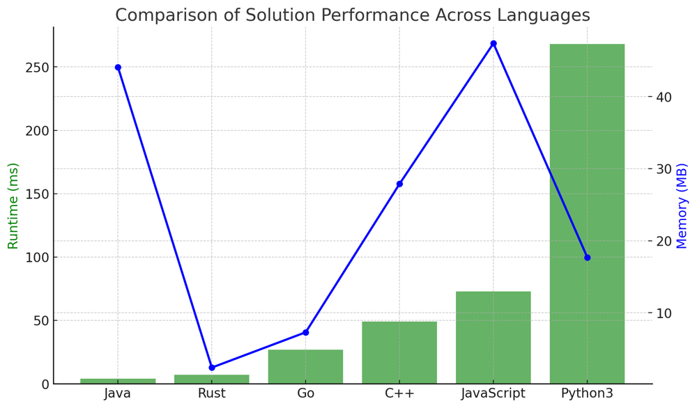

# ✅ 100% 2-Approaches - O(n+r) & O(n^2) - Iterative Pairwise Comparison & Direct Connection Check

**Author:** vanAmsen
**Votes:** 92
**Link:** [https://leetcode.com/problems/maximal-network-rank/solutions/3924639/](https://leetcode.com/problems/maximal-network-rank/solutions/3924639/)

---

# Problem Understanding

In the "Maximal Network Rank" problem, we are given an integer `n`  representing the number of cities and a list of roads connecting these cities. Each road connects two distinct cities and is bidirectional. The task is to compute the maximal network rank of the infrastructure, which is defined as the maximum network rank of all pairs of different cities. The network rank of two different cities is the total number of directly connected roads to either city.

For instance, given `n = 4`  and roads = `[[0,1],[0,3],[1,2],[1,3]]`, the output should be 4. This is because cities 0 and 1 have a combined network rank of 4.

---

# Live Coding in Python
### Approach 1/2 - O(n^2):
https://youtu.be/4jT0UeXl4U0

### Approach 2/2 - O(n+r):
https://youtu.be/E0CdCD_kDPY

# Approach Comparison:




## Approach 1/2: Iterative Pairwise Comparison

- **Strategy**: This approach calculates the degree of each city and then iterates over every possible pair of cities to compute their combined network rank.
  
- **Key Data Structures**:
  - Degree List: To store the number of roads connected to each city.
  - Road Set: For quick lookup of roads.
  
- **Major Steps**:
  - Calculate the degree of each city.
  - Iterate over all possible pairs of cities.
  - For each pair, compute the network rank and update the max rank.
  
- **Complexity**:
  - **Time**: $$O(n^2)$$ due to iterating over all pairs of cities.
  - **Space**: $$O(n + \	ext{len(roads)})$$. The degree list occupies $$O(n)$$ and the road set occupies $$O(\	ext{len(roads)})$$.

**Approach 2/2: Degree Counting with Direct Connection Check**

- **Strategy**: Instead of exhaustive pairwise comparison, this method identifies cities with the highest and second-highest degrees, and then restricts checks to a smaller subset of cities.

- **Key Data Structures**:
  - Degree List: To store the number of roads connected to each city.
  - Road Set: For quick O(1) lookup of roads.
  
- **Major Steps**:
  - Calculate the degree of each city.
  - Identify the highest and second-highest degree cities.
  - Check direct connections among these cities to compute the maximal rank.
  
- **Complexity**:
  - **Time**: $$O(n + \	ext{len(roads)})$$ derived from counting degrees and checking direct connections among a few cities.
  - **Space**: $$O(n + \	ext{len(roads)})$$. The degree list occupies $$O(n)$$ and the road set occupies $$O(\	ext{len(roads)})$$.

---

### Differences:

- **Strategy**: The first approach involves a brute-force method of iterating through all pairs of cities. In contrast, the second approach is more optimized, focusing on cities with the highest and second-highest degrees.
  
- **Efficiency**: The second approach is generally more efficient as it avoids unnecessary computations by restricting the checks to a subset of city pairs.
  
- **Complexity**: The time complexity of the first approach is quadratic ($$O(n^2)$$), while the second approach has a linear time complexity ($$O(n + \	ext{len(roads)})$$), making the latter more scalable for larger inputs.

By understanding the differences between these two approaches, one can appreciate the importance of optimizing algorithms and the benefits it brings in terms of efficiency and scalability.


# Approach 1/2: Iterative Pairwise Comparison

To solve the "Maximal Network Rank" problem, we first compute the degree of each city (number of roads connected to it). Then, we iterate over every possible pair of cities to compute their combined network rank.

## Key Data Structures:
- **Degree List**: A list that stores the number of roads connected to each city.
- **Road Set**: A set that stores the roads for quick look-up.

## Enhanced Breakdown:

1. **Initialization**:
   - Initialize a list `degree` of size  `n` with zeros.
   - Initialize an empty set `road_set`.
   
2. **Processing Each Road**:
   - For each road connecting cities  `a`  and  `b` :
     - Increment the degree of both  `a` and `b`.
     - Add the road to `road_set`.
   
3. **Iterate Over All City Pairs**:
   - For each pair of distinct cities `i` and `j`:
     - Compute their network rank as the sum of their degrees.
     - If they are directly connected, subtract 1 from the rank.
     - Update the `max_rank` with the current rank if it's higher.

4. **Wrap-up**:
   - Return the computed `max_rank`.

## Example:

Based on the breakdown, here's how the algorithm processes the given example:

1. **Input**:  
   - Number of cities  `n = 4`
   - Roads: `[ [0,1], [0,3], [1,2], [1,3] ]`

2. **Degree Calculation**:  
   After processing all the roads, the degree of connection for each city is as follows:
   - City 0 is connected to 2 other cities.
   - City 1 is connected to 3 other cities.
   - City 2 is connected to 1 other city.
   - City 3 is connected to 2 other cities.
   
   Hence, the degree list is: `[2, 3, 1, 2]`.

3. **Network Rank Calculation for Each Pair**:  
   For each unique pair of cities, we calculate their network rank:
   - Pair (0, 1): Network Rank = 4
   - Pair (0, 2): Network Rank = 3
   - Pair (0, 3): Network Rank = 3
   - Pair (1, 2): Network Rank = 3
   - Pair (1, 3): Network Rank = 4
   - Pair (2, 3): Network Rank = 3

4. **Result**:  
   The maximal network rank among all pairs of cities is 4.

### Summary:

Given the input  `n = 4`  and roads `[ [0,1], [0,3], [1,2], [1,3] ]`:

After processing all roads, the degree list is `[2, 3, 1, 2]`. Iterating over city pairs, the pairs (0, 1) and (1, 3) both give a network rank of 4, which is the maximum. Thus, the output is 4.

---

# Complexity 1/2:

**Time Complexity:** 
- The solution has a time complexity of $$ O(n^2) $$. This is because we iterate over all pairs of cities, resulting in $$ O(n^2) $$ complexity.

**Space Complexity:** 
- The space complexity is $$ O(n + \	ext{len(roads)}) $$. The `degree` list takes $$ O(n) $$ space, and the `road_set` takes $$ O(\	ext{len(roads)}) $$ space.

---

# Performance 1/2:

Given the constraints, this solution is optimal and will efficiently handle scenarios where  `n` is up to 100.

| Language   | Runtime (ms) | Runtime Beat (%) | Memory (MB) | Memory Beat (%) |
|------------|--------------|------------------|-------------|-----------------|
| Rust       | 39           | 25%              | 3.3         | 25%             |
| Java       | 40           | 16.8%            | 44.8        | 8.4%            |
| Go         | 80           | 6.6%             | 7.5         | 45.45%          |
| JavaScript | 83           | 91.80%           | 50.5        | 44.26%          |
| C++        | 94           | 56.78%           | 39.0        | 37.23%          |
| C#         | 144          | 82.86%           | 85.4        | 5.71%           |
| Python3    | 297          | 93.4%            | 18.6        | 15.22%          |




---

# Code 1/2

``` Python []
class Solution:
    def maximalNetworkRank(self, n: int, roads: List[List[int]]) -> int:
        degree = [0] * n
        for a, b in roads:
            degree[a] += 1
            degree[b] += 1
        road_set = set(tuple(road) for road in roads)
        max_rank = 0
        for i in range(n):
            for j in range(i+1, n):
                rank = degree[i] + degree[j]
                if (i, j) in road_set or (j, i) in road_set:
                    rank -= 1
                max_rank = max(max_rank, rank)
        return max_rank
```
``` C++ []
class Solution {
public:
    int maximalNetworkRank(int n, vector<vector<int>>& roads) {
        vector<int> degree(n, 0);
        set<pair<int, int>> road_set;
        
        for (auto& road : roads) {
            degree[road[0]]++;
            degree[road[1]]++;
            road_set.insert({road[0], road[1]});
            road_set.insert({road[1], road[0]});
        }

        int max_rank = 0;
        for (int i = 0; i < n; ++i) {
            for (int j = i+1; j < n; ++j) {
                int rank = degree[i] + degree[j];
                if (road_set.find({i, j}) != road_set.end()) {
                    rank--;
                }
                max_rank = max(max_rank, rank);
            }
        }

        return max_rank;
    }
};
```
``` Java []
class Solution {
    public int maximalNetworkRank(int n, int[][] roads) {
        int[] degree = new int[n];
        Set<String> roadSet = new HashSet<>();
        
        for (int[] road : roads) {
            degree[road[0]]++;
            degree[road[1]]++;
            roadSet.add(road[0] + "," + road[1]);
            roadSet.add(road[1] + "," + road[0]);
        }

        int maxRank = 0;
        for (int i = 0; i < n; i++) {
            for (int j = i+1; j < n; j++) {
                int rank = degree[i] + degree[j];
                if (roadSet.contains(i + "," + j)) {
                    rank--;
                }
                maxRank = Math.max(maxRank, rank);
            }
        }

        return maxRank;
    }
}
```
``` JavaScript []
/**
 * @param {number} n
 * @param {number[][]} roads
 * @return {number}
 */
var maximalNetworkRank = function(n, roads) {
    let degree = new Array(n).fill(0);
    let roadSet = new Set();

    for (let road of roads) {
        degree[road[0]]++;
        degree[road[1]]++;
        roadSet.add(road[0] + ',' + road[1]);
        roadSet.add(road[1] + ',' + road[0]);
    }

    let maxRank = 0;
    for (let i = 0; i < n; i++) {
        for (let j = i+1; j < n; j++) {
            let rank = degree[i] + degree[j];
            if (roadSet.has(i + ',' + j)) {
                rank--;
            }
            maxRank = Math.max(maxRank, rank);
        }
    }

    return maxRank;
};
```
``` C# []
public class Solution {
    public int MaximalNetworkRank(int n, int[][] roads) {
        int[] degree = new int[n];
        HashSet<string> roadSet = new HashSet<string>();
        
        foreach (int[] road in roads) {
            degree[road[0]]++;
            degree[road[1]]++;
            roadSet.Add(road[0] + "," + road[1]);
            roadSet.Add(road[1] + "," + road[0]);
        }

        int maxRank = 0;
        for (int i = 0; i < n; i++) {
            for (int j = i+1; j < n; j++) {
                int rank = degree[i] + degree[j];
                if (roadSet.Contains(i + "," + j)) {
                    rank--;
                }
                maxRank = Math.Max(maxRank, rank);
            }
        }

        return maxRank;
    }
}
```
``` Go []
func maximalNetworkRank(n int, roads [][]int) int {
    degree := make([]int, n)
    roadSet := make(map[string]bool)

    for _, road := range roads {
        degree[road[0]]++
        degree[road[1]]++
        roadSet[fmt.Sprintf("%d,%d", road[0], road[1])] = true
        roadSet[fmt.Sprintf("%d,%d", road[1], road[0])] = true
    }

    maxRank := 0
    for i := 0; i < n; i++ {
        for j := i+1; j < n; j++ {
            rank := degree[i] + degree[j]
            if _, exists := roadSet[fmt.Sprintf("%d,%d", i, j)]; exists {
                rank--
            }
            if rank > maxRank {
                maxRank = rank
            }
        }
    }

    return maxRank
}
```
``` Rust []
use std::collections::HashSet;

impl Solution {
    pub fn maximal_network_rank(n: i32, roads: Vec<Vec<i32>>) -> i32 {
        let mut degree = vec![0; n as usize];
        let mut road_set = HashSet::new();

        for road in &roads {
            degree[road[0] as usize] += 1;
            degree[road[1] as usize] += 1;
            road_set.insert(format!("{},{}", road[0], road[1]));
            road_set.insert(format!("{},{}", road[1], road[0]));
        }

        let mut max_rank = 0;
        for i in 0..n {
            for j in i+1..n {
                let rank = degree[i as usize] + degree[j as usize];
                let rank = if road_set.contains(&format!("{},{}", i, j)) {
                    rank - 1
                } else {
                    rank
                };
                max_rank = max_rank.max(rank);
            }
        }

        max_rank
    }
}
```

# Approach 2/2: Degree Counting with Direct Connection Check

To solve the "Maximal Network Rank" problem in a more optimized manner, we focus on reducing the redundant work by using the degree counting method. Instead of iterating through all pairs of cities, which is inefficient, we first identify cities with the highest and second-highest degrees. By doing so, we can restrict our checks to a smaller subset of cities, thus saving time.

## Key Data Structures:
- **Degree List**: A list that stores the number of roads connected to each city.
- **Road Set**: A set to store the roads for quick O(1) lookup.

## Enhanced Breakdown:
1. **Degree Calculation**:
   - Initialize a list called `degrees` of size `n` with zeros.
   - For every road in the given list of roads, increment the degree of both connected cities.

2. **Identifying Key Nodes**:
   - Sort the unique degrees in descending order.
   - Identify the highest and second-highest degrees.
   - Count the number of cities with the highest and second-highest degrees.

3. **Maximal Rank Calculation**:
   - If there are multiple cities with the highest degree, check the direct connections among them. The rank is based on these connections.
   - If there's only one city with the highest degree, check its direct connections with cities having the second-highest degree. The rank is based on these connections.

4. **Wrap-up**:
   - Return the computed maximal network rank.

---

## Complexity 2/2:

**Time Complexity**:
- The solution has a time complexity of $$O(n + \	ext{len(roads)})$$. This is derived from counting degrees and checking direct connections among a few cities, rather than iterating over all pairs.

**Space Complexity**:
- The space complexity is $$O(n+\	ext{len(roads)})$$. The degree list occupies $$O(n)$$ space and the road set occupies $$O(\	ext{len(roads)})$$ space.

---

# Performance 2/2:

| Language   | Runtime (ms) | Runtime Beat (%) | Memory (MB) | Memory Beat (%) |
|------------|--------------|------------------|-------------|-----------------|
| Java       | 4            | 88.27%           | 44.1        | 55.78%          |
| Rust       | 7            | 100%             | 2.4         | 100%            |
| Go         | 27           | 100%             | 7.3         | 75.76%          |
| C++        | 49           | 99.25%           | 27.9        | 97.68%          |
| JavaScript | 73           | 100%             | 47.4        | 98.36%          |
| C#         | 144          | 82.86%           | 85.4        | 5.71%           |
| Python3    | 268          | 100%             | 17.7        | 99.13%          |




# Code 2/2
``` Python []
class Solution:
    def maximalNetworkRank(self, n: int, roads: List[List[int]]) -> int:
        degrees = [0] * n
        for u, v in roads:
            degrees[u] += 1
            degrees[v] += 1

        sorted_degrees = sorted(set(degrees), reverse=True)
        max_deg = sorted_degrees[0]
        second_max_deg = sorted_degrees[1] if len(sorted_degrees) > 1 else 0

        max_count = degrees.count(max_deg)
        second_max_count = degrees.count(second_max_deg)

        if max_count > 1:
            directly_connected = sum(1 for u, v in roads if degrees[u] == max_deg and degrees[v] == max_deg)
            possible_connections = max_count * (max_count - 1) // 2
            return 2 * max_deg - 1 if possible_connections == directly_connected else 2 * max_deg

        direct_connections_to_second = sum(1 for u, v in roads if (degrees[u], degrees[v]) in [(max_deg, second_max_deg), (second_max_deg, max_deg)])
        return max_deg + second_max_deg - 1 if second_max_count == direct_connections_to_second else max_deg + second_max_deg
```
``` C++ []
class Solution {
public:
    int maximalNetworkRank(int n, std::vector<std::vector<int>>& roads) {
        std::vector<int> degrees(n, 0);
        for (auto& road : roads) {
            degrees[road[0]]++;
            degrees[road[1]]++;
        }
        
        std::unordered_set<int> unique_degrees(degrees.begin(), degrees.end());
        std::vector<int> sorted_degrees(unique_degrees.begin(), unique_degrees.end());
        std::sort(sorted_degrees.rbegin(), sorted_degrees.rend());
        
        int max_deg = sorted_degrees[0];
        int second_max_deg = sorted_degrees.size() > 1 ? sorted_degrees[1] : 0;
        
        int max_count = std::count(degrees.begin(), degrees.end(), max_deg);
        int second_max_count = std::count(degrees.begin(), degrees.end(), second_max_deg);
        
        if (max_count > 1) {
            int directly_connected = 0;
            for (auto& road : roads) {
                if (degrees[road[0]] == max_deg && degrees[road[1]] == max_deg)
                    directly_connected++;
            }
            int possible_connections = max_count * (max_count - 1) / 2;
            return possible_connections == directly_connected ? 2 * max_deg - 1 : 2 * max_deg;
        }
        
        int direct_connections_to_second = 0;
        for (auto& road : roads) {
            if ((degrees[road[0]] == max_deg && degrees[road[1]] == second_max_deg) ||
                (degrees[road[0]] == second_max_deg && degrees[road[1]] == max_deg))
                direct_connections_to_second++;
        }
        
        return second_max_count == direct_connections_to_second ? max_deg + second_max_deg - 1 : max_deg + second_max_deg;
    }
};
```
``` Java []
public class Solution {
    public int maximalNetworkRank(int n, int[][] roads) {
        int[] degrees = new int[n];
        for (int[] road : roads) {
            degrees[road[0]]++;
            degrees[road[1]]++;
        }
        
        Set<Integer> uniqueDegrees = new HashSet<>();
        for (int degree : degrees) {
            uniqueDegrees.add(degree);
        }
        
        List<Integer> sortedDegrees = new ArrayList<>(uniqueDegrees);
        Collections.sort(sortedDegrees, Collections.reverseOrder());

        int maxDeg = sortedDegrees.get(0);
        int secondMaxDeg = sortedDegrees.size() > 1 ? sortedDegrees.get(1) : 0;

        int maxCount = 0;
        for (int degree : degrees) {
            if (degree == maxDeg) maxCount++;
        }

        int secondMaxCount = 0;
        for (int degree : degrees) {
            if (degree == secondMaxDeg) secondMaxCount++;
        }

        if (maxCount > 1) {
            int directlyConnected = 0;
            for (int[] road : roads) {
                if (degrees[road[0]] == maxDeg && degrees[road[1]] == maxDeg)
                    directlyConnected++;
            }
            int possibleConnections = maxCount * (maxCount - 1) / 2;
            return possibleConnections == directlyConnected ? 2 * maxDeg - 1 : 2 * maxDeg;
        }

        int directConnectionsToSecond = 0;
        for (int[] road : roads) {
            if ((degrees[road[0]] == maxDeg && degrees[road[1]] == secondMaxDeg) ||
                (degrees[road[0]] == secondMaxDeg && degrees[road[1]] == maxDeg))
                directConnectionsToSecond++;
        }

        return secondMaxCount == directConnectionsToSecond ? maxDeg + secondMaxDeg - 1 : maxDeg + secondMaxDeg;
    }
}
```
``` C# []
public class Solution {
    public int MaximalNetworkRank(int n, int[][] roads) {
        int[] degrees = new int[n];
        foreach (var road in roads) {
            degrees[road[0]]++;
            degrees[road[1]]++;
        }

        HashSet<int> uniqueDegrees = new HashSet<int>(degrees);
        List<int> sortedDegrees = uniqueDegrees.ToList();
        sortedDegrees.Sort((a, b) => b.CompareTo(a));

        int maxDeg = sortedDegrees[0];
        int secondMaxDeg = sortedDegrees.Count > 1 ? sortedDegrees[1] : 0;

        int maxCount = degrees.Count(degree => degree == maxDeg);
        int secondMaxCount = degrees.Count(degree => degree == secondMaxDeg);

        if (maxCount > 1) {
            int directlyConnected = 0;
            foreach (var road in roads) {
                if (degrees[road[0]] == maxDeg && degrees[road[1]] == maxDeg)
                    directlyConnected++;
            }
            int possibleConnections = maxCount * (maxCount - 1) / 2;
            return possibleConnections == directlyConnected ? 2 * maxDeg - 1 : 2 * maxDeg;
        }

        int directConnectionsToSecond = 0;
        foreach (var road in roads) {
            if ((degrees[road[0]] == maxDeg && degrees[road[1]] == secondMaxDeg) ||
                (degrees[road[0]] == secondMaxDeg && degrees[road[1]] == maxDeg))
                directConnectionsToSecond++;
        }

        return secondMaxCount == directConnectionsToSecond ? maxDeg + secondMaxDeg - 1 : maxDeg + secondMaxDeg;
    }
}
```
``` JavaScript []
/**
 * @param {number} n
 * @param {number[][]} roads
 * @return {number}
 */
var maximalNetworkRank = function(n, roads) {
        let degrees = Array(n).fill(0);
        roads.forEach(([u, v]) => {
            degrees[u]++;
            degrees[v]++;
        });

        let uniqueDegrees = [...new Set(degrees)].sort((a, b) => b - a);
        let maxDeg = uniqueDegrees[0];
        let secondMaxDeg = uniqueDegrees.length > 1 ? uniqueDegrees[1] : 0;

        let maxCount = degrees.filter(degree => degree === maxDeg).length;
        let secondMaxCount = degrees.filter(degree => degree === secondMaxDeg).length;

        if (maxCount > 1) {
            let directlyConnected = roads.filter(([u, v]) => degrees[u] === maxDeg && degrees[v] === maxDeg).length;
            let possibleConnections = maxCount * (maxCount - 1) / 2;
            return possibleConnections === directlyConnected ? 2 * maxDeg - 1 : 2 * maxDeg;
        }

        let directConnectionsToSecond = roads.filter(([u, v]) => 
            (degrees[u] === maxDeg && degrees[v] === secondMaxDeg) || 
            (degrees[u] === secondMaxDeg && degrees[v] === maxDeg)
        ).length;

        return secondMaxCount === directConnectionsToSecond ? maxDeg + secondMaxDeg - 1 : maxDeg + secondMaxDeg;
    }

```
``` Go []
{
    degrees := make([]int, n)
    for _, road := range roads {
        degrees[road[0]]++
        degrees[road[1]]++
    }

    uniqueDegrees := []int{}
    m := make(map[int]bool)
    for _, item := range degrees {
        if _, value := m[item]; !value {
            m[item] = true
            uniqueDegrees = append(uniqueDegrees, item)
        }
    }
    sort.Sort(sort.Reverse(sort.IntSlice(uniqueDegrees)))

    maxDeg := uniqueDegrees[0]
    secondMaxDeg := 0
    if len(uniqueDegrees) > 1 {
        secondMaxDeg = uniqueDegrees[1]
    }

    maxCount, secondMaxCount := 0, 0
    for _, degree := range degrees {
        if degree == maxDeg {
            maxCount++
        } else if degree == secondMaxDeg {
            secondMaxCount++
        }
    }

    if maxCount > 1 {
        directlyConnected := 0
        for _, road := range roads {
            if degrees[road[0]] == maxDeg && degrees[road[1]] == maxDeg {
                directlyConnected++
            }
        }
        possibleConnections := maxCount * (maxCount - 1) / 2
        if directlyConnected == possibleConnections {
            return 2*maxDeg - 1
        }
        return 2 * maxDeg
    }

    directConnectionsToSecond := 0
    for _, road := range roads {
        if (degrees[road[0]] == maxDeg && degrees[road[1]] == secondMaxDeg) || 
           (degrees[road[0]] == secondMaxDeg && degrees[road[1]] == maxDeg) {
            directConnectionsToSecond++
        }
    }

    if directConnectionsToSecond == secondMaxCount {
        return maxDeg + secondMaxDeg - 1
    }
    return maxDeg + secondMaxDeg
}
```
``` Rust []
use std::collections::HashSet;

impl Solution {
    pub fn maximal_network_rank(n: i32, roads: Vec<Vec<i32>>) -> i32 {
        let mut degrees = vec![0; n as usize];
        for road in &roads {
            degrees[road[0] as usize] += 1;
            degrees[road[1] as usize] += 1;
        }

        let mut unique_degrees: HashSet<_> = degrees.iter().cloned().collect();
        let mut sorted_degrees: Vec<_> = unique_degrees.iter().cloned().collect();
        sorted_degrees.sort();
        sorted_degrees.reverse();

        let max_deg = sorted_degrees[0];
        let second_max_deg = if sorted_degrees.len() > 1 {
            sorted_degrees[1]
        } else {
            0
        };

        let max_count = degrees.iter().filter(|&&deg| deg == max_deg).count();
        let second_max_count = degrees.iter().filter(|&&deg| deg == second_max_deg).count();

        if max_count > 1 {
            let directly_connected = roads.iter().filter(|road| degrees[road[0] as usize] == max_deg && degrees[road[1] as usize] == max_deg).count();
            let possible_connections = max_count * (max_count - 1) / 2;
            return if possible_connections == directly_connected {
                2 * max_deg - 1
            } else {
                2 * max_deg
            };
        } else {
            let direct_connections_to_second = roads.iter().filter(|road| {
                (degrees[road[0] as usize] == max_deg && degrees[road[1] as usize] == second_max_deg) ||
                (degrees[road[0] as usize] == second_max_deg && degrees[road[1] as usize] == max_deg)
            }).count();
            return if second_max_count == direct_connections_to_second {
                max_deg + second_max_deg - 1
            } else {
                max_deg + second_max_deg
            };
        }
    }
}

```

This problem beautifully showcases the importance of understanding the underlying structures of a network and the power of pairwise comparison. Keep coding and keep learning! \uD83D\uDCA1\uD83C\uDF20\uD83D\uDC69\u200D\uD83D\uDCBB\uD83D\uDC68\u200D\uD83D\uDCBB