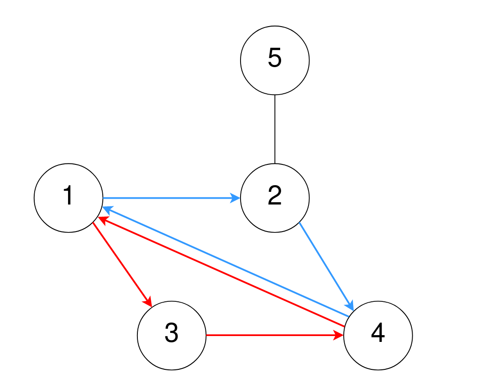
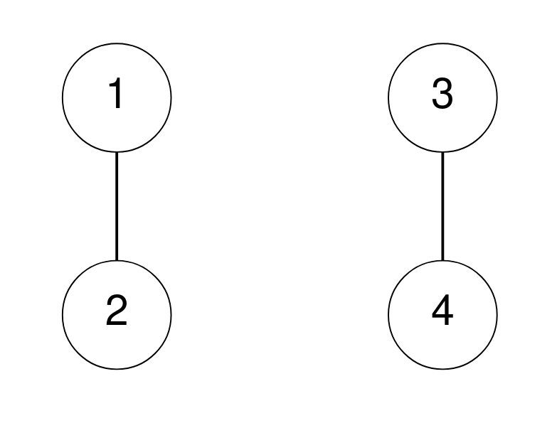

# [2077. Paths in Maze That Lead to Same Room](https://leetcode.com/problems/paths-in-maze-that-lead-to-same-room/)

| Category | Difficulty | Likes | Dislikes |
| :------: | :--------: | :---: | :------: |
| Algorithms | Medium | 140 | 12 |

**Tags:** [`graph`](https://leetcode.com/tag/graph)

**Companies:** `google`

## Description

A maze consists of `n` rooms numbered from `1` to `n`, and some rooms are connected by corridors. You are given a 2D integer array `corridors` where `corridors[i] = [room1_i, room2_i]` indicates that there is a corridor connecting `room1_i` and `room2_i`, allowing a person in the maze to go from `room1_i` to `room2_i` **and vice versa**.

The designer of the maze wants to know how confusing the maze is. The **confusion** **score** of the maze is the number of different cycles of **length 3**.

	- For example, `1 &rarr; 2 &rarr; 3 &rarr; 1` is a cycle of length 3, but `1 &rarr; 2 &rarr; 3 &rarr; 4` and `1 &rarr; 2 &rarr; 3 &rarr; 2 &rarr; 1` are not.

Two cycles are considered to be **different** if one or more of the rooms visited in the first cycle is **not** in the second cycle.

Return *the* ***confusion**** score** of the maze.*

 

**Example 1:**


```

Input: n = 5, corridors = [[1,2],[5,2],[4,1],[2,4],[3,1],[3,4]]
Output: 2
Explanation:
One cycle of length 3 is 4 &rarr; 1 &rarr; 3 &rarr; 4, denoted in red.
Note that this is the same cycle as 3 &rarr; 4 &rarr; 1 &rarr; 3 or 1 &rarr; 3 &rarr; 4 &rarr; 1 because the rooms are the same.
Another cycle of length 3 is 1 &rarr; 2 &rarr; 4 &rarr; 1, denoted in blue.
Thus, there are two different cycles of length 3.

```

**Example 2:**


```

Input: n = 4, corridors = [[1,2],[3,4]]
Output: 0
Explanation:
There are no cycles of length 3.

```

 

**Constraints:**

	- `2 <= n <= 1000`

	- `1 <= corridors.length <= 5 * 10^4`

	- `corridors[i].length == 2`

	- `1 <= room1_i, room2_i <= n`

	- `room1_i != room2_i`

	- There are no duplicate corridors.

---

**Links:** [Submissions](https://leetcode.com/problems/paths-in-maze-that-lead-to-same-room/) | [Solutions](https://leetcode.com/problems/paths-in-maze-that-lead-to-same-room/)
