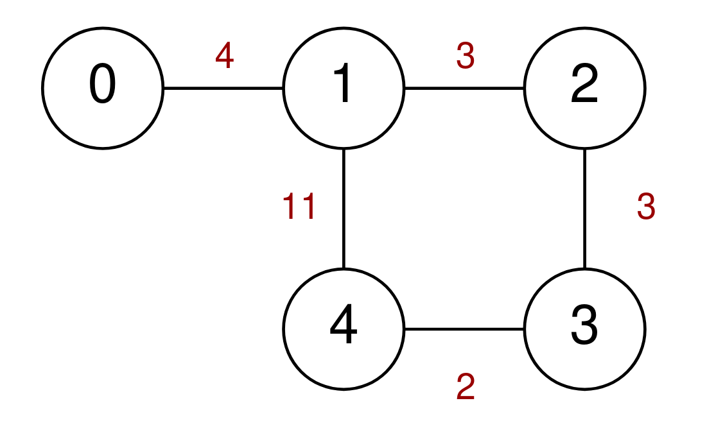
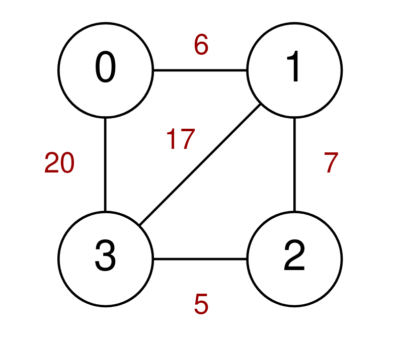
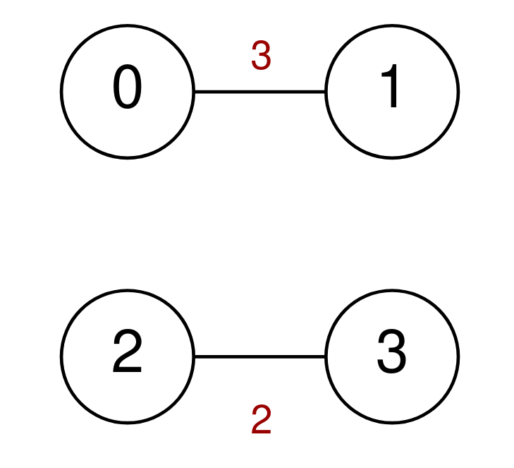

# [2093. Minimum Cost to Reach City With Discounts](https://leetcode.com/problems/minimum-cost-to-reach-city-with-discounts/)

| Category | Difficulty | Likes | Dislikes |
| :------: | :--------: | :---: | :------: |
| Algorithms | Medium | 241 | 22 |

**Tags:** [`graph`](https://leetcode.com/tag/graph), [`heap-priority-queue`](https://leetcode.com/tag/heap-priority-queue), [`shortest-path`](https://leetcode.com/tag/shortest-path)

**Companies:** `flipkart`

## Description

A series of highways connect `n` cities numbered from `0` to `n - 1`. You are given a 2D integer array `highways` where `highways[i] = [city1_i, city2_i, toll_i]` indicates that there is a highway that connects `city1_i` and `city2_i`, allowing a car to go from `city1_i` to `city2_i` **and vice versa** for a cost of `toll_i`.

You are also given an integer `discounts` which represents the number of discounts you have. You can use a discount to travel across the `i^th` highway for a cost of `toll_i / 2` (**integer** **division**). Each discount may only be used **once**, and you can only use at most **one** discount per highway.

Return *the **minimum total cost** to go from city *`0`* to city *`n - 1`*, or *`-1`* if it is not possible to go from city *`0`* to city *`n - 1`*.*

 

**Example 1:**



```

Input: n = 5, highways = [[0,1,4],[2,1,3],[1,4,11],[3,2,3],[3,4,2]], discounts = 1
Output: 9
Explanation:
Go from 0 to 1 for a cost of 4.
Go from 1 to 4 and use a discount for a cost of 11 / 2 = 5.
The minimum cost to go from 0 to 4 is 4 + 5 = 9.

```

**Example 2:**



```

Input: n = 4, highways = [[1,3,17],[1,2,7],[3,2,5],[0,1,6],[3,0,20]], discounts = 20
Output: 8
Explanation:
Go from 0 to 1 and use a discount for a cost of 6 / 2 = 3.
Go from 1 to 2 and use a discount for a cost of 7 / 2 = 3.
Go from 2 to 3 and use a discount for a cost of 5 / 2 = 2.
The minimum cost to go from 0 to 3 is 3 + 3 + 2 = 8.

```

**Example 3:**



```

Input: n = 4, highways = [[0,1,3],[2,3,2]], discounts = 0
Output: -1
Explanation:
It is impossible to go from 0 to 3 so return -1.

```

 

**Constraints:**

	- `2 <= n <= 1000`

	- `1 <= highways.length <= 1000`

	- `highways[i].length == 3`

	- `0 <= city1_i, city2_i <= n - 1`

	- `city1_i != city2_i`

	- `0 <= toll_i <= 10^5`

	- `0 <= discounts <= 500`

	- There are no duplicate highways.

---

**Links:** [Submissions](https://leetcode.com/problems/minimum-cost-to-reach-city-with-discounts/) | [Solutions](https://leetcode.com/problems/minimum-cost-to-reach-city-with-discounts/)
