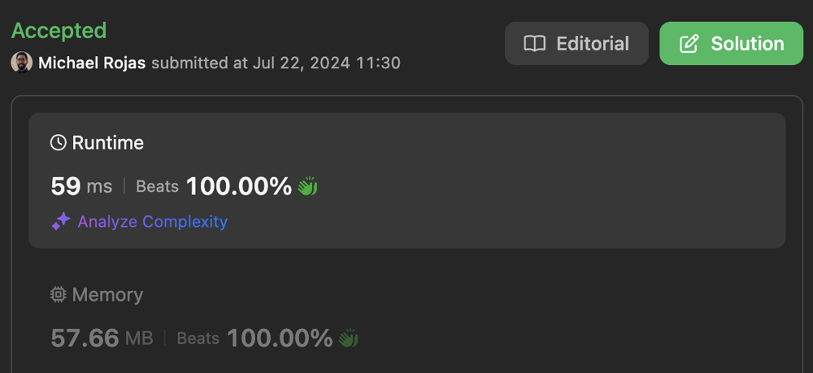

# BFS

**Author:** rojas
**Votes:** 0
**Link:** [https://leetcode.com/problems/minimum-cost-to-reach-city-with-discounts/solutions/5517501/](https://leetcode.com/problems/minimum-cost-to-reach-city-with-discounts/solutions/5517501/)

---

[Submission](https://leetcode.com/problems/minimum-cost-to-reach-city-with-discounts/submissions/1329653861/)



# Code

```typescript
function minimumCost(n: number, highways: number[][], discounts: number): number {

    // Initialize edges
    const edges = new Map<number, Map<number, number>>();
    for (let i = 0; i < n; ++i) {
        edges.set(i, new Map());
    }

    // Populate edges
    for (const [from, to, cost] of highways) {
        let map = edges.get(from)!;
        map.set(to, Math.min(cost, map.get(to) ?? Infinity));
        map = edges.get(to)!;
        map.set(from, Math.min(cost, map.get(from) ?? Infinity));
    }

    // Initialize queue
    const target = n - 1;
    const queue: number[][] = [[0, 0, -1]]; // [city, sum, prevIdx]
    const visited = new Array(n).fill(Infinity);
    visited[0] = 0;

    // Find paths to target
    let q = 0;
    let minCost = Infinity;
    do {
        for (const Q = queue.length; q < Q; ++q) {
            const [from, sum] = queue[q];
            if (from == target) {
                minCost = Math.min(minCost, getCost(queue, q, discounts));
                continue;
            }
            for (const [to, cost] of edges.get(from)!) {
                if (visited[to] > sum + cost) {
                    visited[to] = sum + cost;
                    queue.push([to, sum + cost, q]);
                }
            }
        }
    } while (q < queue.length);

    // Check if path found
    return isFinite(minCost) ? minCost : -1;
};

function getCost(queue: number[][], curr: number, discounts: number): number {
    // Get total cost
    let sum = queue[curr][1];
    
    // Get individual highway costs.
    // Generates an extra zero entry.
    let subSum = sum;
    const costs: number[] = [];
    while (subSum > 0) {
        const temp = subSum;
        [, subSum, curr] = queue[curr];
        costs.push(temp - subSum);
    }

    // Sort costs DESC
    costs.sort((a, b) => b - a);

    // Subtract discounts from total cost
    const N = Math.min(discounts, costs.length - 1);
    for (let i = 0; i < N; ++i) {
        sum -= costs[i] - (costs[i] >> 1);
    }

    return sum;
}
```