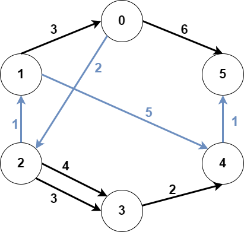

# [2203. Minimum Weighted Subgraph With the Required Paths](https://leetcode.com/problems/minimum-weighted-subgraph-with-the-required-paths/)

| Category | Difficulty | Likes | Dislikes |
| :------: | :--------: | :---: | :------: |
| Algorithms | Hard | 773 | 23 |

**Tags:** [`graph`](https://leetcode.com/tag/graph), [`shortest-path`](https://leetcode.com/tag/shortest-path)

**Companies:** `google`

## Description

You are given an integer `n` denoting the number of nodes of a **weighted directed** graph. The nodes are numbered from `0` to `n - 1`.

You are also given a 2D integer array `edges` where `edges[i] = [from_i, to_i, weight_i]` denotes that there exists a **directed** edge from `from_i` to `to_i` with weight `weight_i`.

Lastly, you are given three **distinct** integers `src1`, `src2`, and `dest` denoting three distinct nodes of the graph.

Return *the **minimum weight** of a subgraph of the graph such that it is **possible** to reach* `dest` *from both* `src1` *and* `src2` *via a set of edges of this subgraph*. In case such a subgraph does not exist, return `-1`.

A **subgraph** is a graph whose vertices and edges are subsets of the original graph. The **weight** of a subgraph is the sum of weights of its constituent edges.

 

**Example 1:**


```

Input: n = 6, edges = [[0,2,2],[0,5,6],[1,0,3],[1,4,5],[2,1,1],[2,3,3],[2,3,4],[3,4,2],[4,5,1]], src1 = 0, src2 = 1, dest = 5
Output: 9
Explanation:
The above figure represents the input graph.
The blue edges represent one of the subgraphs that yield the optimal answer.
Note that the subgraph [[1,0,3],[0,5,6]] also yields the optimal answer. It is not possible to get a subgraph with less weight satisfying all the constraints.

```

**Example 2:**


```

Input: n = 3, edges = [[0,1,1],[2,1,1]], src1 = 0, src2 = 1, dest = 2
Output: -1
Explanation:
The above figure represents the input graph.
It can be seen that there does not exist any path from node 1 to node 2, hence there are no subgraphs satisfying all the constraints.

```

 

**Constraints:**

	- `3 <= n <= 10^5`

	- `0 <= edges.length <= 10^5`

	- `edges[i].length == 3`

	- `0 <= from_i, to_i, src1, src2, dest <= n - 1`

	- `from_i != to_i`

	- `src1`, `src2`, and `dest` are pairwise distinct.

	- `1 <= weight[i] <= 10^5`

---

**Links:** [Submissions](https://leetcode.com/problems/minimum-weighted-subgraph-with-the-required-paths/) | [Solutions](https://leetcode.com/problems/minimum-weighted-subgraph-with-the-required-paths/)
