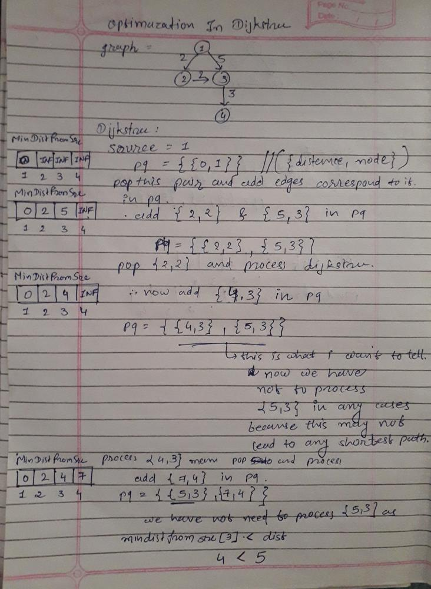

# C++ || Explanation with picture on Dijkstra Optimisation

**Author:** AJAY_MAKVANA
**Votes:** 55
**Link:** [https://leetcode.com/problems/minimum-weighted-subgraph-with-the-required-paths/solutions/1844680/](https://leetcode.com/problems/minimum-weighted-subgraph-with-the-required-paths/solutions/1844680/)

---

**77/78 test cases passes and 1 case TLE is due to not optimized Dijkstra**.
In below i had mentioned what to do optimization in Dijkstra and Why ?

when we process priority_queue pair by pair in Dijkstra
then if we find any pair where `minDistanceFromSrcTo[u] < dist` (where `dist = pq.top().first` & `u = pq.top().second`)
then all shortest path passes from this node u is already processed so we have to not need to process this pair.



**eg.** during processing let assume that first we found minDistanceFromSrcTo[u] as 5 so we add pair `{5, u}` in priority_queue
then after 
for some path we found minDistanceFromSrcTo[u] as 8 so we add pair `{4, u}` in priority_queue
so now when we process the queue pair by pair 
first we pop `{4, u}` (as we use min pririty queue in Dijkstra) pair and found all shortest path according to that
and then we get `{5, u}` so now we had no need to process this because this is not lead to any shortest path.

**In Below solution i had done comment in Dijkstra for optimization mentioned above**

**Solution :**
here I had done **Dijkstra 3 times**.
**First time** : store the shortest distance from node `src1` to all other nodes in array `fromSrc1To`.
**Second time** : store the shortest distance from node `src2` to all other nodes in array `fromSrc2To`.
**Third time** : store the shortest distance from node `dest` to all other nodes via Reversed Graph in array `fromDestTo`.
**The answer is the minimum of** `fromSrc1To[i] + fromSrc2To[i] + fromDestTo[i]` (`0 <= i < N`).

```
class Solution {
	long MAXX = 1e10;
public:
	// DIJKSTRA
	void Dijkstra(long src, vector<pair<long, long>> adj[], vector<long>&minDistanceFromSrcTo)
	{
		priority_queue<pair<long, long>, vector<pair<long, long>>, greater<pair<long, long>>> pq;
		pq.push({0, src});
		minDistanceFromSrcTo[src] = 0;
		long u, v, wt, dist;
		while (!pq.empty()) {
			u = pq.top().second;
			dist = pq.top().first;
			pq.pop();
			// below line in Dijkstra becomes game changer
			// because if for any pair in priority_queue pq
			// minDistanceFromSrcTo[u] < dist
			// then shortest path passing from this u is already processed
			// so no need to go below for() loop for time consumption
			if (minDistanceFromSrcTo[u] < dist) continue;
			for (auto it : adj[u]) {
				v = it.first;
				wt = it.second;
				if (minDistanceFromSrcTo[u] + wt < minDistanceFromSrcTo[v]) {
					minDistanceFromSrcTo[v] = wt + minDistanceFromSrcTo[u];
					pq.push({minDistanceFromSrcTo[v], v});
				}
			}
		}
	}

	long minimumWeight(int n, vector<vector<int>>& edges, int src1, int src2, int dest) {
		vector<pair<long, long>> adj[n], revadj[n];
		for (auto e : edges) {
			adj[e[0]].push_back({e[1], e[2]});
			revadj[e[1]].push_back({e[0], e[2]});
		}

		vector<long>fromSrc1To(n, MAXX), fromSrc2To(n, MAXX), fromDestTo(n, MAXX);
		Dijkstra(src1, adj, fromSrc1To);
		Dijkstra(src2, adj, fromSrc2To);
		Dijkstra(dest, revadj, fromDestTo);

		// BASE CASE : not fount any path from src1 to dest OR src2 to dest
		if (fromSrc1To[dest] == MAXX || fromSrc2To[dest] == MAXX) return -1;

		long ans = MAXX;
		for (long i = 0; i < n; i++) {
			ans = min(ans, fromSrc1To[i] + fromSrc2To[i] + fromDestTo[i]);
		}
		return ans;
	}
};
```
**If find Helpful *Upvote It* \uD83D\uDC4D**