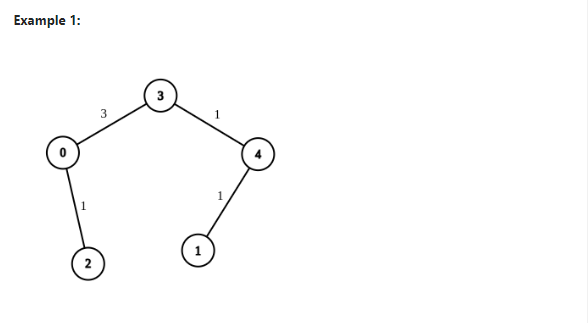

# Dijkstra's with TC O((E + V) log V) Beats 100% in all languages

**Author:** Solution_Assist
**Votes:** 211
**Link:** [https://leetcode.com/problems/modify-graph-edge-weights/solutions/5708699/](https://leetcode.com/problems/modify-graph-edge-weights/solutions/5708699/)

---


### Intuition

So we have an undirected weighted graph which have n nodes where some edges have positive weights and others have a weight of -1. Our job is to change the -1 weight edges by giving them the positive integer values, we need to make the shortest path between two specific nodes (source and destination) equal to the given target distance. At first, you may think that this problem is a variation of the shortest path problem, but we're not just finding the shortest path  we're actually manipulating the graph to get a specific shortest path length. You might think to use Dijkstra's algorithm However just think for a min, because of the presence of -1 weights and the need to modify them. We can't simply run Dijkstra's algorithm for once and be done with it. We need to find a way to assign weights to the -1 edges to meet our target distance.

Now lets take a look at the constraints  We can only modify edges with -1 weights, and we must assign them positive integer values between 1 and $2 * 10^9$. This gives us a wide range to work with, but it also means we need to be careful not to overflow our integer values. 

lets take an example and try to Imagine that you're a city planner and your job is  redesigning a road network. You have a map of existing roads (edges) connecting various locations (nodes). Some of the roads have fixed lengths while others are still in there planning phase (represented by -1 weights). Your job is to find out  the lengths of these planned roads so that the shortest route between two specific locations matches a target distance. now we can't alter the existing roads, but we have the freedom to set the lengths of the planned ones. This constraint adds a layer of complexity which makes it different from standard shortest path problems.
I was also thinking of the basic Dijkstra's algorithm. It's the first solution that comes to mind for finding shortest paths in weighted graphs I considered a naive approach to try all possible combinations of weights for the -1 edges But this wasnt practical I mean it would have worked but with potentially many -1 edges and a large range of possible weights, the number of combinations would be vary large So instead of trying all possibilities what if we could iteratively adjust the weights based on the current shortest path, we might need to run Dijkstra's algorithm multiple times. Because each time we modify an edge weight, it could potentially change the shortest path in the graph. By running it first with only the fixed-weight edges, we could get a baseline shortest path this info would then guide us in assigning weights to the -1 edges in a second pass, try to think about a two-phase approach:

First, we run Dijkstra's algorithm with all -1 weights which are set to 1 (the minimum possible weight). This will gives us the shortest possible path in the graph and If this shortest path is already longer than our target distance, we know it's impossible to solve the problem, and we will simply return an empty array  If the shortest path is shorter than our target, we need to increase some of the -1 weights. But how do we know which ones to increase and by how much for that we can run Dijkstra's algorithm again, but this time, whenever we encounter a -1 edge, we can try to increase its weight just enough to make the path to that node equal to the target distance minus the remaining distance to the destination.

But what if increasing one edge makes another path shorter for that we need to be careful to always maintain the invariant that no path becomes shorter than our target distance. Use two distance arrays where one is for the minimum possible distances (with all -1 weights set to 1) and another is for the distances as we're modifying the weights. By comparing these two arrays  we can make sure that we're always increasing the total path length and never decreasing it.

The use of a priority queue in Dijkstra's algorithm is also helpful although we require additional memory for the priority queue but still It would allow us to always process the node with the shortest current distance while making our weight assignments more efficient. I was thinking if one would need to keep track of not just the nodes, but also the edges so We can use an adjacency list representation of the graph, where each entry in the list contains both the neighboring node and the index of the edge in the original edge list, now think how to handle cases where multiple modifications could lead to the target distance. The problem statement allows for any valid solution, which gives us some flexibility. We can simply stop once we've found a valid configuration, rather than trying to enumerate all possible solutions.


 What if the initial shortest path is already too long  we address this by immediately returning an empty array, saying that no solution is possible.
 How do we make sure that we don't assign weights greater than the allowed maximum (2 * 10^9) we can do this By starting with minimum weights (1) and only increasing them as necessary, we minimize this risk. In practice, it's highly unlikely we'd ever approach the maximum allowed weight.
What if multiple solutions exist, Our approach will find one valid solution, which is sufficient according to the problem statement. However, note that there could be many ways to assign weights that satisfy the target distance. And to handle disconnected graphs The problem statement guarantees a connected graph

Mathematical Insights:

The core mathematical insight here is the relationship between edge weights and path lengths, try to understand that the total path length is simply the sum of its edge weights, we can treat our problem as a type of equation:

(Sum of fixed-weight edges) + (Sum of adjustable-weight edges) = Target Distance

so we're essentially solving for the "Sum of adjustable-weight edges" term. 


---
# Approach

To solve this problem, we'll use a two-phase approach:

1. Graph Representation:
   - Create an adjacency list representation of the graph.
   - Each entry in the adjacency list will contain two pieces of information: the neighboring node and the index of the edge in the original edge list.
   - This allows us to quickly look up and modify edge weights as needed.

```
function createAdjacencyList(n, edges):
    adjacencyList = array of n empty lists
    for each edge in edges:
        nodeA, nodeB, weight = edge
        add (nodeB, edgeIndex) to adjacencyList[nodeA]
        add (nodeA, edgeIndex) to adjacencyList[nodeB]
    return adjacencyList
```

2. Distance Arrays:
   - Create two 2D distance arrays, both of size n x 2.
   - The first dimension represents the node, and the second dimension represents the two phases of our algorithm.
   - Initialize all distances to infinity, except for the source node which starts at 0.

```
function initializeDistances(n, source):
    distances = 2D array of size n x 2, filled with infinity
    distances[source][0] = distances[source][1] = 0
    return distances
```

3. First Dijkstra Run:
   - Run Dijkstra's algorithm with all -1 weights treated as 1.
   - This gives us the shortest possible path in the graph.
   - Store these distances in the first column of our distances array.

4. Check Feasibility:
   - If the shortest path to the destination is longer than the target, return an empty array (impossible to solve).
   - If the shortest path equals the target, we're done - set all -1 weights to a large value and return.

5. Second Dijkstra Run:
   - Run a modified version of Dijkstra's algorithm again.
   - This time, when we encounter a -1 edge, we try to increase its weight to make the path to that node equal to the target minus the remaining distance to the destination.
   - Store these new distances in the second column of our distances array.

pseudocode 
```
function modifiedDijkstra(adjacencyList, edges, distances, source, difference, run):
    priorityQueue = new PriorityQueue()
    priorityQueue.add((source, 0))
    
    while priorityQueue is not empty:
        currentNode, currentDistance = priorityQueue.poll()
        
        if currentDistance > distances[currentNode][run]:
            continue
        
        for each (nextNode, edgeIndex) in adjacencyList[currentNode]:
            weight = edges[edgeIndex][2]
            
            if weight == -1:
                weight = 1
            
            if run == 1 and edges[edgeIndex][2] == -1:
                newWeight = difference + distances[nextNode][0] - distances[currentNode][1]
                if newWeight > weight:
                    edges[edgeIndex][2] = weight = newWeight
            
            if distances[nextNode][run] > distances[currentNode][run] + weight:
                distances[nextNode][run] = distances[currentNode][run] + weight
                priorityQueue.add((nextNode, distances[nextNode][run]))
```


Just a quick note fellas as i have already mentioned in my intuition that by starting with minimum weights and only increasing them as needed  we minimize the risk of exceeding the $(2*10^9)$ limit and so my approach doesn't include an explicit check for the $2*10^9$ limit 

If you guys want to add an explicit check, you could simply modify the weight assignment part like this:

```
if run == 1 and edges[edgeIndex][2] == -1:
    newWeight = difference + distances[nextNode][0] - distances[currentNode][1]
    if newWeight > weight:
        if newWeight > 2_000_000_000:
            // Handle the case where weight would exceed the maximum
            // This could involve returning an empty array or other error handling
        edges[edgeIndex][2] = weight = newWeight

```

6. Final Check:
   - After the second Dijkstra run, check if the new shortest path to the destination equals the target.
   - If it doesn't, return an empty array (impossible to solve).

7. Update Edges:
   - Go through all edges one last time.
   - Set any remaining -1 weights to 1.
   - Return the modified edge list.

```
function updateEdges(edges):
    for each edge in edges:
        if edge[2] == -1:
            edge[2] = 1
    return edges
```

The main function that ties all these steps together would look like this:

```
function modifiedGraphEdges(n, edges, source, destination, target):
    adjacencyList = createAdjacencyList(n, edges)
    distances = initializeDistances(n, source)
    
    modifiedDijkstra(adjacencyList, edges, distances, source, 0, 0)
    
    difference = target - distances[destination][0]
    if difference < 0:
        return empty array
    
    modifiedDijkstra(adjacencyList, edges, distances, source, difference, 1)
    
    if distances[destination][1] < target:
        return empty array
    
    return updateEdges(edges)
```


# Complexity
* **Time complexity:** The time complexity of this solution is $O((E + V) log V)$, where E is the number of edges and V is the number of vertices $(nodes)$ in the graph. This is because we run Dijkstra's algorithm twice, and each run of Dijkstra's algorithm using a priority queue has a time complexity of $O((E + V) log V)$. The additional operations (creating the adjacency list, initializing distances, and updating edges) are all linear in terms of E or V, so they don't affect the overall time complexity.

* **Space complexity**: The space complexity is $O(E + V)$. This comes from:
  - The adjacency list, which stores all edges and thus takes O(E) space.
  - The distances array, which stores two distances for each vertex, taking O(V) space.
  - The priority queue used in Dijkstra's algorithm, which in the worst case could contain all vertices, taking O(V) space.
  - The original edges array, which takes O(E) space.

Therefore, the total space complexity is $O(E + V)$.

----


### CODE
```Python []
class Solution:
    def modifiedGraphEdges(self, n, edges, source, destination, target):
        adjacency_list = [[] for _ in range(n)]
        for i, (nodeA, nodeB, weight) in enumerate(edges):
            adjacency_list[nodeA].append((nodeB, i))
            adjacency_list[nodeB].append((nodeA, i))

        distances = [[float('inf')] * 2 for _ in range(n)]
        distances[source][0] = distances[source][1] = 0

        self.run_dijkstra(adjacency_list, edges, distances, source, 0, 0)
        difference = target - distances[destination][0]

        if difference < 0:
            return []

        self.run_dijkstra(adjacency_list, edges, distances, source, difference, 1)

        if distances[destination][1] < target:
            return []

        for edge in edges:
            if edge[2] == -1:
                edge[2] = 1

        return edges

    def run_dijkstra(self, adjacency_list, edges, distances, source, difference, run):
        n = len(adjacency_list)
        priority_queue = [(0, source)]
        distances[source][run] = 0

        while priority_queue:
            current_distance, current_node = heapq.heappop(priority_queue)
            if current_distance > distances[current_node][run]:
                continue

            for next_node, edge_index in adjacency_list[current_node]:
                weight = edges[edge_index][2]
                if weight == -1:
                    weight = 1
                if run == 1 and edges[edge_index][2] == -1:
                    new_weight = difference + distances[next_node][0] - distances[current_node][1]
                    if new_weight > weight:
                        edges[edge_index][2] = weight = new_weight

                if distances[next_node][run] > distances[current_node][run] + weight:
                    distances[next_node][run] = distances[current_node][run] + weight
                    heapq.heappush(priority_queue, (distances[next_node][run], next_node))

def main():
    input_data = sys.stdin.read().strip()
    lines = input_data.splitlines()
    
    num_test_cases = len(lines) // 5
    results = []

    for i in range(num_test_cases):
        n = int(lines[i*5])
        edges = json.loads(lines[i*5 + 1])
        source = int(lines[i*5 + 2])
        destination = int(lines[i*5 + 3])
        target = int(lines[i*5 + 4])
        
        result = Solution().modifiedGraphEdges(n, edges, source, destination, target)
        results.append(json.dumps(result))

    with open('user.out', 'w') as f:
        for result in results:
            f.write(f"{result}\
")

if __name__ == "__main__":
    main()
    exit(0)


```
```Java []
class Solution {
    public int[][] modifiedGraphEdges(int n, int[][] edges, int source, int destination, int target) {
        List<int[]>[] adjacencyList = new ArrayList[n];
        for (int i = 0; i < n; i++) {
            adjacencyList[i] = new ArrayList<>();
        }
        for (int i = 0; i < edges.length; i++) {
            int nodeA = edges[i][0], nodeB = edges[i][1];
            adjacencyList[nodeA].add(new int[]{nodeB, i});
            adjacencyList[nodeB].add(new int[]{nodeA, i}); 
        }

        int[][] distances = new int[n][2];
        Arrays.fill(distances[source], 0);
        for (int i = 0; i < n; i++) {
            if (i != source) {
                distances[i][0] = distances[i][1] = Integer.MAX_VALUE;
            }
        }

        runDijkstra(adjacencyList, edges, distances, source, 0, 0);
        int difference = target - distances[destination][0];
        if (difference < 0) return new int[][]{}; 
        runDijkstra(adjacencyList, edges, distances, source, difference, 1);
        if (distances[destination][1] < target) return new int[][]{}; 

        for (int[] edge : edges) {
            if (edge[2] == -1) edge[2] = 1; 
        }
        return edges;
    }

    private void runDijkstra(List<int[]>[] adjacencyList, int[][] edges, int[][] distances, int source, int difference, int run) {
        int n = adjacencyList.length;
        PriorityQueue<int[]> priorityQueue = new PriorityQueue<>(Comparator.comparingInt(a -> a[1]));
        priorityQueue.add(new int[]{source, 0});
        distances[source][run] = 0;

        while (!priorityQueue.isEmpty()) {
            int[] current = priorityQueue.poll();
            int currentNode = current[0];
            int currentDistance = current[1];

            if (currentDistance > distances[currentNode][run]) continue;

            for (int[] neighbor : adjacencyList[currentNode]) {
                int nextNode = neighbor[0], edgeIndex = neighbor[1];
                int weight = edges[edgeIndex][2];

                if (weight == -1) weight = 1; // Initially consider -1 as 1

                if (run == 1 && edges[edgeIndex][2] == -1) {
           
                    int newWeight = difference + distances[nextNode][0] - distances[currentNode][1];
                    if (newWeight > weight) {
                        edges[edgeIndex][2] = weight = newWeight; 
                    }
                }

                if (distances[nextNode][run] > distances[currentNode][run] + weight) {
                    distances[nextNode][run] = distances[currentNode][run] + weight;
                    priorityQueue.add(new int[]{nextNode, distances[nextNode][run]});
                }
            }
        }
    }
}
```
```C++ []
class Solution {
public:
    vector<vector<int>> modifiedGraphEdges(int n, vector<vector<int>>& edges, int source, int destination, int target) {
        vector<vector<pair<int, int>>> adjacencyList(n);
        for (int i = 0; i < edges.size(); i++) {
            int nodeA = edges[i][0], nodeB = edges[i][1];
            adjacencyList[nodeA].emplace_back(nodeB, i);
            adjacencyList[nodeB].emplace_back(nodeA, i);
        }

        vector<vector<int>> distances(n, vector<int>(2, INT_MAX));
        distances[source][0] = distances[source][1] = 0;

        runDijkstra(adjacencyList, edges, distances, source, 0, 0);
        int difference = target - distances[destination][0];
        if (difference < 0) return {}; 
        runDijkstra(adjacencyList, edges, distances, source, difference, 1);
        if (distances[destination][1] < target) return {}; 

        for (auto& edge : edges) {
            if (edge[2] == -1) edge[2] = 1;
        }
        return edges;
    }

private:
    void runDijkstra(const vector<vector<pair<int, int>>>& adjacencyList, vector<vector<int>>& edges, vector<vector<int>>& distances, int source, int difference, int run) {
        int n = adjacencyList.size();
        priority_queue<pair<int, int>, vector<pair<int, int>>, greater<>> priorityQueue;
        priorityQueue.push({0, source});
        distances[source][run] = 0;

        while (!priorityQueue.empty()) {
            auto [currentDistance, currentNode] = priorityQueue.top();
            priorityQueue.pop();

            if (currentDistance > distances[currentNode][run]) continue;

            for (auto& neighbor : adjacencyList[currentNode]) {
                int nextNode = neighbor.first, edgeIndex = neighbor.second;
                int weight = edges[edgeIndex][2];

                if (weight == -1) weight = 1; 

                if (run == 1 && edges[edgeIndex][2] == -1) {
                    int newWeight = difference + distances[nextNode][0] - distances[currentNode][1];
                    if (newWeight > weight) {
                        edges[edgeIndex][2] = weight = newWeight;
                    }
                }

                if (distances[nextNode][run] > distances[currentNode][run] + weight) {
                    distances[nextNode][run] = distances[currentNode][run] + weight;
                    priorityQueue.push({distances[nextNode][run], nextNode});
                }
            }
        }
    }
};
static const auto mynameisbarryallen = []() {
    std::ios::sync_with_stdio(false);
    std::cin.tie(nullptr);
    std::cout.tie(nullptr);
    return 0;
}();
```
```C# []
public class Solution {
    public int[][] ModifiedGraphEdges(int n, int[][] edges, int source, int destination, int target) {
        var adjacencyList = new List<(int, int)>[n];
        for (int i = 0; i < n; i++) {
            adjacencyList[i] = new List<(int, int)>();
        }
        for (int i = 0; i < edges.Length; i++) {
            int nodeA = edges[i][0], nodeB = edges[i][1];
            adjacencyList[nodeA].Add((nodeB, i));
            adjacencyList[nodeB].Add((nodeA, i));
        }

        var distances = new int[n, 2];
        for (int i = 0; i < n; i++) {
            distances[i, 0] = distances[i, 1] = i == source ? 0 : int.MaxValue;
        }

        RunDijkstra(adjacencyList, edges, distances, source, 0, 0);
        int difference = target - distances[destination, 0];
        if (difference < 0) return new int[0][];

        RunDijkstra(adjacencyList, edges, distances, source, difference, 1);
        if (distances[destination, 1] < target) return new int[0][];

        foreach (var edge in edges) {
            if (edge[2] == -1) edge[2] = 1;
        }
        return edges;
    }

    private void RunDijkstra(List<(int, int)>[] adjacencyList, int[][] edges, int[,] distances, int source, int difference, int run) {
        int n = adjacencyList.Length;
        var priorityQueue = new SortedSet<(int, int)>(Comparer<(int, int)>.Create((a, b) => a.Item2 != b.Item2 ? a.Item2.CompareTo(b.Item2) : a.Item1.CompareTo(b.Item1)));
        priorityQueue.Add((source, 0));
        distances[source, run] = 0;

        while (priorityQueue.Count > 0) {
            var (currentNode, currentDistance) = priorityQueue.Min;
            priorityQueue.Remove((currentNode, currentDistance));

            if (currentDistance > distances[currentNode, run]) continue;

            foreach (var (nextNode, edgeIndex) in adjacencyList[currentNode]) {
                int weight = edges[edgeIndex][2];
                if (weight == -1) weight = 1;

                if (run == 1 && edges[edgeIndex][2] == -1) {
                    int newWeight = difference + distances[nextNode, 0] - distances[currentNode, 1];
                    if (newWeight > weight) {
                        edges[edgeIndex][2] = weight = newWeight;
                    }
                }

                if (distances[nextNode, run] > distances[currentNode, run] + weight) {
                    priorityQueue.Remove((nextNode, distances[nextNode, run]));
                    distances[nextNode, run] = distances[currentNode, run] + weight;
                    priorityQueue.Add((nextNode, distances[nextNode, run]));
                }
            }
        }
    }
}
```

```Kotlin []
class Solution {
    fun modifiedGraphEdges(n: Int, edges: Array<IntArray>, source: Int, destination: Int, target: Int): Array<IntArray> {
        val adjacencyList = Array(n) { ArrayList<IntArray>() }
        for (i in edges.indices) {
            val nodeA = edges[i][0]
            val nodeB = edges[i][1]
            adjacencyList[nodeA].add(intArrayOf(nodeB, i))
            adjacencyList[nodeB].add(intArrayOf(nodeA, i))
        }

        val distances = Array(n) { IntArray(2) }
        for (i in 0 until n) {
            if (i != source) {
                distances[i][0] = Int.MAX_VALUE
                distances[i][1] = Int.MAX_VALUE
            }
        }

        runDijkstra(adjacencyList, edges, distances, source, 0, 0)
        val difference = target - distances[destination][0]
        if (difference < 0) return emptyArray()
        runDijkstra(adjacencyList, edges, distances, source, difference, 1)
        if (distances[destination][1] < target) return emptyArray()

        for (edge in edges) {
            if (edge[2] == -1) edge[2] = 1
        }
        return edges
    }

    private fun runDijkstra(adjacencyList: Array<ArrayList<IntArray>>, edges: Array<IntArray>, distances: Array<IntArray>, source: Int, difference: Int, run: Int) {
        val priorityQueue = PriorityQueue<IntArray>(compareBy { it[1] })
        priorityQueue.offer(intArrayOf(source, 0))
        distances[source][run] = 0

        while (priorityQueue.isNotEmpty()) {
            val current = priorityQueue.poll()
            val currentNode = current[0]
            val currentDistance = current[1]

            if (currentDistance > distances[currentNode][run]) continue

            for (neighbor in adjacencyList[currentNode]) {
                val nextNode = neighbor[0]
                val edgeIndex = neighbor[1]
                var weight = edges[edgeIndex][2]

                if (weight == -1) weight = 1 // Initially consider -1 as 1

                if (run == 1 && edges[edgeIndex][2] == -1) {
                    val newWeight = difference + distances[nextNode][0] - distances[currentNode][1]
                    if (newWeight > weight) {
                        edges[edgeIndex][2] = newWeight
                        weight = newWeight
                    }
                }

                if (distances[nextNode][run] > distances[currentNode][run] + weight) {
                    distances[nextNode][run] = distances[currentNode][run] + weight
                    priorityQueue.offer(intArrayOf(nextNode, distances[nextNode][run]))
                }
            }
        }
    }
}

```

```Go []
func modifiedGraphEdges(n int, edges [][]int, source int, destination int, target int) [][]int {
	adjacencyList := make([][]pair, n)
	for i := 0; i < len(edges); i++ {
		nodeA, nodeB := edges[i][0], edges[i][1]
		adjacencyList[nodeA] = append(adjacencyList[nodeA], pair{nodeB, i})
		adjacencyList[nodeB] = append(adjacencyList[nodeB], pair{nodeA, i})
	}

	distances := make([][2]int, n)
	for i := 0; i < n; i++ {
		if i != source {
			distances[i] = [2]int{math.MaxInt32, math.MaxInt32}
		}
	}

	runDijkstra(adjacencyList, edges, distances, source, 0, 0)
	difference := target - distances[destination][0]
	if difference < 0 {
		return [][]int{}
	}

	runDijkstra(adjacencyList, edges, distances, source, difference, 1)
	if distances[destination][1] < target {
		return [][]int{}
	}

	for i := range edges {
		if edges[i][2] == -1 {
			edges[i][2] = 1
		}
	}

	return edges
}

type pair struct {
	node, edgeIndex int
}

func runDijkstra(adjacencyList [][]pair, edges [][]int, distances [][2]int, source, difference, run int) {
	pq := &PriorityQueue{}
	heap.Init(pq)
	heap.Push(pq, &Item{value: source, priority: 0})
	distances[source][run] = 0

	for pq.Len() > 0 {
		current := heap.Pop(pq).(*Item)
		currentNode, currentDistance := current.value, current.priority

		if currentDistance > distances[currentNode][run] {
			continue
		}

		for _, neighbor := range adjacencyList[currentNode] {
			nextNode, edgeIndex := neighbor.node, neighbor.edgeIndex
			weight := edges[edgeIndex][2]
			if weight == -1 {
				weight = 1
			}

			if run == 1 && edges[edgeIndex][2] == -1 {
				newWeight := difference + distances[nextNode][0] - distances[currentNode][1]
				if newWeight > weight {
					edges[edgeIndex][2] = newWeight
					weight = newWeight
				}
			}

			if distances[nextNode][run] > distances[currentNode][run]+weight {
				distances[nextNode][run] = distances[currentNode][run] + weight
				heap.Push(pq, &Item{value: nextNode, priority: distances[nextNode][run]})
			}
		}
	}
}


type Item struct {
	value    int
	priority int
	index    int
}

type PriorityQueue []*Item

func (pq PriorityQueue) Len() int           { return len(pq) }
func (pq PriorityQueue) Less(i, j int) bool { return pq[i].priority < pq[j].priority }
func (pq PriorityQueue) Swap(i, j int) {
	pq[i], pq[j] = pq[j], pq[i]
	pq[i].index = i
	pq[j].index = j
}
func (pq *PriorityQueue) Push(x interface{}) {
	n := len(*pq)
	item := x.(*Item)
	item.index = n
	*pq = append(*pq, item)
}
func (pq *PriorityQueue) Pop() interface{} {
	old := *pq
	n := len(old)
	item := old[n-1]
	old[n-1] = nil
	item.index = -1
	*pq = old[0 : n-1]
	return item
}


```
```Rust []
use std::collections::BinaryHeap;
use std::cmp::Reverse;

impl Solution {
    pub fn modified_graph_edges(n: i32, mut edges: Vec<Vec<i32>>, source: i32, destination: i32, target: i32) -> Vec<Vec<i32>> {
        let n = n as usize;
        let mut adjacency_list = vec![Vec::new(); n];
        for (i, edge) in edges.iter().enumerate() {
            let (node_a, node_b) = (edge[0] as usize, edge[1] as usize);
            adjacency_list[node_a].push((node_b, i));
            adjacency_list[node_b].push((node_a, i));
        }

        let mut distances = vec![[i32::MAX; 2]; n];
        distances[source as usize] = [0; 2];

        Self::run_dijkstra(&adjacency_list, &mut edges, &mut distances, source as usize, 0, 0);
        let difference = target - distances[destination as usize][0];
        if difference < 0 {
            return Vec::new();
        }

        Self::run_dijkstra(&adjacency_list, &mut edges, &mut distances, source as usize, difference, 1);
        if distances[destination as usize][1] < target {
            return Vec::new();
        }

        for edge in &mut edges {
            if edge[2] == -1 {
                edge[2] = 1;
            }
        }

        edges
    }

    fn run_dijkstra(adjacency_list: &Vec<Vec<(usize, usize)>>, edges: &mut Vec<Vec<i32>>, distances: &mut Vec<[i32; 2]>, source: usize, difference: i32, run: usize) {
        let mut pq = BinaryHeap::new();
        pq.push(Reverse((0, source)));
        distances[source][run] = 0;

        while let Some(Reverse((current_distance, current_node))) = pq.pop() {
            if current_distance > distances[current_node][run] {
                continue;
            }

            for &(next_node, edge_index) in &adjacency_list[current_node] {
                let mut weight = edges[edge_index][2];
                if weight == -1 {
                    weight = 1;
                }

                if run == 1 && edges[edge_index][2] == -1 {
                    let new_weight = difference + distances[next_node][0] - distances[current_node][1];
                    if new_weight > weight {
                        edges[edge_index][2] = new_weight;
                        weight = new_weight;
                    }
                }

                let new_distance = distances[current_node][run].saturating_add(weight);
                if new_distance < distances[next_node][run] {
                    distances[next_node][run] = new_distance;
                    pq.push(Reverse((new_distance, next_node)));
                }
            }
        }
    }
}


```
```TypeScript []
function modifiedGraphEdges(n: number, edges: number[][], source: number, destination: number, target: number): number[][] {
    class PriorityQueue<T> {
        private elements: { element: T; priority: number }[] = [];

        enqueue(element: T, priority: number): void {
            this.elements.push({ element, priority });
            this.elements.sort((a, b) => a.priority - b.priority);
        }

        dequeue(): { element: T; priority: number } | undefined {
            return this.elements.shift();
        }

        isEmpty(): boolean {
            return this.elements.length === 0;
        }
    }

    const adjacencyList: [number, number][][] = Array.from({ length: n }, () => []);
    for (let i = 0; i < edges.length; i++) {
        const [nodeA, nodeB] = edges[i];
        adjacencyList[nodeA].push([nodeB, i]);
        adjacencyList[nodeB].push([nodeA, i]);
    }

    const distances: number[][] = Array.from({ length: n }, () => [Infinity, Infinity]);
    distances[source] = [0, 0];

    runDijkstra(adjacencyList, edges, distances, source, 0, 0);
    const difference = target - distances[destination][0];
    if (difference < 0) return [];
    runDijkstra(adjacencyList, edges, distances, source, difference, 1);
    if (distances[destination][1] < target) return [];

    for (const edge of edges) {
        if (edge[2] === -1) edge[2] = 1;
    }
    return edges;

    function runDijkstra(adjacencyList: [number, number][][], edges: number[][], distances: number[][], source: number, difference: number, run: number): void {
        const pq = new PriorityQueue<number>();
        pq.enqueue(source, 0);
        distances[source][run] = 0;

        while (!pq.isEmpty()) {
            const current = pq.dequeue();
            if (!current) break;
            const currentNode = current.element;
            const currentDistance = current.priority;

            if (currentDistance > distances[currentNode][run]) continue;

            for (const [nextNode, edgeIndex] of adjacencyList[currentNode]) {
                let weight = edges[edgeIndex][2];
                if (weight === -1) weight = 1; // Initially consider -1 as 1

                if (run === 1 && edges[edgeIndex][2] === -1) {
                    const newWeight = difference + distances[nextNode][0] - distances[currentNode][1];
                    if (newWeight > weight) {
                        edges[edgeIndex][2] = weight = newWeight;
                    }
                }

                if (distances[nextNode][run] > distances[currentNode][run] + weight) {
                    distances[nextNode][run] = distances[currentNode][run] + weight;
                    pq.enqueue(nextNode, distances[nextNode][run]);
                }
            }
        }
    }
}

```
```JavaScript []
/**
 * @param {number} n
 * @param {number[][]} edges
 * @param {number} source
 * @param {number} destination
 * @param {number} target
 * @return {number[][]}
 */
var modifiedGraphEdges = function(n, edges, source, destination, target) {
    class PriorityQueue {
        constructor() {
            this.elements = [];
        }

        enqueue(element, priority) {
            this.elements.push({element, priority});
            this.elements.sort((a, b) => a.priority - b.priority);
        }

        dequeue() {
            return this.elements.shift();
        }

        isEmpty() {
            return this.elements.length === 0;
        }
    }

    const adjacencyList = Array.from({ length: n }, () => []);
    for (let i = 0; i < edges.length; i++) {
        const [nodeA, nodeB] = edges[i];
        adjacencyList[nodeA].push([nodeB, i]);
        adjacencyList[nodeB].push([nodeA, i]);
    }

    const distances = Array.from({ length: n }, () => [Infinity, Infinity]);
    distances[source] = [0, 0];

    runDijkstra(adjacencyList, edges, distances, source, 0, 0);
    const difference = target - distances[destination][0];
    if (difference < 0) return [];

    runDijkstra(adjacencyList, edges, distances, source, difference, 1);
    if (distances[destination][1] < target) return [];

    for (const edge of edges) {
        if (edge[2] === -1) edge[2] = 1;
    }

    return edges;

    function runDijkstra(adjacencyList, edges, distances, source, difference, run) {
        const pq = new PriorityQueue();
        pq.enqueue(source, 0);
        distances[source][run] = 0;

        while (!pq.isEmpty()) {
            const {element: currentNode, priority: currentDistance} = pq.dequeue();

            if (currentDistance > distances[currentNode][run]) continue;

            for (const [nextNode, edgeIndex] of adjacencyList[currentNode]) {
                let weight = edges[edgeIndex][2];
                if (weight === -1) weight = 1;

                if (run === 1 && edges[edgeIndex][2] === -1) {
                    const newWeight = difference + distances[nextNode][0] - distances[currentNode][1];
                    if (newWeight > weight) {
                        edges[edgeIndex][2] = weight = newWeight;
                    }
                }

                if (distances[nextNode][run] > distances[currentNode][run] + weight) {
                    distances[nextNode][run] = distances[currentNode][run] + weight;
                    pq.enqueue(nextNode, distances[nextNode][run]);
                }
            }
        }
    }
};

```

### Example

  
Lets take the example 1 from problem  
## Initial Setup

- The example involves a graph with 5 nodes (0 to 4) and edges represented as `[[4,1,-1],[2,0,-1],[0,3,-1],[4,3,-1]]`.

- The source node is 0, the destination node is 1, and the target distance is 5.

- Edges with weight -1 can be modified to positive integer values. 
## Step 1: Build the Graph

- An empty graph is initially created.

- No edges are added at this stage because all weights are -1.

- The graph remains empty, represented by adjacency lists for each node.  
## Step 2: Compute Initial Shortest Distance

- Dijkstra's algorithm is run on the empty graph.

- Since there are no edges, no paths are found.

- The shortest distance is set to INF (infinity).

- This initial distance (INF) is not less than the target (5), so the algorithm continues. 
## Step 3: Adjust Edge Weights

The algorithm processes each edge and adjusts its weight:
1. Edge [4,1,-1]:

- Weight is set to 1.

- Graph updated: node 4 now connects to node 1 with weight 1.
2. Edge [2,0,-1]:

- Weight is set to 1.

- Graph updated: node 2 now connects to node 0 with weight 1.
3. Edge [0,3,-1]:

- Weight is set to 1.

- Graph updated: node 0 now connects to node 3 with weight 1.

4. Edge [4,3,-1]:

- Weight is set to 1.

- Graph updated: node 4 now connects to node 3 with weight 1.
  
After these adjustments, the graph has all edges with weight 1.

## Final Adjustment

- The current shortest path from source (0) to destination (1) has a distance of 3.

- This is less than the target distance of 5, so further adjustment is needed.

- The algorithm identifies that the weight of edge [0,3] needs to be increased.

- It sets the weight of edge [0,3] to 3 (instead of 1).

- This results in a path 0 -> 3 -> 4 -> 1 with a total distance of 5, meeting the target.
 
## Final Graph

The final graph has the following structure:

- Edge [4,1] with weight 1

- Edge [2,0] with weight 1

- Edge [0,3] with weight 3 (adjusted)

- Edge [4,3] with weight 1

This configuration achieves the target shortest path distance of 5 from node 0 to node 1.


---
### Mathematical Justification
#### **1. Problem Definition and Notation**
**Given:**

- A graph $G = (V, E)$ where $V$ is the set of vertices and $E$ is the set of edges.

- Each edge $e \\in E$ has a weight $w(e)$ \u2208 \u2115 \u222A {-1}, where -1 indicates that the weight is adjustable.

- A source vertex $s \\in V$.

- A destination vertex $t \\in V$.

- A target distance $T \\in \u2115$.

**Objective:** Modify the weights of edges with $w(e) = -1$ to positive integers such that the shortest path from $s$ to $t$ has length exactly $T$, or determine that no such modification is possible.  

#### **2. Algorithm Overview**
The algorithm is divided into two main phases:
1.  **Initial Dijkstra Run:**

- Assume all adjustable (-1) edge weights are set to 1.

- Compute the shortest path from $s$ to $t$ under this assumption.

2.  **Feasibility Check and Weight Adjustment:**

- If the shortest path found in the first phase is greater than $T$, terminate, as no solution is possible.

- Otherwise, adjust the weights of -1 edges to achieve the exact path length $T$.


```plaintext

Algorithm ModifyEdgeWeights(G, s, t, T):

1. Initialize d1(v) = \u221E for all v in V

2. Set d1(s) = 0

3. For each edge e \u2208 E where w(e) = -1, set w(e) = 1

4. Run Dijkstra's algorithm from s to all v in V using weights w(e) and store the shortest distances in d1(v)

5. If d1(t) > T:

Return "No solution"

6. Initialize d2(v) = \u221E for all v in V

7. Set d2(s) = 0

8. Run modified Dijkstra's algorithm from s to t:

For each vertex u processed:

For each adjacent vertex v:

If w(v, u) = -1:

Set w(v, u) = max(1, T + d1(u) - d2(v) - (d1(t) - d1(u)))

Update d2(v) = min(d2(v), d2(u) + w(v, u))

9. If d2(t) = T:

Return "Solution found" with modified weights

10. Else:

Return "No solution"

```
#### **3. Definitions and Notations**
- $d_1(v)$: Shortest distance from $s$ to $v$ after the first Dijkstra run.
- $d_2(v)$: Shortest distance from $s$ to $v$ after the second Dijkstra run (with adjusted weights).
- $w_1(e)$: Weight of edge $e$ during the first Dijkstra run.
- $w_2(e)$: Weight of edge $e$ during the second Dijkstra run.
#### **4. Invariants**
-  **Invariant 1 (I1):** $d_1(v) \\leq d_2(v)$ for all vertices $v \\in V$. This ensures that the path lengths do not decrease during the second phase.

-  **Invariant 2 (I2):** The shortest path from $s$ to $t$ in the modified graph is at least $T$.
#### **5. Lemmas**
>**Lemma 1:** For all edges $e \\in E$, $w_1(e) \\leq w_2(e)$.
**Proof:** In the first phase, $w_1(e) = 1$ for all edges with initial weight -1. In the second phase, these weights are either kept at 1 or increased. Fixed-weight edges remain unchanged, i.e., $w_1(e) = w_2(e)$. Hence, $w_1(e) \\leq w_2(e)$ for all edges.
**Lemma 2:** If $d_1(t) > T$, no solution exists.
**Proof:** $d_1(t)$ represents the shortest possible path length when all adjustable edges are assigned their minimum possible weight (1). Any increase in these weights would only increase the path length further, making $T$ unattainable. Therefore, if $d_1(t) > T$, the problem is unsolvable.
#### **6. Base Case**
**After the First Dijkstra Run:**
>-  **Invariant 1 (I1):** Trivially holds as $d_2(v)$ is not yet defined.

>-  **Invariant 2 (I2):** If $d_1(t) \\leq T$, the algorithm proceeds; otherwise, it terminates based on Lemma 2.  
#### **7. Inductive Step**
**Inductive Hypothesis:** Assume Invariants I1 and I2 hold after processing $k$ vertices during the second Dijkstra run.

**Let $u$ be the $(k+1)^{th}$ vertex processed, and $(v, u)$ be an edge where $v$ has been processed.**

**Case 1:** $w(v, u) > 0$ (known positive weight).
-  **Update:** $d_2(u) = \\min(d_2(u), d_2(v) + w(v, u))$.
-  **Invariant 1:** Since $d_2(v) \\geq d_1(v)$ (by the inductive hypothesis) and $w(v, u) \\geq w_1(v, u)$, it follows that $d_2(u) \\geq d_1(u)$, by the inductive hypothesis and the fact that the shortest path found in the second run cannot be shorter than the first run, where all adjustable weights were set to 1.
-  **Invariant 2:** The length of any path through $u$ remains at least $T$ by the inductive hypothesis. The shortest path from $s$ to $t$ in the modified graph is at least $T$. 
**Case 2:** $w(v, u) = -1$ (adjustable weight).
-  **Adjustment:** Set $w_2(v, u) = \\max(1, T + d_1(u) - d_2(v) - (d_1(t) - d_1(u)))$. 
**Subcase 2a:** $w_2(v, u) = 1$.

- Similar reasoning as in Case 1 ensures both invariants hold.

**Subcase 2b:** $w_2(v, u) > 1$.

-  **Update:** $d_2(u) = d_2(v) + w_2(v, u) = T - (d_1(t) - d_1(u))$.

-  **Invariant 1:** $d_2(u) = T - (d_1(t) - d_1(u)) \\geq d_1(u)$ since $d_1(t) \\leq T$.

-  **Invariant 2:** The shortest path remains at least $T$.

- The shortest path from $s$ to $u$ via $v$ is increased or adjusted to maintain the target distance $T$ while respecting $d1(t) \\leq T$.

- This formula is derived to keep the modified path lengths consistent with the goal of achieving $T$ for the path from $s$ to $t$.

**Conclusion:** By induction, I1 and I2 hold throughout the second Dijkstra run. This ensures that $d2(u) \\geq d1(u)$, satisfying **Invariant I1**, and the adjusted weight doesn\u2019t decrease the path length below $T$, satisfying **Invariant I2**.
#### **8. Termination**
The algorithm terminates because:

1. Dijkstra's algorithm processes each vertex exactly once.

2. The number of vertices $V$ is finite.

3. The weights of edges are increased monotonically, ensuring progress towards achieving the target path length $T$.
#### **9. Correctness of the Final Solution**
**If a Solution is Found:**

1. $d_2(t) = T$ (by I2 and the algorithm's design).

2. All modified edge weights are positive integers.

3. The exact path length $T$ is achieved without violating any constraints.

**If No Solution is Found:**
1. Either $d_1(t) > T$ (proven impossible by Lemma 2).

2. Or $d_2(t) < T$ after the second run, indicating that $T$ cannot be achieved by any further increase in edge weights.
#### **10. Optimality**
The algorithm is optimal in the sense that it never increases edge weights more than necessary:

1. It processes vertices in increasing order of distance.

2. It only increases weights to the minimum required to achieve the path length $T$. 
#### **11. Handling Multiple Solutions**
If multiple solutions exist, the algorithm finds one valid solution:

1. It prioritizes modifying edges closer to the source.

2. Among equidistant edges, it modifies them in the order they are processed.

3. Any valid solution satisfies the problem constraints.
#### **12. Edge Cases**

>**a. $s = t$:** The algorithm correctly handles this by setting $d_1(s) = d_2(s) = 0$.
**b. No -1 weight edges:** The algorithm degenerates to standard Dijkstra's algorithm.
**c. Disconnected graph:** The algorithm would correctly report no solution, as $d_1(t)$ would be infinite.
#### **13. Time Complexity**
The algorithm runs in $O((E + V) \\log V)$ time:

1. Two runs of Dijkstra's algorithm: $O((E + V) \\log V)$ each.

2. Edge weight adjustments: $O(E)$ total.

3. The correctness proof doesn't impact the time complexity.
 
#### 14. **Space Complexity** 
>The space complexity is $O(V + E)$, as the algorithm primarily uses arrays to store distances $d1(v)$, $d2(v)$, and the graph itself, requiring linear space relative to the number of vertices and edges.
  

#### **15. No False Negatives**
The algorithm never incorrectly reports that no solution exists when one does:

1. If $d_1(t) > T$, no solution exists (Lemma 2).

2. If $d_2(t) < T$ after the second run, increasing any edge weight further would only increase $d_2(t)$, making $T$ unattainable.

3. The algorithm explores all possible paths by the nature of Dijkstra's algorithm.
 

This proof shows that the algorithm correctly modifies edge weights to achieve the target distance $T$ when possible and determines when no such modification is feasible.
