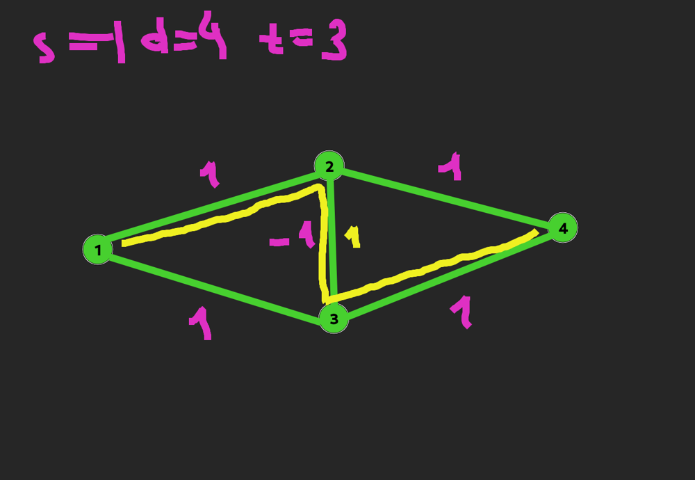
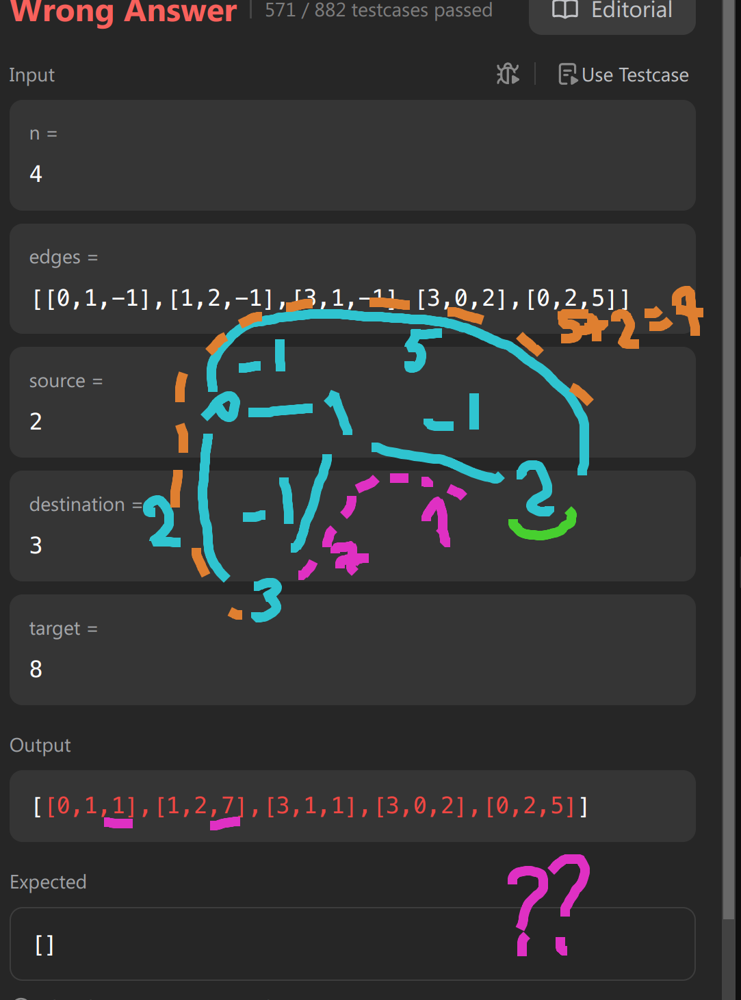

# Kotlin | Rust

**Author:** SamoylenkoDmitry
**Votes:** 1
**Link:** [https://leetcode.com/problems/modify-graph-edge-weights/solutions/5709968/](https://leetcode.com/problems/modify-graph-edge-weights/solutions/5709968/)

---


https://youtu.be/uX2Y_5P5b0s

#### Join me on Telegram

https://t.me/leetcode_daily_unstoppable/718

#### Problem TLDR

Assign vacant `-1` weight in graph to make shorted path equal `target` #hard #graph

#### Intuition

This is a kind of hard-hard problem. (and I failed it and have a hard time to understand the solution).

Some thoughts: 


* we should consider only the shortest paths
* shortest means we considering the weights (not just distances)

One corner case:

* we can't just choose `any` paths that equal to `target`, our path should be the shortest one

(At this point a gave up and checked @voturbac's solution)

* find shortest path excluding `-1` edges, it must not be larger than target
* find shortest path making all vacant edges to `1`, pick one of it and assign it's value to `1 + target - dist`

#### Approach

* relax and and steal

#### Complexity

- Time complexity:
$$O(E^2log(V))$$

- Space complexity:
$$O(EV)$$

#### Code

```kotlin []

    fun modifiedGraphEdges(n: Int, edges: Array<IntArray>, source: Int, destination: Int, target: Int): Array<IntArray> {
        val g = mutableMapOf<Int, MutableList<Pair<Int, Int>>>()
        for ((i, e) in edges.withIndex()) {
            g.getOrPut(e[0]) { mutableListOf() } += e[1] to i
            g.getOrPut(e[1]) { mutableListOf() } += e[0] to i
        }
        fun bfs(modify: Boolean): Pair<Int, Int> = PriorityQueue<Pair<Int, Int>>(compareBy({ it.first })).run {
            add(0 to source)
            val dist = IntArray(n) { Int.MAX_VALUE }; val modId = dist.clone()
            dist[source] = 0
            while (size > 0) {
                val (d, curr) = poll()
                for ((sibl, j) in g[curr] ?: listOf()) 
                    if ((modify || edges[j][2] != -1) && dist[sibl] > d + max(1, edges[j][2])) {
                        dist[sibl] = d + max(1, edges[j][2])
                        modId[sibl] = if (edges[j][2] == -1) j else modId[curr]
                        add(dist[sibl] to sibl)
                    }
            }
            dist[destination] to modId[destination]
        }
        val (dist, _) = bfs(false); if (dist < target) return arrayOf()
        while (true) {
            val (dist, modId) = bfs(true)
            if (dist > target) return arrayOf()
            if (dist == target) break
            edges[modId][2] = 1 + target - dist
        }
        for (e in edges) if (e[2] < 0) e[2] = 1
        return edges
    }

```
```rust []

    pub fn modified_graph_edges(n: i32, mut edges: Vec<Vec<i32>>, source: i32, destination: i32, target: i32) -> Vec<Vec<i32>> {
        let mut g: HashMap<i32, Vec<(i32, usize)>> = HashMap::new();
        for (i, e) in edges.iter().enumerate() {
            g.entry(e[0]).or_insert(Vec::new()).push((e[1], i));
            g.entry(e[1]).or_insert(Vec::new()).push((e[0], i));
        }
        fn bfs(g: &HashMap<i32, Vec<(i32, usize)>>, n: i32, edges: &Vec<Vec<i32>>, source: i32, destination: i32, modify: bool) -> (i32, i32) {
            let mut heap = BinaryHeap::new(); heap.push(Reverse((0, source)));
            let mut dist = vec![i32::MAX; n as usize]; let mut mod_id = dist.clone(); dist[source as usize] = 0;
            while let Some(Reverse((d, curr))) = heap.pop() { if let Some(neighbors) = g.get(&curr) {
                for &(sibl, j) in neighbors {
                    if (modify || edges[j][2] != -1) && dist[sibl as usize] > d + max(1, edges[j][2]) {
                        dist[sibl as usize] = d + max(1, edges[j][2]);
                        mod_id[sibl as usize] = if edges[j][2] == -1 { j as i32 } else { mod_id[curr as usize] };
                        heap.push(Reverse((dist[sibl as usize], sibl)));
                    }}}}
            (dist[destination as usize], mod_id[destination as usize])
        }
        let (dist, _) = bfs(&g, n, &edges, source, destination, false); if dist < target { return vec![]; }
        loop {
            let (dist, mod_id) = bfs(&g, n, &edges, source, destination, true);
            if dist > target { return vec![]; }
            if dist == target { break; }
            edges[mod_id as usize][2] = 1 + target - dist;
        }
        for e in &mut edges { if e[2] < 0 { e[2] = 1; } }; edges
    }

```