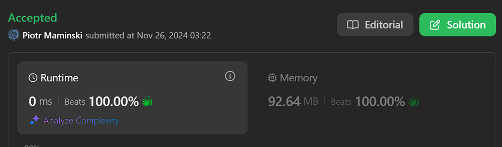
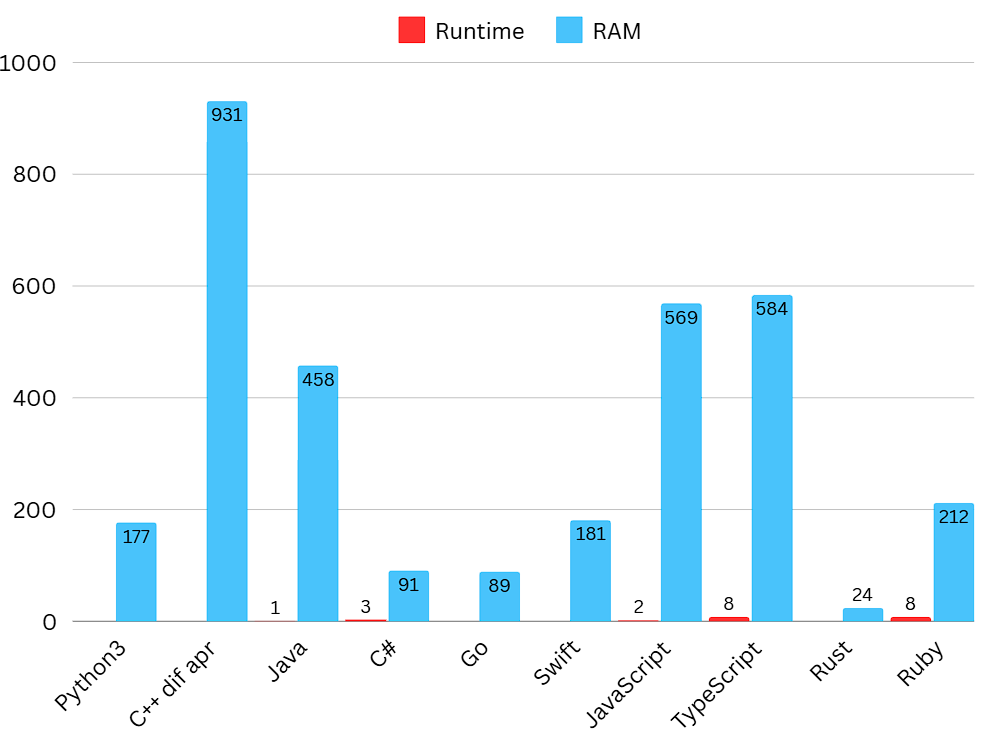
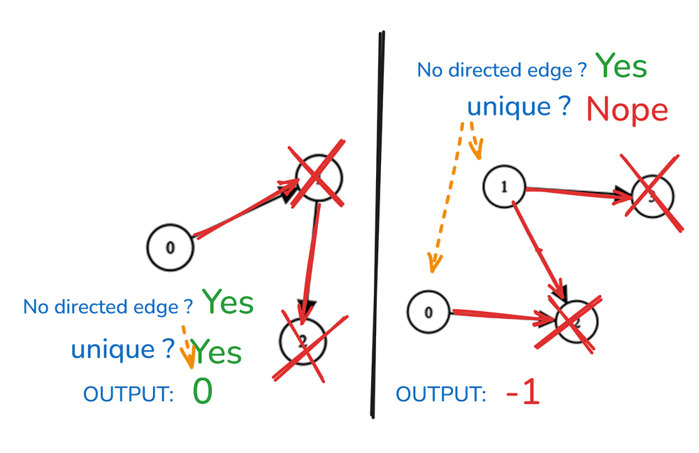

# ✅ Video | Beats 100% | Simple & Short

**Author:** Piotr_Maminski
**Votes:** 66
**Link:** [https://leetcode.com/problems/find-champion-ii/solutions/6083421/](https://leetcode.com/problems/find-champion-ii/solutions/6083421/)

---




https://youtu.be/HjSmSLPR7S4?si=LgiHBsl3AHKrlodL


# #1 Simple & Short (All beats 100% [[1]](https://leetcode.com/problems/find-champion-ii/submissions/1462861885)[[2]](https://leetcode.com/problems/find-champion-ii/submissions/1462875130)[[3]](https://leetcode.com/problems/find-champion-ii/submissions/1462875386)[[5]](https://leetcode.com/problems/find-champion-ii/submissions/1462876105)[[6]](https://leetcode.com/problems/find-champion-ii/submissions/1462876281)[[7]](https://leetcode.com/problems/find-champion-ii/submissions/1462876337)[[8]](https://leetcode.com/problems/find-champion-ii/submissions/1462876400)[[9]](https://leetcode.com/problems/find-champion-ii/submissions/1462876466)[[10]](https://leetcode.com/problems/find-champion-ii/submissions/1462932379) )
```python3 []
class Solution:
    def findChampion(self, n: int, edges: List[List[int]]) -> int:
        isUndefeated = [True] * n
        
        for winner, loser in edges:
            isUndefeated[loser] = False
            
        champion = -1
        championCount = 0
        
        for team in range(n):
            if isUndefeated[team]:
                champion = team
                championCount += 1
                
        if championCount == 1:
            return champion
            
        return -1
```
```cpp [C++v2]
class Solution {
public:
    int findChampion(int n, vector<vector<int>>& edges) {
        bitset<100> losses; 
        
        for (const auto& edge : edges) {
            losses.set(edge[1]);
        }
        
        int champion = -1;
        for (int i = 0; i < n; i++) {
            if (!losses[i]) {
                if (champion != -1) return -1;
                champion = i;
            }
        }
        
        return champion;
    }
};
```
```java []
class Solution {
    public int findChampion(int n, int[][] edges) {
        boolean[] isUndefeated = new boolean[n];
        Arrays.fill(isUndefeated, true);
        
        for (int[] edge : edges) {
            int winner = edge[0];
            int loser = edge[1];
            isUndefeated[loser] = false;
        }
        
        int champion = -1;
        int championCount = 0;
        
        for (int team = 0; team < n; team++) {
            if (isUndefeated[team]) {
                champion = team;
                championCount++;
            }
        }
        
        return championCount == 1 ? champion : -1;
    }
}
```
```csharp []
public class Solution {
    public int FindChampion(int n, int[][] edges) {
        bool[] isUndefeated = new bool[n];
        Array.Fill(isUndefeated, true);
        
        foreach (var edge in edges) {
            int winner = edge[0], loser = edge[1];
            isUndefeated[loser] = false;
        }
        
        int champion = -1;
        int championCount = 0;
        
        for (int team = 0; team < n; team++) {
            if (isUndefeated[team]) {
                champion = team;
                championCount++;
            }
        }
        
        return championCount == 1 ? champion : -1;
    }
}
```
```golang []
func findChampion(n int, edges [][]int) int {
    isUndefeated := make([]bool, n)
    for i := range isUndefeated {
        isUndefeated[i] = true
    }
    
    for _, edge := range edges {
        _, loser := edge[0], edge[1]
        isUndefeated[loser] = false
    }
    
    champion := -1
    championCount := 0
    
    for team := 0; team < n; team++ {
        if isUndefeated[team] {
            champion = team
            championCount++
        }
    }
    
    if championCount == 1 {
        return champion
    }
    return -1
}


```
```swift []
class Solution {
    func findChampion(_ n: Int, _ edges: [[Int]]) -> Int {
        var isUndefeated = Array(repeating: true, count: n)
        
        for edge in edges {
            let winner = edge[0], loser = edge[1]
            isUndefeated[loser] = false
        }
        
        var champion = -1
        var championCount = 0
        
        for team in 0..<n {
            if isUndefeated[team] {
                champion = team
                championCount += 1
            }
        }
        
        return championCount == 1 ? champion : -1
    }
}
```
```javascript [JS]
// JavaScript

var findChampion = function(n, edges) {
    const isUndefeated = new Array(n).fill(true);
    
    for (const [winner, loser] of edges) {
        isUndefeated[loser] = false;
    }
    
    let champion = -1;
    let championCount = 0;
    
    for (let team = 0; team < n; team++) {
        if (isUndefeated[team]) {
            champion = team;
            championCount++;
        }
    }
    
    return championCount === 1 ? champion : -1;
};
```
```typescript [TS]
// TypeScript

function findChampion(n: number, edges: number[][]): number {
    const isUndefeated: boolean[] = new Array(n).fill(true);
    
    for (const [winner, loser] of edges) {
        isUndefeated[loser] = false;
    }
    
    let champion: number = -1;
    let championCount: number = 0;
    
    for (let team = 0; team < n; team++) {
        if (isUndefeated[team]) {
            champion = team;
            championCount++;
        }
    }
    
    return championCount === 1 ? champion : -1;
}
```
```rust []
impl Solution {
    pub fn find_champion(n: i32, edges: Vec<Vec<i32>>) -> i32 {
        let n = n as usize;
        let mut is_undefeated = vec![true; n];
        
        for edge in edges {
            let winner = edge[0] as usize;
            let loser = edge[1] as usize;
            is_undefeated[loser] = false;
        }
        
        let mut champion = -1;
        let mut champion_count = 0;
        
        for team in 0..n {
            if is_undefeated[team] {
                champion = team as i32;
                champion_count += 1;
            }
        }
        
        if champion_count == 1 { champion } else { -1 }
    }
}
```
```ruby []
def find_champion(n, edges)
    is_undefeated = Array.new(n, true)
    
    edges.each do |winner, loser|
        is_undefeated[loser] = false
    end
    
    champion = -1
    champion_count = 0
    
    n.times do |team|
        if is_undefeated[team]
            champion = team
            champion_count += 1
        end
    end
    
    champion_count == 1 ? champion : -1
end
```


- Complexity: Time O(n + e) & Space O(n)


 
- C++ uses manual memory management with vectors that may **over-allocate** for growth, so I updated the solution but left the old graph for a fair comparison.


---

# #2 From Video


```python3 []
class Solution:
    def findChampion(self, n: int, edges: List[List[int]]) -> int:
        incoming = [0] * n

        for src, dst in edges:
            incoming[dst] += 1

        champions = []
        for i, incoming_cnt in enumerate(incoming):
            if not incoming_cnt:
                champions.append(i)

        if len(champions) > 1:
            return -1

        return champions[0]
```
```cpp []
class Solution {
public:
    int findChampion(int n, vector<vector<int>>& edges) {
        vector<int> incoming(n, 0);
        
        for (const auto& edge : edges) {
            incoming[edge[1]]++;
        }
        
        vector<int> champions;
        for (int i = 0; i < n; i++) {
            if (incoming[i] == 0) {
                champions.push_back(i);
            }
        }
        
        if (champions.size() > 1) {
            return -1;
        }
        
        return champions[0];
    }
};
```
```java []
class Solution {
    public int findChampion(int n, int[][] edges) {
        boolean[] isUndefeated = new boolean[n];
        Arrays.fill(isUndefeated, true);
        
        for (int[] edge : edges) {
            int winner = edge[0];
            int loser = edge[1];
            isUndefeated[loser] = false;
        }
        
        int champion = -1;
        int championCount = 0;
        
        for (int team = 0; team < n; team++) {
            if (isUndefeated[team]) {
                champion = team;
                championCount++;
            }
        }
        
        return championCount == 1 ? champion : -1;
    }
}
```
```csharp []
public class Solution {
    public int FindChampion(int n, int[][] edges) {
        bool[] isUndefeated = new bool[n];
        Array.Fill(isUndefeated, true);
        
        foreach (var edge in edges) {
            int winner = edge[0];
            int loser = edge[1];
            isUndefeated[loser] = false;
        }
        
        int champion = -1;
        int championCount = 0;
        
        for (int team = 0; team < n; team++) {
            if (isUndefeated[team]) {
                champion = team;
                championCount++;
            }
        }
        
        return championCount == 1 ? champion : -1;
    }
}
```
```golang []
func findChampion(n int, edges [][]int) int {
    incoming := make([]int, n)
    
    for _, edge := range edges {
        incoming[edge[1]]++
    }
    
    champions := []int{}
    for i, count := range incoming {
        if count == 0 {
            champions = append(champions, i)
        }
    }
    
    if len(champions) > 1 {
        return -1
    }
    
    return champions[0]
}
```
```swift []
class Solution {
    func findChampion(_ n: Int, _ edges: [[Int]]) -> Int {
        var incoming = Array(repeating: 0, count: n)
        
        for edge in edges {
            incoming[edge[1]] += 1
        }
        
        var champions: [Int] = []
        for (i, count) in incoming.enumerated() {
            if count == 0 {
                champions.append(i)
            }
        }
        
        return champions.count > 1 ? -1 : champions[0]
    }
}
```
```javascript [JS]
// JavaScript

var findChampion = function(n, edges) {
    const incoming = new Array(n).fill(0);
    
    for (const [src, dst] of edges) {
        incoming[dst]++;
    }
    
    const champions = [];
    for (let i = 0; i < incoming.length; i++) {
        if (incoming[i] === 0) {
            champions.push(i);
        }
    }
    
    return champions.length > 1 ? -1 : champions[0];
};
```
```typescript [TS]
// TypeScript

function findChampion(n: number, edges: number[][]): number {
    const incoming: number[] = new Array(n).fill(0);
    
    for (const [src, dst] of edges) {
        incoming[dst]++;
    }
    
    const champions: number[] = [];
    incoming.forEach((count, i) => {
        if (count === 0) {
            champions.push(i);
        }
    });
    
    return champions.length > 1 ? -1 : champions[0];
}
```
```rust []
impl Solution {
    pub fn find_champion(n: i32, edges: Vec<Vec<i32>>) -> i32 {
        let n = n as usize;
        let mut incoming = vec![0; n];
        
        for edge in edges {
            incoming[edge[1] as usize] += 1;
        }
        
        let champions: Vec<i32> = incoming
            .iter()
            .enumerate()
            .filter(|(_, &count)| count == 0)
            .map(|(i, _)| i as i32)
            .collect();
            
        if champions.len() > 1 {
            -1
        } else {
            champions[0]
        }
    }
}
```
```ruby []
def find_champion(n, edges)
    incoming = Array.new(n, 0)
    
    edges.each do |src, dst|
        incoming[dst] += 1
    end
    
    champions = []
    incoming.each_with_index do |count, i|
        champions << i if count == 0
    end
    
    champions.length > 1 ? -1 : champions[0]
end
```
- Complexity: Time O(n + e) & Space O(n)


# Explanation 

---

## Intuition

- We need to find a "team"  that the "edge" is not going to.
- If there is **one**, return team digit,
- If **more then one**, return **-1**



**And that's basically the whole problem.** It's described very complicatedly but that's all it is.

###  Approach #1

- n: number of teams (numbered 0 to n-1)
- edges: list of [winner, loser] pairs representing matches

1. Array where all teams **start as potential** champions

```
isUndefeated = [True] * n
```

2. Marks teams that have lost **at least one** match as defeated

```
for winner, loser in edges:
    isUndefeated[loser] = False
```

3. Counts how many undefeated teams remain, Keeps track of the last undefeated team found

```
champion = -1
championCount = 0

for team in range(n):
    if isUndefeated[team]:
        champion = team
        championCount += 1
```

5. Returns the champion if exactly one undefeated team exists, if many, rreturns **-1** 


```
if championCount == 1:
    return champion
return -1
```

Done. 


**UpVote** if you think it is helpful and will help others

---

## Graph Theory

- (IMO) the best explaining Video on graph from Google engineer.
https://youtu.be/09_LlHjoEiY?si=EKU-b9pAafWX1Wea

- [Directed Acylic Graph (wiki)](https://en.wikipedia.org/wiki/Directed_acyclic_graph)


####  [Interview Questions and Answers Repository](https://github.com/RooTinfinite/Interview-questions-and-answers)

