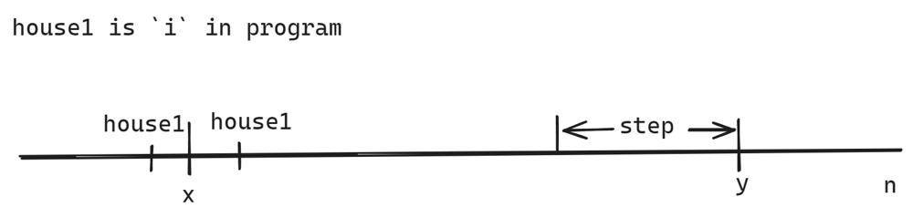

# fix house1-> generate intervals -> sweep line.  o(n) || short code

**Author:** imoonkin
**Votes:** 3
**Link:** [https://leetcode.com/problems/count-the-number-of-houses-at-a-certain-distance-ii/solutions/4600767/](https://leetcode.com/problems/count-the-number-of-houses-at-a-certain-distance-ii/solutions/4600767/)

---

# Intuition
<!-- Describe your first thoughts on how to solve this problem. -->
1. fix the `house1`, for every possible `house2 > house1`, find min distance, double result. (easy version of this problem)
2. observe: if there is no `x and y`, then for a given `house1`, min distance is `list=[1,2,3,4,5,..., n-house1]` for all `house2` that `house2 > house1`.
### now for a given house1
3. with `x and y`: `x and y` only take effect when we can take a shortcut from `house1` to `y`, that is` y-house1 > 1 + abs(house1-x)`. Because we are finding the min distance.


4. so, when there is a shortcut from `house1`, distance of all houses rightside of `y` should make use of this shortcut, distance of these hosues should be `1 + abs(house1 - x) + (house2 - y)`.
5. as for houses between `hosue1` and `y`, we check from `y` to `house1`, we have two distance: 
- (chosen at `y`) shorter distance of `y` is `1 + abs(house1 - x)`, increases as we move from `y` to `house1` if we take shortcut, and 
- (chosen later) the longer distance (`y-house1`) decreases as we move. 
8. So for each step we move from `y` to `hosue1`, the difference between the two distance decreases by 2. when below zero, the optimal choice changes to the other one.
9. That is to say: the distance of hosues from `y` to `house1` consists of two lists `left_half=[1,2,...,y-step] and right_half=[shortcut, shortcut+1, shortcut+2, ..., shortcut+step]`
# Approach
<!-- Describe your approach to solving the problem. -->
To get the final result, we need to count frequence of elements in these distance lists.
One approach is lazy propagation segment tree, which allows range modification. This is too complex for this problem.
We may think of sweep line for interval ops. The lists can be transfrom into intervals (continuous), then we can apply sweep line to get the value for each index.
# Complexity
- Time complexity:
<!-- Add your time complexity here, e.g. $$O(n)$$ -->
o(n)
- Space complexity:
<!-- Add your space complexity here, e.g. $$O(n)$$ -->

# Code
```
func abs(x int) int {
	if x < 0 {
		return -x
	}
	return x
}

type it struct {
	l, r int
}

func countOfPairs(n int, x int, y int) []int64 {
	if x > y {
		x, y = y, x
	}
    // generate intervals
	ret := []int64{}
	intervals := []it{}
	for i := 1; i < n; i++ {
		short := 1 + abs(i-x)
		if y-i > short { // shortcut
			if y<n{ // y to n
				intervals = append(intervals, it{short+1, short + n - y})
			}	
            t := y - i - short
			step := t / 2
			if t&1 == 1 {
				step++
			}
			intervals = append(intervals, it{short, short + step - 1}) // right half of house1 to y
			intervals = append(intervals, it{1, y - step - i}) // left half of house1 to y
		} else { // x y is not a shortcut
			intervals = append(intervals, it{1, n - i})
		}
	}
    // sweep line
	arr := make([]int64, n+1)
	for _, i := range intervals {
		arr[i.l]++
		arr[i.r+1]--
	}
	cur := int64(0)
	for k := 1; k <= n; k++ {
		cur += arr[k]
		ret = append(ret, 2*cur)
	}

	return ret
}
```