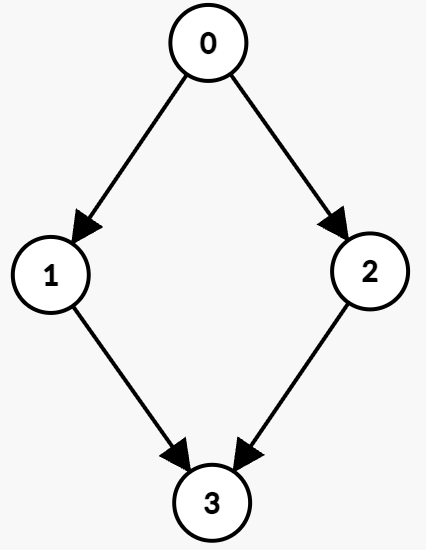

# [3604. Minimum Time to Reach Destination in Directed Graph](https://leetcode.com/problems/minimum-time-to-reach-destination-in-directed-graph/)

| Category | Difficulty | Likes | Dislikes |
| :------: | :--------: | :---: | :------: |
| Algorithms | Medium | 92 | 4 |

**Tags:** [`graph`](https://leetcode.com/tag/graph), [`heap-priority-queue`](https://leetcode.com/tag/heap-priority-queue), [`shortest-path`](https://leetcode.com/tag/shortest-path)

## Description

You are given an integer `n` and a **directed** graph with `n` nodes labeled from 0 to `n - 1`. This is represented by a 2D array `edges`, where `edges[i] = [u_i, v_i, start_i, end_i]` indicates an edge from node `u_i` to `v_i` that can **only** be used at any integer time `t` such that `start_i , take the edge `(1 &rarr; 2)` which is available from 2 to 5. You arrive at node 2 at time 3.

Hence, the minimum time to reach node 2 is 3.

**Example 2:**

**Input:** n = 4, edges = [[0,1,0,3],[1,3,7,8],[0,2,1,5],[2,3,4,7]]

**Output:** 5

**Explanation:**

The optimal path is:

	- Wait at node 0 until time `t = 1`, then take the edge `(0 &rarr; 2)` which is available from 1 to 5. You arrive at node 2 at `t = 2`.

	- Wait at node 2 until time `t = 4`, then take the edge `(2 &rarr; 3)` which is available from 4 to 7. You arrive at node 3 at `t = 5`.

Hence, the minimum time to reach node 3 is 5.

**Example 3:**

**Input:** n = 3, edges = [[1,0,1,3],[1,2,3,5]]

**Output:** -1

**Explanation:**

	- Since there is no outgoing edge from node 0, it is impossible to reach node 2. Hence, the output is -1.

 

**Constraints:**

	- `1 <= n <= 10^5`

	- `0 <= edges.length <= 10^5`

	- `edges[i] == [u_i, v_i, start_i, end_i]`

	- `0 <= u_i, v_i <= n - 1`

	- `u_i != v_i`

	- `0 <= start_i <= end_i <= 10^9`

---

**Links:** [Submissions](https://leetcode.com/problems/minimum-time-to-reach-destination-in-directed-graph/) | [Solutions](https://leetcode.com/problems/minimum-time-to-reach-destination-in-directed-graph/)
