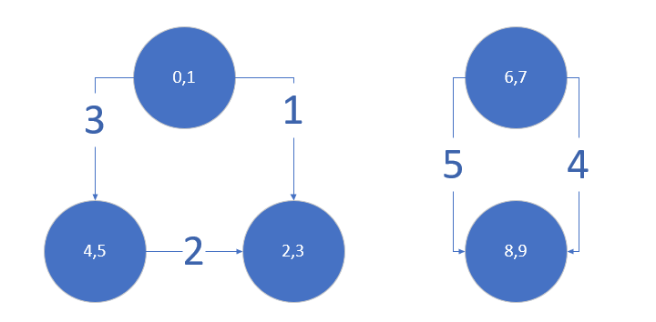

# Java, Union Find Solution with explanation, Time O(N) - 0ms, beats 100%

**Author:** devenps
**Votes:** 17
**Link:** [https://leetcode.com/problems/couples-holding-hands/solutions/600607/](https://leetcode.com/problems/couples-holding-hands/solutions/600607/)

---

I am taking a couple as a node, so there will be N nodes (2N people). Lets say for some j value(0<=j <N), 2j and 2j+1 are the positions. If couple is seated at these 2 positions, then we don't need any swap for this pair (this will be a isolated node), otherwise we need 1 swap for this pair so we will form an edge between nodes which these people are part of (for 3,7 value: 3 is part of <2,3> node and 7 is part of <6,7>). And for every union operation (or for an edge), we will keep incrementing the count and if it forms a cycle, then we don't need to incement the count (explained below with example). Finally the total count will be our answer.

If there is cycle present with k nodes, so if you break k-1 edges by swapping the elements, then last edge will break automatically.

For example: [1,2,3,4,5,0,7,8,9,6]
So when you break 1st,2nd edge (shown in the below diagram) by swapping pairs, then 3rd pair will automatically be sorted. Similarly when you break edge 4th, then 5th will be broken automatically.
[1,2,3,4,5,0,7,8,9,6] => [3,2,1,4,5,0,7,8,9,6] => [3,2,5,4,1,0,7,8,9,6] => [3,2,5,4,1,0,9,8,7,6]




I hope it helps.
Following is the implementation:
```
class Solution {
    public int minSwapsCouples(int[] row) {
        if (row == null || row.length < 2) return 0;

        int number = 0;
        DisjointSets disjointSets = new DisjointSets(row.length/2);
        for (int i = 0; i<row.length; i = i+2){
            if (!isCouple(row[i], row[i+1])){
                if (disjointSets.union(row[i]/2, row[i+1]/2)){
                    number++;
                }
            }
        }
        
        return number;
    }

    private boolean isCouple(int i, int j) {
        return (Math.min(i, j) & 1) == 0 && Math.abs(i - j) == 1;
    }
    
    public static class DisjointSets {
        public int[] parent;
        private int n;

        public DisjointSets(int n) {
            this.n = n;
            this.parent = new int[n];
            for (int i = 0; i < n; i++) {
                this.parent[i] = -1;
            }
        }

        public int find(int n) {
            if (parent[n] < 0) return n;
            parent[n] = find(parent[n]);
            return parent[n];
        }

        public boolean union(int x, int y) {
            int xp = find(x), yp = find(y);
            if (xp == yp) {
                return false;
            }

            if (Math.abs(parent[xp]) >= Math.abs(parent[yp])) {
                parent[xp] += parent[yp];
                parent[yp] = xp;
            } else {
                parent[yp] += parent[xp];
                parent[xp] = yp;
            }

            return true;
        }
    }
}
```