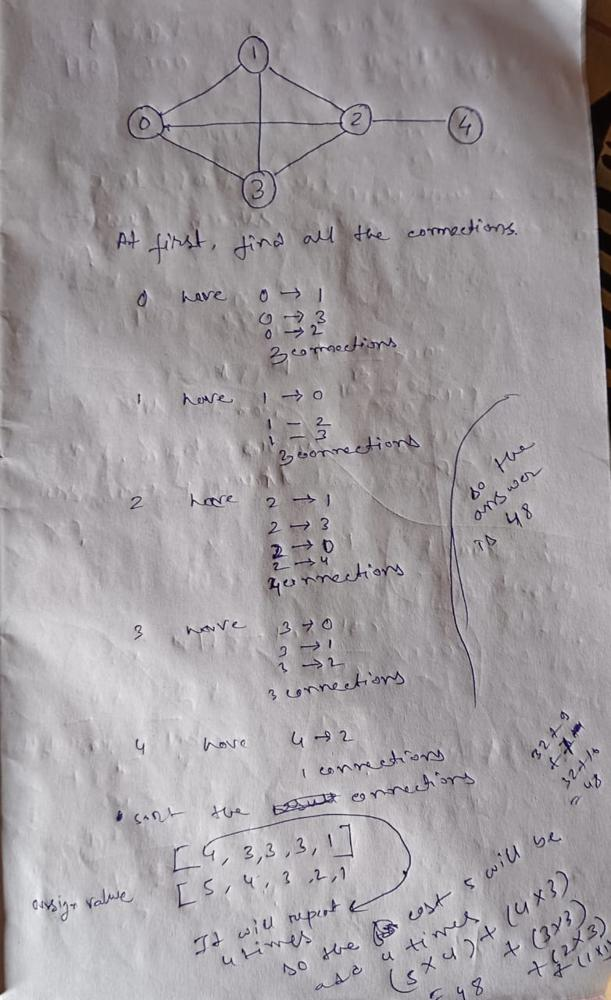

# EASY WITH EXPLANATION | JAVA 🍵 | JAVASCRIPT 💻 | C++🔧 | PYTHON3 🐍

**Author:** IamHazra
**Votes:** 92
**Link:** [https://leetcode.com/problems/maximum-total-importance-of-roads/solutions/5380397/](https://leetcode.com/problems/maximum-total-importance-of-roads/solutions/5380397/)

---

## Intuition \uD83E\uDDE0
The goal is to maximize the total importance of the roads by assigning importance values to cities. The importance of a road is the sum of the importance values of the two cities it connects. To achieve the maximum total importance, cities with more connections (higher degrees) should be assigned higher importance values.

## Approach \uD83D\uDE80
1. **Count Connections**: Traverse the list of roads and count the number of connections (roads) each city has. This can be stored in an array where each index represents a city, and the value at that index represents the number of roads connected to that city.
2. **Sort Connections**: Sort the array of connection counts in ascending order. This allows us to assign the smallest importance values to the cities with the fewest connections and the largest importance values to the cities with the most connections.
3. **Assign Importance**: Initialize a variable `cost` to 1, representing the lowest importance value. Iterate through the sorted connections array, multiplying each value by the current `cost`, and add the result to the total importance. Increment `cost` after each multiplication.
4. **Return Result**: The total importance calculated in the previous step is the maximum importance of the roads.

## Complexity \uD83D\uDCCA
- **Time complexity**: \\(O(n \\log n + m)\\), where \\(n\\) is the number of cities and \\(m\\) is the number of roads. Sorting the connections array takes \\(O(n \\log n)\\), and counting the connections takes \\(O(m)\\).
- **Space complexity**: \\(O(n)\\), where \\(n\\) is the number of cities. This is due to the space needed to store the connections array.



The image shows an example of a graph with 5 cities and several roads connecting them. Here\u2019s the detailed step-by-step approach based on the image:

1. **Count Connections**:
    - City 0 has 3 connections: to cities 1, 2, and 3.
    - City 1 has 3 connections: to cities 0, 2, and 3.
    - City 2 has 4 connections: to cities 0, 1, 3, and 4.
    - City 3 has 3 connections: to cities 0, 1, and 2.
    - City 4 has 1 connection: to city 2.

2. **Sort Connections**:
    - The connections array before sorting: \\([3, 3, 4, 3, 1]\\).
    - The connections array after sorting: \\([1, 3, 3, 3, 4]\\).

3. **Assign Importance**:
    - Assign importance values starting from 1.
    - City with 1 connection gets importance 1.
    - Cities with 3 connections get importance 2, 3, and 4.
    - City with 4 connections gets importance 5.
    - Importance values assigned: \\([1, 2, 3, 4, 5]\\).

4. **Calculate Total Importance**:
    - Multiply the sorted connections by their assigned importance values and sum them up.
    - Total importance = \\(1 \	imes 1 + 3 \	imes 2 + 3 \	imes 3 + 3 \	imes 4 + 4 \	imes 5 = 1 + 6 + 9 + 12 + 20 = 48\\).

## Code \uD83D\uDDA5\uFE0F


```java []
class Solution {
    public long maximumImportance(int n, int[][] roads) {
        long res = 0, cost = 1;
        long[] conn = new long[n];
        for (int[] road : roads) {
            conn[road[0]]++;
            conn[road[1]]++;
        }
        Arrays.sort(conn);
        for (long con : conn) {
            res += con * (cost++);
        }
        return res;
    }
}
```

```javascript []
/**
 * @param {number} n
 * @param {number[][]} roads
 * @return {number}
 */
var maximumImportance = function(n, roads) {
    let res = 0, cost = 1;
    let conn = new Array(n).fill(0);

    for (const road of roads) {
        conn[road[0]]++;
        conn[road[1]]++;
    }

    conn.sort((a, b) => a - b);

    for (const con of conn) {
        res += con * cost++;
    }
    return res;
};
```

```c++ []
class Solution {
public:
    long long maximumImportance(int n, vector<vector<int>>& roads) {
        long res = 0, cost = 1;
        vector<int> conn(n, 0);
        for (auto road : roads) {
            conn[road[0]]++;
            conn[road[1]]++;
        }
        sort(conn.begin(), conn.end());
        for (auto con : conn) res += con * (cost++);
        return res;
    }
};
```

```python []
class Solution:
    def maximumImportance(self, n: int, roads: List[List[int]]) -> int:
        res = 0
        cost = 1
        conn = [0] * n
        for road in roads:
            conn[road[0]] += 1
            conn[road[1]] += 1

        conn.sort()
        for con in conn:
            res += con * cost
            cost += 1
        return res
```
please upvote \uD83D\uDE0D


Happy coding \uD83C\uDF75\uD83E\uDDD1\u200D\uD83D\uDCBB


