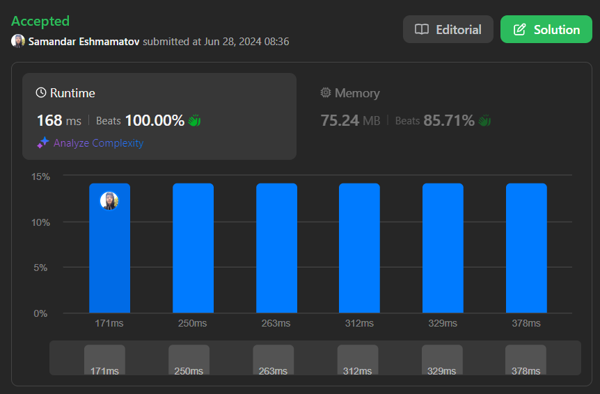
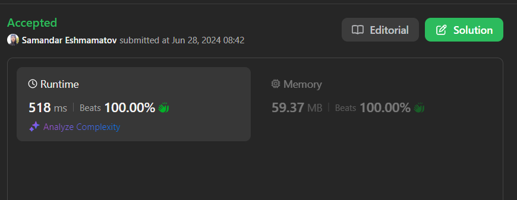
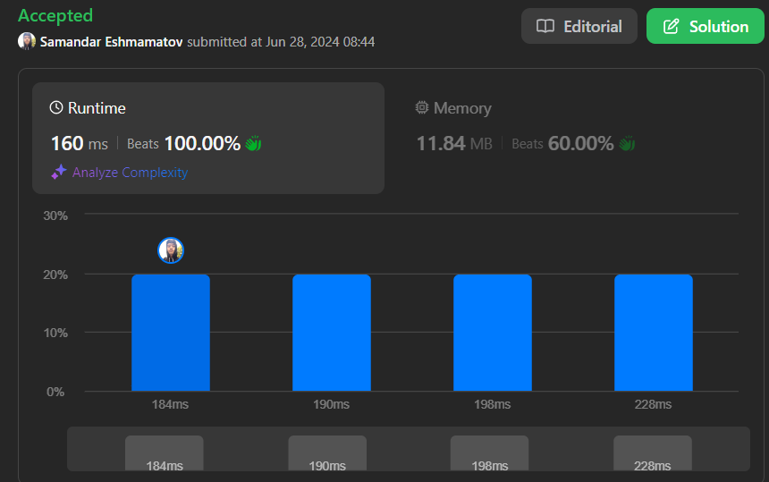

# 🥷🏻🔥 100% beats O(n) complexity, Go, Typescript, PHP, Javascript✔️😎

**Author:** samandareshmamatov
**Votes:** 6
**Link:** [https://leetcode.com/problems/maximum-total-importance-of-roads/solutions/5380520/](https://leetcode.com/problems/maximum-total-importance-of-roads/solutions/5380520/)

---

Typescript

PHP

Go



```javascript []
function maximumImportance(n, roads) {
    const roadCount = new Array(n).fill(0);

    for (const [a, b] of roads) {
        roadCount[a]++;
        roadCount[b]++;
    }

    roadCount.sort((a, b) => a - b);

    let totalImportance = 0;
    for (let i = 1; i <= n; i++) 
        totalImportance += i * roadCount[i - 1];

    return totalImportance;  
```
``` PHP []
class Solution {

    /**
     * @param Integer $n
     * @param Integer[][] $roads
     * @return Integer
     */
    function maximumImportance($n, $roads) {
        $roadCount = array_fill(0, $n, 0);

        foreach ($roads as $road) {
            $a = $road[0];
            $b = $road[1];
            $roadCount[$a]++;
            $roadCount[$b]++;
        }

        sort($roadCount);

        $totalImportance = 0;
        for ($i = 1; $i <= $n; $i++) {
            $totalImportance += $i * $roadCount[$i - 1];
        }

       return $totalImportance;
    }
}
```
```Go []
func maximumImportance(n int, roads [][]int) int64 {
	roadCount := make([]int, n)

	for _, road := range roads {
		a, b := road[0], road[1]
		roadCount[a]++
		roadCount[b]++
	}

	sort.Ints(roadCount)

	var totalImportance int64 = 0
	for i := 1; i <= n; i++ {
		totalImportance += int64(i) * int64(roadCount[i-1])
	}

	return totalImportance
}
```
```Typescript []
function maximumImportance(n: number, roads: number[][]): number {
    const roadCount = new Array(n).fill(0);

    for (const [a, b] of roads) {
        roadCount[a]++;
        roadCount[b]++;
    }

    roadCount.sort((a, b) => a - b);

    let totalImportance: number = 0;
    for (let i = 1; i <= n; i++) 
        totalImportance += i * roadCount[i - 1];

    return totalImportance;  
};
```