# [Java/C++] A reall Detailed Explanation

**Author:** hi-malik
**Votes:** 1016
**Link:** [https://leetcode.com/problems/longest-substring-without-repeating-characters/solutions/2133524/](https://leetcode.com/problems/longest-substring-without-repeating-characters/solutions/2133524/)

---

So, the prerequisit of this problem is **Sliding Window**, if you know then it's a plus point. But, if you don't know don't worry I'll try to teach you.

Let's understand first of all what the problem is saying!!
```
Given a string s, find the length of the longest substring without repeating characters.
```
Okay, so from the given statement we will try to find out wether it is a **Sliding Window** problem or not>>

So, to check that out I'm giving you a tempelate & it'll work in almost all of the questions of **sliding window**

```
To, find out a sliding window problem :-
> First thing is, we have given something like an "Array" | OR | "String"
> Second thing is, they are talking about either "subsequence" | OR | "substring"
> And third most thing is, either we have given a "window size i.e. k" | OR | we have to "manually find out window size" 
```

Now, using above keys let's understand wether this problem is of a sliding window or not.
```
> Are they talking about, "Array" or "String" --> yes they are talking about "string" +1 point
> Are they asking to find out "subsequence" or "substring" --> yes they are talking about "substring" +1 point
> Do, we have given a window size --> No, we don't have

Total score is "2 / 3" so, it's a 100% sliding window problem. If your score lies from 2/3 to 3/3 that's a gauranteed sliding window problem 
```

Now, let's talk about how we gonna implement sliding window in this problem, but before that I just want to tell you one more thing. There's exist basically 2 types of sliding window.
1. Fix size sliding window **{means K is given}**


2. Variable silze sliding window **{means K is not given}**

**Before moving to the problem I want to give you a template which you can use in any sliding window `{Variable size}` problem**

```
while(j < size()){

    // Calculation's happen's here
-----------------------------------------------
    if(condition < k){
        j++;
    }
-----------------------------------------------

-----------------------------------------------
    else if(condition == k){
        // ans <-- calculation
        j++;
    }
----------------------------------------------

----------------------------------------------
    else if(condition > k){
        while(condition > k){
            // remove calculation for i
            i++;
        }
        j++;
    }
----------------------------------------------
}
return ans;
```

So, in this problem we gonna deal with variable size sliding window. Let's take one example :-

```
Input: s = "abcabcbb"
Output: 3
```

So, inorder to solve this, what I'm thinking is, we should have to use one more Data Structure to store the occurence of these characters, I thing HashMap will be best to use.

* Now, what I'll do is create 2 pointer's i & j initally they both start from 0
* The j pointer will helps us to fill the array while the i pointer will helps in removing from the map {Don't know what I'm talking about} just wait. You'll understand :)

```
Let's understand it visually :-
```

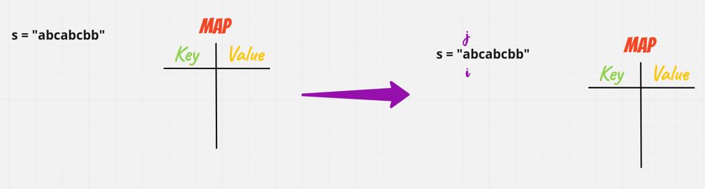

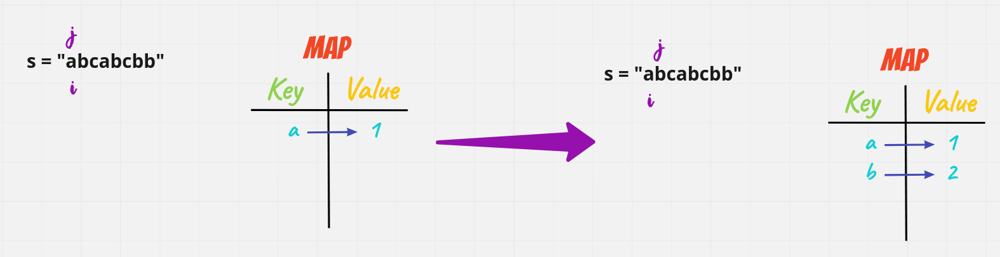

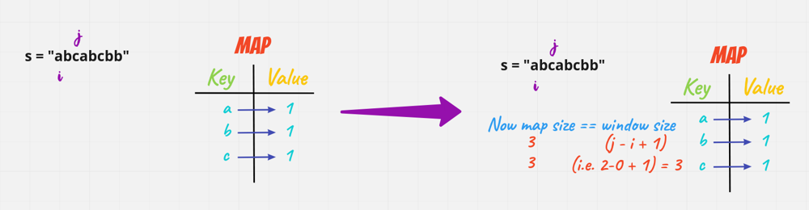

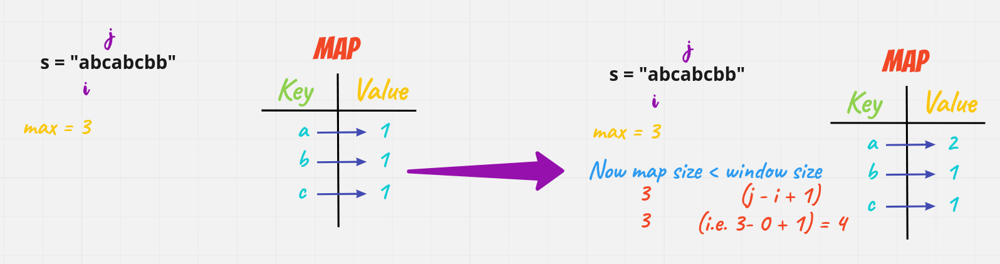

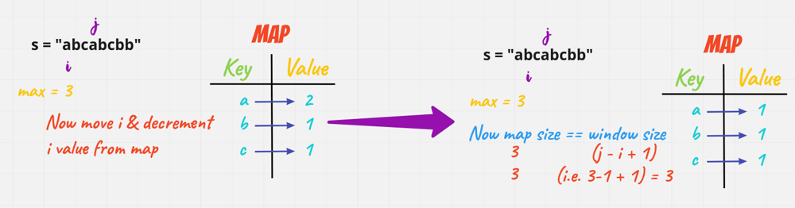

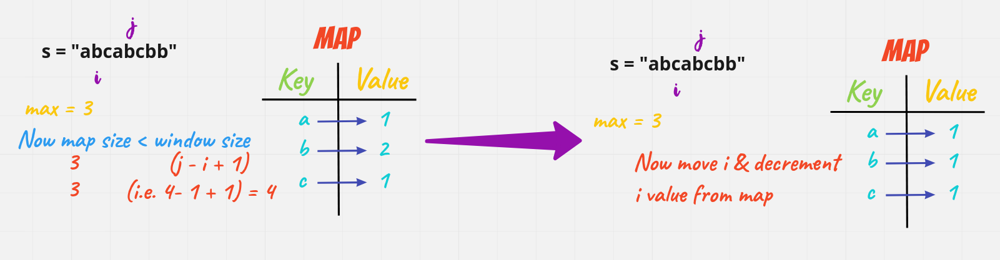

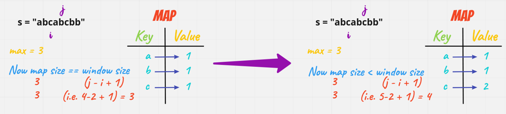

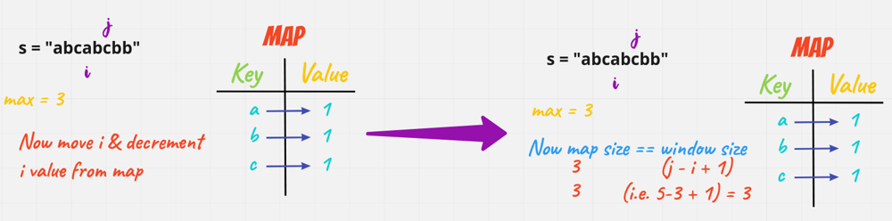

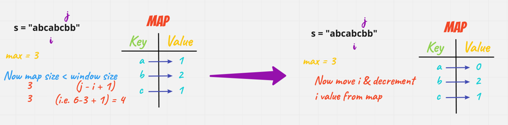

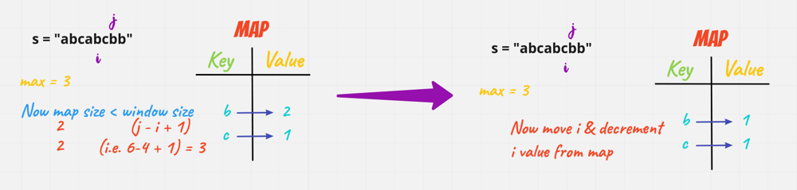

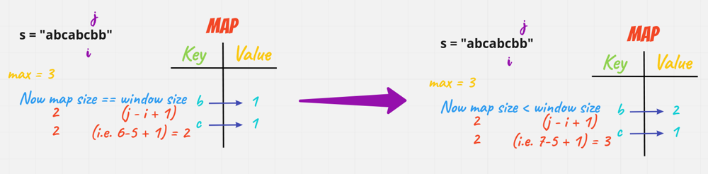

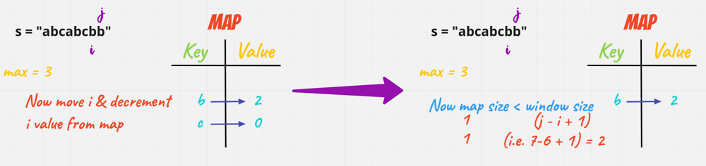

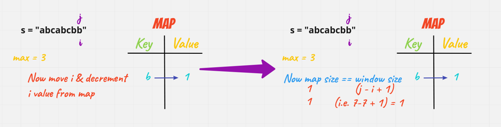

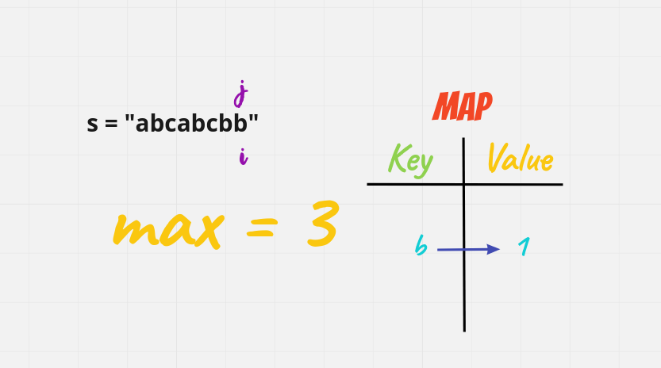


**Java**
```
class Solution {
    public int lengthOfLongestSubstring(String s) {
        Map<Character, Integer> map = new HashMap<>();
        int i = 0;
        int j = 0;
        int max = 0;
        while(j < s.length()){
            map.put(s.charAt(j), map.getOrDefault(s.charAt(j), 0) + 1);
            if(map.size() == j - i + 1){
                max = Math.max(max, j - i + 1);
                j++;
            }
            else if(map.size() < j - i + 1){
                while(map.size() < j - i + 1){
                    map.put(s.charAt(i), map.get(s.charAt(i)) - 1);
                    if(map.get(s.charAt(i)) == 0) map.remove(s.charAt(i));
                    i++;
                }
                j++;
            }
        }
        return max;
    }
}
```
**C++**
```
class Solution {
public:
    int lengthOfLongestSubstring(string s) {
        if(s.length()==0)return 0;   //if string of length zero comes simply return 0
        unordered_map<char,int> m;   //create map to store frequency,(get to know all unique characters
        int i=0,j=0,ans=INT_MIN; 
        while(j<s.length())   
        {
            m[s[j]]++;  //increase the frequency of the element as you traverse the string
            if(m.size()==j-i+1)  // whem map size is equal to the window size means suppose window size is 3 and map size is also three that means in map all unique characters are their
            {
                ans = max(ans,j-i+1);  //compare the length of the maximum window size
            }
            else if(m.size()<j-i+1)   //if the map size is less than the window size means there is some duplicate present like window size = 3 and map size = 2 means there is a duplicates
            {
                while(m.size()<j-i+1)  //so till the duplicates are removed completely
                {
                    m[s[i]]--;   //remove the duplicates
                    if(m[s[i]]==0)  //if the frequency becomes zero 
                    {
                        m.erase(s[i]);//delete it completely
                    }
                    i++;  //go for next element 
                }
            }
             j++;  //go for the next element
        }
        return ans;
    }
};
```