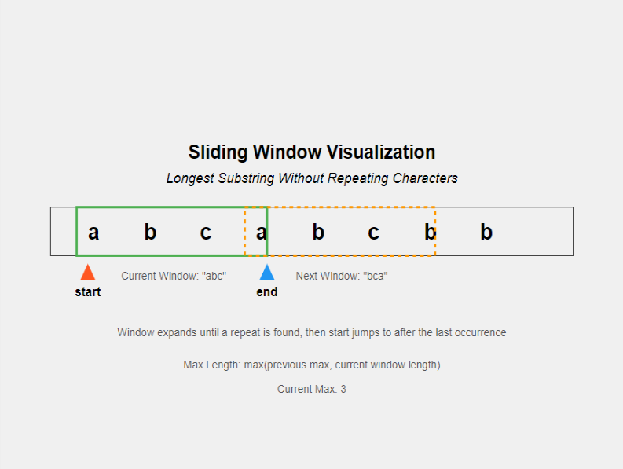
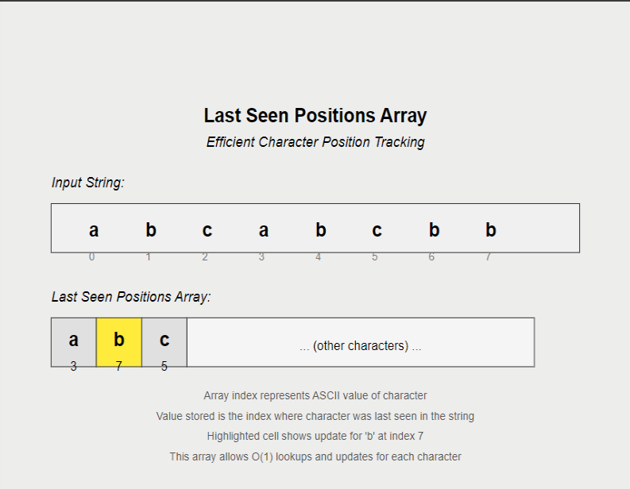
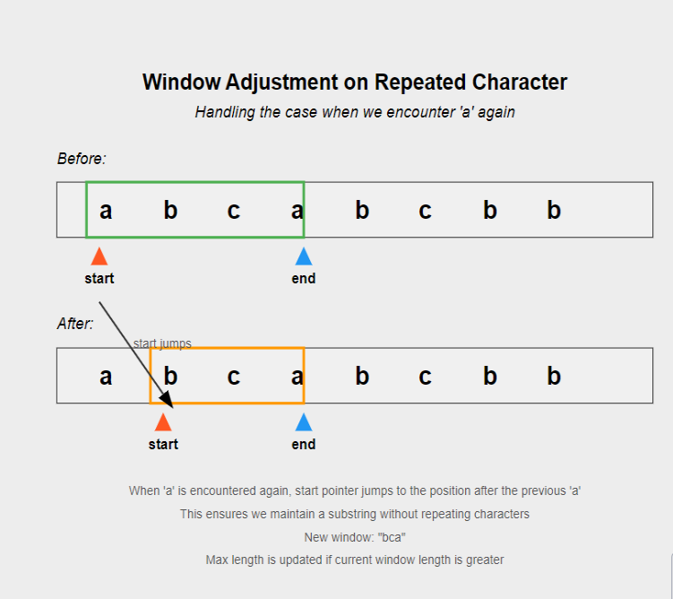
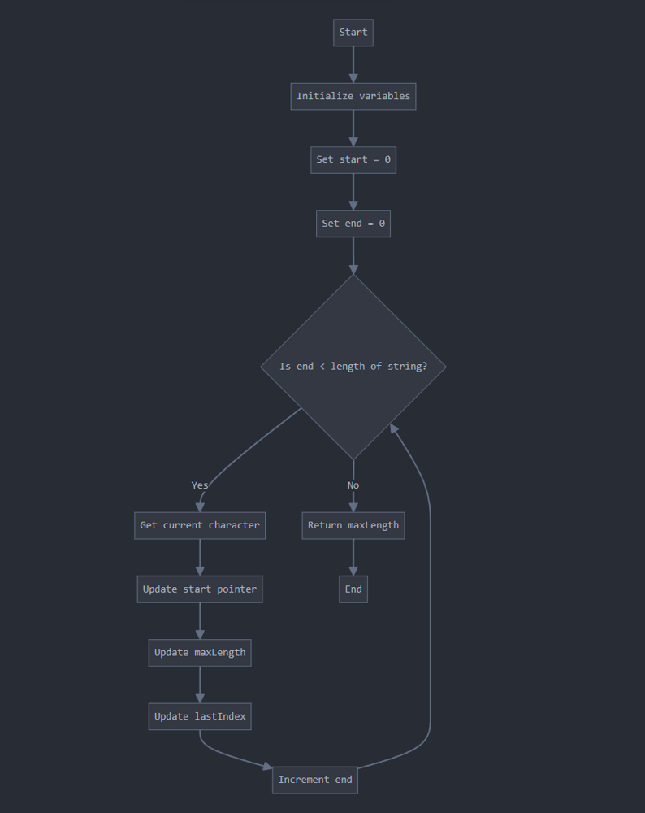
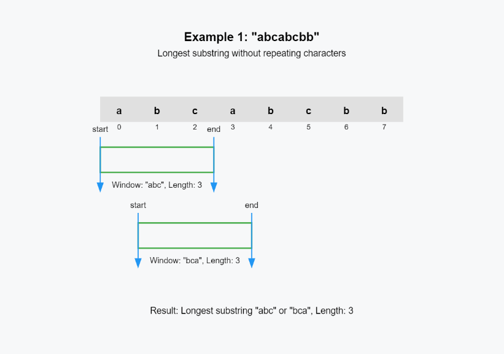
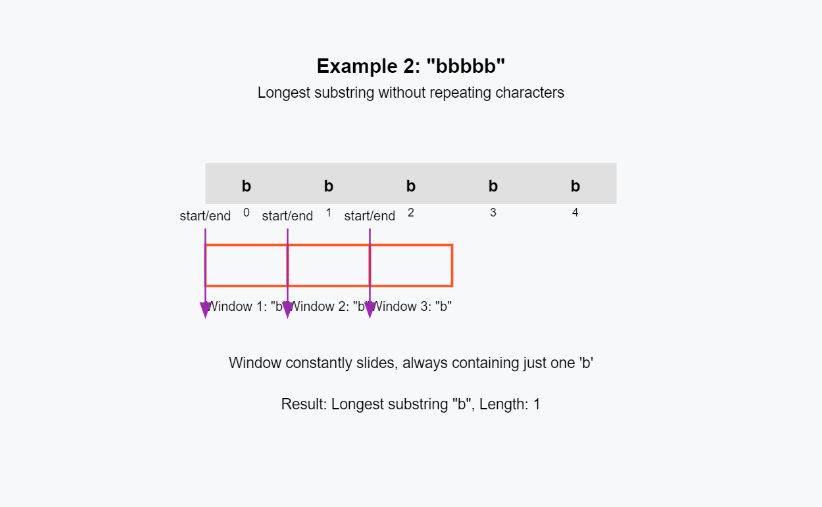
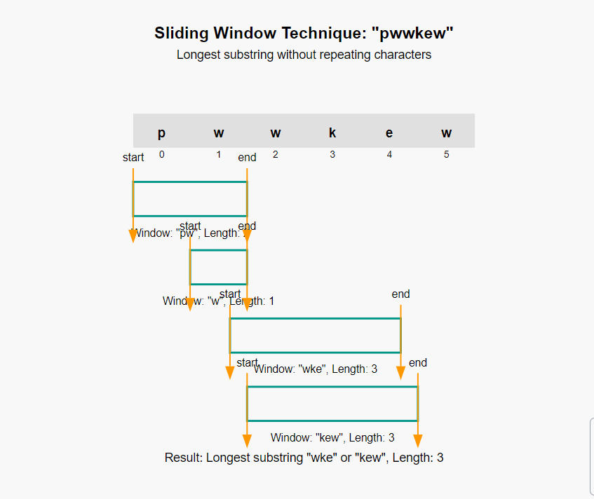

# O(n) | Beats 100 % | Sliding Window | Java | C++ | Python | Go | Rust | JavaScript

**Author:** kartikdevsharma_
**Votes:** 35
**Link:** [https://leetcode.com/problems/longest-substring-without-repeating-characters/solutions/5816760/](https://leetcode.com/problems/longest-substring-without-repeating-characters/solutions/5816760/)

---

## Intuition

The problem asks us to find the length of the **longest substring without repeating characters**. It might sound a bit technical at first, but we can break it down: 
Imagine you\u2019re given a string, like "abcabcbb". What we\u2019re really being asked is, "What\u2019s the longest continuous chunk of this string where no characters repeat?" For example, in "abcabcbb", the substring "abc" is the longest part where every character is different. So, in this case, the answer would be 3 because "abc" is made up of 3 unique characters.
We're looking for the longest substring without repeating characters - seems simple enough, right? But We need to find a stretch of characters where each character appears only once it gets tricky when you have repeating characters in the string, like in the case of "abcabcbb". As soon as you hit the second 'a', the substring is no longer valid because the 'a' already appeared earlier. So, we\u2019ll need to figure out how to handle those situations without missing the longest valid substring. That's our target. The challenge here is that we need to do this efficiently - we can't just check every possible substring, especially if the string is really long.

Our first instinct might be to use a brute force approach. We could check every possible substring, right? Start with the first character, then look at the first two, then the first three, and so on. For each substring, we'd check if it has any repeating characters. But let's think about this for a moment. For a string of length n, we'd be checking n(n+1)/2 substrings, and for each substring, we'd need to scan through its characters to check for duplicates. That's an O(n^3) time complexity - definitely not efficient, especially for longer strings!

So, we need to refine our approach. This is where the concept of a sliding window comes in handy. Instead of checking every substring from scratch, what if we "slide" over the string, expanding or shrinking our window as we go? The window represents the current substring we're looking at, and we try to keep it as long as possible while ensuring there are no repeating characters inside it.

Let's walk through this with an example, say "abcabcbb":

1. We start with 'a'. Our window is just "a" - no repeats, so we're good.
2. We move to 'b'. Window becomes "ab" - still no repeats.
3. Next is 'c'. Window is "abc" - all unique so far.
4. Now we hit another 'a'. Here's where it gets interesting. We can't just add this 'a' to our window because it would create a repeat. So, we need to shrink our window from the left until we remove the first 'a'.

This is a key insight: when we see a repeating character, we don't need to start all over. We can just adjust our window by moving the left boundary. This lets us keep track of longer substrings without recomputing everything from scratch.




But Every time we hit a repeat, we're sliding the left side of the window one character at a time until the repeat is gone.  What if we could jump directly to the right position instead of sliding one by one? We need a way to quickly know where we last saw each character. A hash map could work, but remember, we're dealing with characters here. There's only a limited number of possible characters. we can use an array instead of a hash map, with each index representing a character. It's like having a direct line to where we last saw each character. This array will store the last seen position of each character we encounter.




Now, let's think about how we'd use this array. As we move through the string with our end pointer, we're updating our array with the latest position of each character. But here's the magic - we can use this same array to update our start pointer. When we hit a repeated character, instead of slowly shrinking the window, we can jump our start pointer directly to the position after where we last saw the repeated character.

But what if we've already moved past the last occurrence of the repeated character? We don't want to jump backwards, do we? This is where we use a max operation. We set our start pointer to the max of its current position and the position after where we last saw the repeated character. This ensures we're always moving forward, never backward.




As we're doing all this, we're constantly updating our max length. Every time we move our end pointer, we check if this new substring is longer than our current max. It's like we're always ready to capture the longest substring at any moment.

Let's think about edge cases for a moment. What if the string is empty? Or what if it's all the same character? Our approach handles these naturally. If it's empty, we never enter our loop. If it's all the same character, our max length will be 1.

So:

>1. We keep two pointers - start and end - representing our current window.
>2. We maintain an array (let's call it lastIndex) to store the last seen position of each character.
>3. As we move the end pointer through the string:
	   - If the character at end is already in lastIndex and its position is after or at start, we need to jump start to skip over it.
	   - We update lastIndex with the current position of the character.
	   - We calculate the length of the current valid window (end - start + 1) and update our max length if needed.
>4. We continue this until end reaches the end of the string.

It only requires one pass through the string. We're doing all our work - updating last seen positions, moving our start pointer, and calculating our max length - all in one smooth motion through the string. In terms of space complexity, we're using a fixed-size array for our characters. This is much more efficient than storing substrings or using a variable-size data structure. Our time complexity is O(n) because we're only scanning through the string once, making this solution efficient even for very long strings.

## Approach

As i have already told in the intuition that core idea behind our solution is to use a sliding window approach combined with character indexing. This allows us to efficiently scan through the string once while keeping track of the longest valid substring we've encountered so far.

The sliding window technique involves maintaining two pointers:
1. A 'start' pointer that marks the beginning of our current substring.
2. An 'end' pointer that we move through the string, expanding our substring.

As we move the 'end' pointer, we're essentially expanding our window. When we encounter a repeated character, we need to contract our window by moving the 'start' pointer.

To  handle repeated characters, we use an array to keep track of the last seen position of each character. This allows us to quickly jump our 'start' pointer to the correct position when we encounter a repeat, rather than moving it incrementally.




### Initialization

```
n = length of s
maxLength = 0
lastIndex = array of 128 integers, all initialized to 0
start = 0
```

- We store the length of the input string in `n` for easy reference.
- `maxLength` will keep track of the longest valid substring we've seen so far.
- `lastIndex` is an array used to store the last seen position of each character. We use 128 as the size because it covers all ASCII characters. Each index in this array represents a character, and the value at that index represents the last position where we saw that character.
- `start` is initialized to 0, representing the start of our sliding window.

### Main Loop

```
for end = 0 to n-1:
    currentChar = s[end]
    start = max(start, lastIndex[currentChar])
    maxLength = max(maxLength, end - start + 1)
    lastIndex[currentChar] = end + 1
```

 We iterate through the string, moving our 'end' pointer from left to right.

1. `currentChar = s[end]`: We get the current character at the 'end' position.

2. `start = max(start, lastIndex[currentChar])`: This is a crucial step. We update our 'start' pointer to be the maximum of its current value and the last seen position of the current character plus one.

   - If we haven't seen this character before (or if we've seen it, but it's outside our current window), `lastIndex[currentChar]` will be less than `start`, so `start` remains unchanged.
   - If we have seen this character within our current window, `lastIndex[currentChar]` will be greater than or equal to `start`. In this case, we move `start` to the position just after where we last saw this character.

   This step effectively "jumps" our start pointer to the correct position when we encounter a repeat, ensuring our window always contains unique characters.

3. `maxLength = max(maxLength, end - start + 1)`: We update `maxLength` if our current window is longer than the previous longest substring.

4. `lastIndex[currentChar] = end + 1`: We update the last seen position of the current character. We use `end + 1` instead of `end` because it simplifies our logic in step 2 - it allows us to move `start` directly to the correct position without needing to add 1.

## Pseudo-code Algorithm


```
function lengthOfLongestSubstring(s):
    n = length of s
    maxLength = 0
    lastIndex = array of 128 integers, all initialized to 0
    start = 0
    
    for end = 0 to n-1:
        currentChar = s[end]
        start = max(start, lastIndex[currentChar])
        maxLength = max(maxLength, end - start + 1)
        lastIndex[currentChar] = end + 1
    
    return maxLength
```


 The longest substring without repeating characters ending at any position must be built from a valid substring ending at the previous position. By maintaining a sliding window, we're always building on our previous valid substrings. By using the `lastIndex` array, we can update our `start` pointer in constant time whenever we encounter a repeat. This is much more efficient than scanning back through the substring to find the repeated character. We only need to go through the string once. At each step, we're making a constant number of operations (updating `start`, `maxLength`, and `lastIndex`), resulting in a linear time complexity. We're using a fixed-size array for `lastIndex`, regardless of the input size. This gives us constant space complexity.

## Time and Space Complexity

- **Time Complexity: $O(n)$**, where n is the length of the input string. We make a single pass through the string, performing constant-time operations at each step.
- **Space Complexity: $O(1)$**. We use a fixed-size array of 128 integers, regardless of the input size. This is considered constant space.


## Code
```java []
class Solution {
    public int lengthOfLongestSubstring(String s) {
        int n = s.length();
        int maxLength = 0;
        int[] lastIndex = new int[128];
        
        for (int start = 0, end = 0; end < n; end++) {
            char currentChar = s.charAt(end);
            start = Math.max(start, lastIndex[currentChar]);
            maxLength = Math.max(maxLength, end - start + 1);
            lastIndex[currentChar] = end + 1;
        }
        
        return maxLength;
    }
}
//KDS
```

```C++ []
class Solution {
public:
    int lengthOfLongestSubstring(string s) {
        int n = s.length();
        int maxLength = 0;
        vector<int> lastIndex(128, 0);
        
        for (int start = 0, end = 0; end < n; end++) {
            char currentChar = s[end];
            start = max(start, lastIndex[currentChar]);
            maxLength = max(maxLength, end - start + 1);
            lastIndex[currentChar] = end + 1;
        }
        
        return maxLength;
    }
};
```
```Python []
class Solution:
    def lengthOfLongestSubstring(self, s: str) -> int:
        n = len(s)
        max_length = 0
        last_index = {}
        
        start = 0
        for end in range(n):
            current_char = s[end]
            start = max(start, last_index.get(current_char, 0))
            max_length = max(max_length, end - start + 1)
            last_index[current_char] = end + 1
        
        return max_length
```
```Go []
func lengthOfLongestSubstring(s string) int {
    n := len(s)
    maxLength := 0
    lastIndex := make([]int, 128)
    
    start := 0
    for end := 0; end < n; end++ {
        currentChar := s[end]
        if lastIndex[currentChar] > start {
            start = lastIndex[currentChar]
        }
        if end-start+1 > maxLength {
            maxLength = end - start + 1
        }
        lastIndex[currentChar] = end + 1
    }
    
    return maxLength
}
```
```Rust []
impl Solution {
    pub fn length_of_longest_substring(s: String) -> i32 {
        let mut max_length = 0;
        let mut last_index = [0; 128];
        let mut start = 0;
        
        for (end, ch) in s.chars().enumerate() {
            start = start.max(last_index[ch as usize]);
            max_length = max_length.max(end - start + 1);
            last_index[ch as usize] = end + 1;
        }
        
        max_length as i32
    }
}
```
```JavaScript []
/**
 * @param {string} s
 * @return {number}
 */
var lengthOfLongestSubstring = function(s) {
    let n = s.length;
    let maxLength = 0;
    let lastIndex = new Map();
    
    let start = 0;
    for (let end = 0; end < n; end++) {
        let currentChar = s[end];
        start = Math.max(start, lastIndex.get(currentChar) || 0);
        maxLength = Math.max(maxLength, end - start + 1);
        lastIndex.set(currentChar, end + 1);
    }
    
    return maxLength;
};
```


## Example
#### Example 1: **"abcabcbb"**



| Step | `end` | `start` | `currentChar` | `lastIndex[currentChar]` | `new start` | `window` | `maxLength` |
|------|-------|---------|---------------|--------------------------|-------------|----------|-------------|
| 1    | 0     | 0       | 'a'           | 0                        | 0           | "a"      | 1           |
| 2    | 1     | 0       | 'b'           | 0                        | 0           | "ab"     | 2           |
| 3    | 2     | 0       | 'c'           | 0                        | 0           | "abc"    | 3           |
| 4    | 3     | 0       | 'a'           | 1                        | 1           | "bca"    | 3           |
| 5    | 4     | 1       | 'b'           | 2                        | 2           | "cab"    | 3           |
| 6    | 5     | 2       | 'c'           | 3                        | 3           | "abc"    | 3           |
| 7    | 6     | 3       | 'b'           | 5                        | 5           | "b"      | 3           |
| 8    | 7     | 5       | 'b'           | 6                        | 6           | "b"      | 3           |

**Result:** The maximum valid window without repeating characters is `"abc"`, with a length of `3`.


#### Example 2: **"bbbbb"**




| Step | `end` | `start` | `currentChar` | `lastIndex[currentChar]` | `new start` | `window` | `maxLength` |
|------|-------|---------|---------------|--------------------------|-------------|----------|-------------|
| 1    | 0     | 0       | 'b'           | 0                        | 0           | "b"      | 1           |
| 2    | 1     | 0       | 'b'           | 1                        | 1           | "b"      | 1           |
| 3    | 2     | 1       | 'b'           | 2                        | 2           | "b"      | 1           |
| 4    | 3     | 2       | 'b'           | 3                        | 3           | "b"      | 1           |
| 5    | 4     | 3       | 'b'           | 4                        | 4           | "b"      | 1           |

**Result:** The longest substring without repeating characters is `"b"`, with a length of `1`.


#### Example 3: **"pwwkew"**




| Step | `end` | `start` | `currentChar` | `lastIndex[currentChar]` | `new start` | `window` | `maxLength` |
|------|-------|---------|---------------|--------------------------|-------------|----------|-------------|
| 1    | 0     | 0       | 'p'           | 0                        | 0           | "p"      | 1           |
| 2    | 1     | 0       | 'w'           | 0                        | 0           | "pw"     | 2           |
| 3    | 2     | 0       | 'w'           | 2                        | 2           | "w"      | 2           |
| 4    | 3     | 2       | 'k'           | 0                        | 2           | "wk"     | 2           |
| 5    | 4     | 2       | 'e'           | 0                        | 2           | "wke"    | 3           |
| 6    | 5     | 2       | 'w'           | 3                        | 3           | "kew"    | 3           |

**Result:** The longest substring without repeating characters is `"wke"` or `"kew"`, both with a length of `3`.