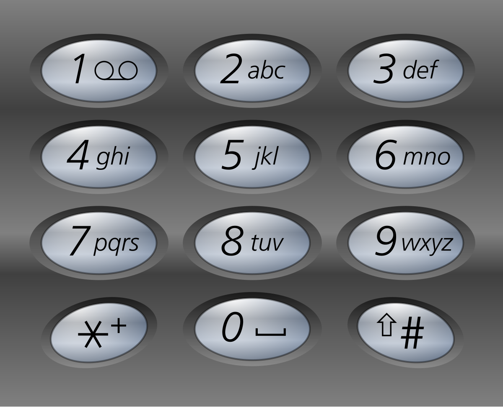

# [17. Letter Combinations of a Phone Number](https://leetcode.com/problems/letter-combinations-of-a-phone-number/)

| Category | Difficulty | Likes | Dislikes |
| :------: | :--------: | :---: | :------: |
| Algorithms | Medium | 20531 | 1112 |

**Tags:** [`hash-table`](https://leetcode.com/tag/hash-table), [`string`](https://leetcode.com/tag/string), [`backtracking`](https://leetcode.com/tag/backtracking)

**Companies:** `amazon`, `linkedin`, `google`, `microsoft`, `facebook`, `apple`, `bloomberg`, `uber`, `oracle`, `visa`, `epic-systems`, `goldman-sachs`, `servicenow`, `de-shaw`, `accenture`, `adobe`, `ibm`, `tesla`, `siemens`, `yandex`, `swiggy`, `citadel`, `tiktok`, `flexport`, `zoho`, `societe-generale`, `dropbox`

## Description

Given a string containing digits from `2-9` inclusive, return all possible letter combinations that the number could represent. Return the answer in **any order**.

A mapping of digits to letters (just like on the telephone buttons) is given below. Note that 1 does not map to any letters.



 

**Example 1:**

```

Input: digits = &quot;23&quot;
Output: [&quot;ad&quot;,&quot;ae&quot;,&quot;af&quot;,&quot;bd&quot;,&quot;be&quot;,&quot;bf&quot;,&quot;cd&quot;,&quot;ce&quot;,&quot;cf&quot;]

```

**Example 2:**

```

Input: digits = &quot;2&quot;
Output: [&quot;a&quot;,&quot;b&quot;,&quot;c&quot;]

```

 

**Constraints:**

	- `1 <= digits.length <= 4`

	- `digits[i]` is a digit in the range `['2', '9']`.

---

**Links:** [Submissions](https://leetcode.com/problems/letter-combinations-of-a-phone-number/) | [Solutions](https://leetcode.com/problems/letter-combinations-of-a-phone-number/)
