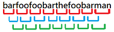

# Python || Easily Understood ✅ || Faster than 96% || Less than 78% || O(nm)

**Author:** wingskh
**Votes:** 60
**Link:** [https://leetcode.com/problems/substring-with-concatenation-of-all-words/solutions/2419817/](https://leetcode.com/problems/substring-with-concatenation-of-all-words/solutions/2419817/)

---

Method: `Hash Table`

First we can create a `dict` to store the occurrence times for each word in `words`.

For example,
If `s = "barfoofoobarthefoobarman"` and `words = ["bar","foo","the"]`, 
the dict will be `word_count = {'bar': 1, 'foo': 1, 'the': 1}`,

Since all the strings stored in `words` have the same length, the size of **sliding window** will be the word length of a single string. In the example above, the **sliding window** will be `3`


```
bar -> foo -> foo -> bar -> the -> foo -> bar -> man
ignore b -> arf -> oof -> oob -> art -> hef -> oob -> arm -> ignore an
ignore ba -> rfo -> ofo -> oba -> rth -> efo -> oba -> rma -> ignore n
```
Then, we can scan `s` in these 3 ways one by one

Let the word in **sliding window** be `word`.
Also, we will create a `queue` to store the scan history.
```
1) word_count.get(word, 0) >= 0 
    -> word_count[word] -= 1 as it uses one of the string in words
	-> queue.append(word)
	
2) word_count.get(word, 0) == 0 
    -> while queue.pop()
		-> queue.pop() == word
			-> queue.append(queue.pop()) # Only the beginning word is dropped, the remaining words are still in use
			-> break
		-> queue.pop() != word
			# Since the beginning word is dropped, the count of beginning word should be added 1.
			-> word_dict[last_element] += 1
				-> word_dict[last_element] exceeds its original value, reset the whole word_dict
			-> continue
```
Code:
```
from collections import deque, defaultdict

class Solution:
    def findSubstring(self, s: str, words: List[str]) -> List[int]:
        word_len = len(words[0])
        ori_word_dict = defaultdict(int)
		
        for word in words:
            ori_word_dict[word] += 1
        
        all_word_len = len(words) * word_len
        result = []
        for i in range(word_len):
            queue = deque()
            word_dict = ori_word_dict.copy()
            for j in range(i, len(s) - word_len + 1, word_len):
                word = s[j:j + word_len]
                if word_dict.get(word, 0) != 0:
                    word_dict[word] -= 1
                    queue.append(word)
                    if sum(word_dict.values()) == 0:
                        result.append(j - all_word_len + word_len)
                        last_element = queue.popleft()
                        word_dict[last_element] = word_dict.get(last_element, 0) + 1
                else:
                    while len(queue):
                        last_element = queue.popleft()
                        if last_element == word:
                            queue.append(word)
                            break
                        else:
                            word_dict[last_element] = word_dict.get(last_element, 0) + 1
                            if word_dict[last_element] > ori_word_dict[last_element]:
                                word_dict = ori_word_dict.copy()

        return result
```

Let `n` be the length of a word in `words`
and `m` be the total number of words in `words`

**Time complexity**: `O(n * m)`
**Space complexity**: `O(n + m)`
<br/>