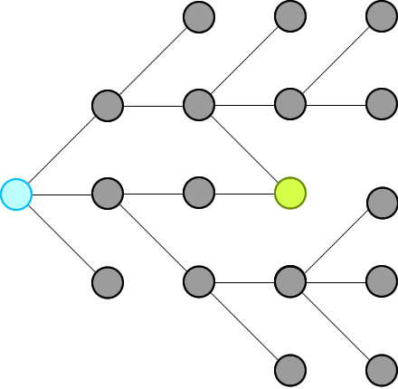
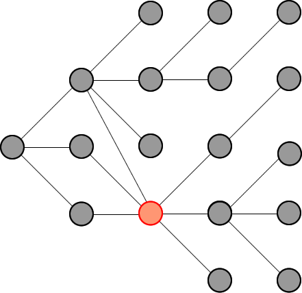

# ✔️ Explanation with Animation - Accepted without TLE!

**Author:** timcodex
**Votes:** 62
**Link:** [https://leetcode.com/problems/word-ladder-ii/solutions/2424910/](https://leetcode.com/problems/word-ladder-ii/solutions/2424910/)

---

# Intuition
We just need to record all possible words that can connect from the beginning, level by level, until we hit the end at a level.



Then we will traverse backward from end via the words in the record and construct our final ways.

**Remember:** we will not record paths, we record only nodes. 

_____
# Explanation
First, because we traverse level by level, so as soon as we see the end, that is the shortest distance (shortest path) we have from beginning. This is the basic theorem of BFS in an unweighted graph: https://sneeit.com/graph/?tab=documentation#breath-first-search-in-graph

When we see the end, we know some of the nodes from previous level (which connect to the beginning because we traversed from there) are pointing to the end. We just need to move backward, level by level then we could collect all paths to end from begin
_____
# Why Other's Solutions Get TLE
Because if there are some nodes point to a same node, their solutions keep computing the same path again and again due to they see those paths are different (from the beginning node). This is the weakness of recording paths, instead of nodes.

Check the red node in the following figure for more information:



In summary:
1. Other solutions:
	* Store paths, so every node could be stored multiple times.
	* Compute the intersections in paths again and again
	* Paths that does not lead to end also be computed
2. My solution:
	* Store only nodes so every node is store exactly one time
	* Move backward to compute only the paths that can connect from begin to end

_____
# Algorithm
* **Moving Forward: start from begin**
	1. Each level, find all connected nodes to the nodes of the current level in the record and add those to the record for the next level.
	2. Delete node from wordList to prevent revisiting and forming cycles
	3. Repeat the above steps until we reach end or we add no new nodes to the record for next level

* **Moving Backward: start from end**
	1. Do the same steps as moving forward but this time we will not record nodes but contruct our paths
	2. Construct paths in reversing order to have paths from begin to end
_____

# Codes
_____

## JavaScript

```
var findLadders = function(beginWord, endWord, wordList) {
    // to check if two words can connect
    let connected = (a,b) => {
        let c = 0
        for (let i = 0; i < a.length && c < 2; i++) {
            if (a[i] !== b[i]) c++
        }
        return c == 1
    }

    // dictionary to help us search words faster
    // and to trackback what word was used
    let dict = new Set(wordList);
    if (dict.has(endWord) == false) return []

    dict.delete(beginWord)
    let queue = [beginWord]
    let nodes = []

    
    // find all ways from beginning
    // level by level, until reach end at a level
    let reached = false;    
    while (queue.length && !reached) {
        // update nodes of paths for this level
        nodes.push(queue.slice())

        // access whole level   
        let qlen = queue.length;
        for (let i = 0; i < qlen && !reached; i++) {

            let from = queue.shift();
            
            // find all nodes that connect to the nodes of this level
            for (let to of dict) {                

                if (connected(from,to) == false) continue

                // if connect
                // - and one of them is end word
                // - then we can stop moving forward
                if (to == endWord) {
                    reached = true
                    break;
                }

                // - otherwise,
                // - add all connected nodes to the record for the next level
                // - and delete them from dict to prevent revisiting to form cycles
                queue.push(to)                
                dict.delete(to)                
            }
        }
    }

    // try but did not find endWord
    if (!reached) return []

    // move backward to construct paths
    // add nodes to paths in reverse order to have paths from begin to end
    let ans = [[endWord]]
    for (let level = nodes.length - 1; level >= 0; level--) {        
        let alen = ans.length
        for (let a = 0; a < alen; a++) {
            let p = ans.shift()
            let last = p[0]            
            for (let word of nodes[level]) {                
                if (!connected(last, word)) continue                
                ans.push([word, ...p])
            }
        }        
    }

    return ans
}
```

____
## C++
This is my first C++ code. Hope you can suggest optimizations . Thanks.
```
class Solution {
public:
    bool isConnected(string s,string t){
        int c=0;
        for(int i=0;i<s.length();i++)
            c+=(s[i]!=t[i]);
        return c==1;
    }

    vector<vector<string>> findLadders(string beginWord, string endWord, vector<string>& wordList) {
        vector<vector<string>> ans;        
        vector<vector<string>> nodes;   
        unordered_set<string> dict(wordList.begin(),wordList.end());
        
        if (!dict.count(endWord)) return ans;
        dict.erase(beginWord);
        
        
        bool reached = false;
        nodes.push_back({beginWord});
        
        while (dict.size() && !reached) {                        
            vector<string> last = nodes.back();
            vector<string> curr;
                        
            for (int i = 0; i < last.size() && !reached; i++) {
                unordered_set<string> visited;
                string from = last[i];                                
                // check all nodes that connect
                // to the nodes of the previous level                
                for (auto& to : dict) {                    
                    if (visited.count(to)) continue;
                    if (!isConnected(from, to)) continue;                                        
                    // if one of them is "endWord" then we can stop 
                    // because this level is the shortest distance from begin
                    if (to == endWord) {                        
                        reached = true; 
                        break;
                    }
                    
                    // otherwise,
                    // add nodes for the current level
                    curr.push_back(to);   
                    visited.insert(to);                    
                }   
                // delete the visited to prevent forming cycles            
                for (auto& visited : visited) {                
                    dict.erase(visited);
                }
            }
            
            // found endWord this level
            if (reached) break;
            
            // can not add any new nodes to our level
            if (!curr.size()) break;
            
            // otherwise, record all nodes for the current level
            nodes.push_back(curr);            
        }
        
        // try but not find
        if (reached == false) return ans;
        
        // move backward
        ans.push_back({endWord});          
        for (int level = nodes.size() - 1; level >= 0; level--) {                        
            int alen = ans.size();
            while (alen) {
                vector<string> path = ans.back();
                ans.pop_back();
                string from = path.front();                
                for (string &to : nodes[level]) {                    
                    if (!isConnected(from, to)) continue;
                                        
                    vector<string> newpath = path;
                    newpath.insert(newpath.begin(), to);
                    ans.insert(ans.begin(), newpath);
                }    
                alen--;
            }             
        }
        return ans;
    }
};
```
____
## Pseudocode
```
// Pseudocode
function findLadders(beginWord, endWord, wordList) {
    if (wordList.hasNo(endWord)) return []
    wordList.delete(beginWord)

    // move forward
    queue = [beginWord]
    paths = [] // 2D array
    reached = false;    
    while (queue.length && !reached) {
        paths.append(queue) // deep copy
        
        // need static here to access only the nodes of this level
        qlen = queue.length; 
        for (let i = 0; i < qlen && !reached; i++) {
            from = queue.takeFirst()
            forEach (to of wordList) {
                if (isConnected(from, to)) {                    
                    if (to == endWord) {
                        reached = true
                        break // exit from the forEach
                    }
                                    
                    queue.push(to) 
                    wordList.delete(to) // delete to preven a cycle 
                }
            }
        }
    }

    // can not reach the end eventually
    if (!reached) return []

    // move backward
    answer = [[endWord]] // 2D array    
    for (level = paths.length - 1; level >= 0; level--) {        
        path = paths[level]
        alen = answer.length
        for (a = 0; a < alen; a++) {
            p = answer.takeFirst()
            last = p[0]
            forEach (word of path) {
                if (!isConnected(last, word)) {
                    answer.append([word, ...p])
                }
                
            }
        }        
    }

    return answer
}


// to check if two words can connect
function isConnected(a,b) {
    c = 0
    for (i = 0; i < a.length && c < 2; i++) {
        if (a[i] !== b[i]) c++
    }
    return c == 1
}
```

____
