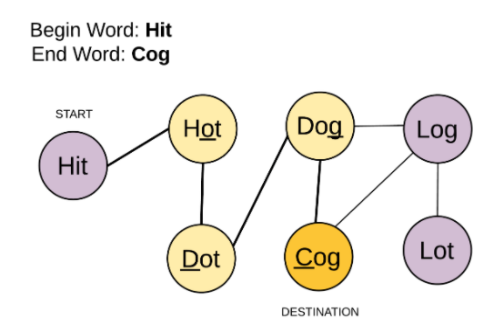

# Easy BFS in C++ with explanation :-

**Author:** soumakpoddar
**Votes:** 115
**Link:** [https://leetcode.com/problems/word-ladder/solutions/898086/](https://leetcode.com/problems/word-ladder/solutions/898086/)

---

We can easily solve this problem using BFS with the following steps :-
* At the very first we check weather our endWord is present in the word list or not. If not then we return 0.
* First of all we have to see that how we can form a graph for the given question -> The first node in the graph will be our begin word and the last node as the endWord.
* For each node's neighbour we transform at most one character in the node's string and check weather it is present in our wordList or not. Then, the transformed word forms the neighbour of the given node.

The above is the graph we have constructed...

**Now we will see how can we apply BFS to the above constructed graph -**
* First of all insert the beginWord to the queue.
* Then for each level in the queue we increase the depth variable as indicated in the code as 'd' by one.
* Then we replace each character of the top of the queue and check it with the endWord.
* If present we return 'd'+1, else we  insert the transformed word in the queue and remove the transformed word from the wordList....
**And that's it.....U are done...**
```
class Solution {
public:
    int ladderLength(string beginWord, string endWord, vector<string>& wordList)
    {
        if(find(wordList.begin(),wordList.end(),endWord)==wordList.end())
            return 0;
        set<string> s;
        for(auto i:wordList)
            s.insert(i);
        queue<string> q;
        q.push(beginWord);
        int d=0;
        while(!q.empty())
        {
            d++;
            int n=q.size();
            while(n--)
            {
                string curr=q.front();
                q.pop();
                for(int i=0;i<curr.length();i++)
                {
                    string tmp=curr;
                    for(char c='a';c<='z';c++)
                    {
                        tmp[i]=c;
                        if(tmp==curr)
                            continue;
                        if(tmp==endWord)
                            return d+1;
                        if(s.find(tmp)!=s.end())
                        {
                            q.push(tmp);
                            s.erase(tmp);
                        }
                    }
                }
            }
        }
        return 0;
    }
};
```

**Please upvote if U got my explanation....Happy Coding...**