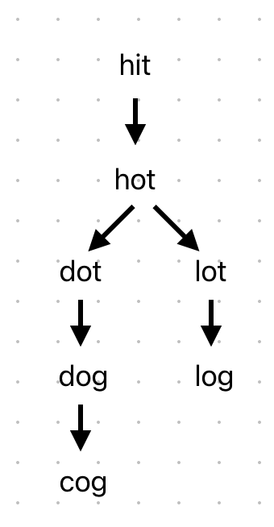

# Dart Solution - WordLadder (BFS) | Easy to understand, with explanation!

**Author:** kshitijgm
**Votes:** 0
**Link:** [https://leetcode.com/problems/word-ladder/solutions/5697443/](https://leetcode.com/problems/word-ladder/solutions/5697443/)

---

# Intuition
We can change one letter of each word to find another word in wordList. To help with this, let's make a helper function to give us the list of words matching this criteria and remove them from wordList.
Now, let's consider the first example:
```
Input: beginWord = "hit", endWord = "cog", wordList = ["hot","dot","dog","lot","log","cog"]
Output: 5
```

Let's build a basic decision tree/graph, keeping in mind what our helper function would do:


Here we construct a graph to see what we may "logically" think about.


Note how we are working "left to right" removing each entry we see from wordList.
1. Ensure hit not in wordList, remove if needed. `["hot","dot","dog","lot","log","cog"]`
1. hit would give us hot. Remove hot. `["dot","dog","lot","log","cog"]`
2. hot gives us dot and lot. Remove dot & lot. `["dog","log","cog"]`
3. dot gives us dog. Remove dog. `["log","cog"]`
4. lot gives us log. Remove log. `["cog"]`
5. dog gives us cog. Remove cog. `[]`

The resulting path to cog will be the shortest path! Notice how we move level-by-level? This problem is surely gonna need the **BFS pattern.**

# Approach
Let's make our helper function `findSimilarWords` which takes input of a word and the current wordList. Any changes to the list will affect the actual input list (in the calling function). Let's compare each word in the list to the input current word. We will count the number of characters that are different. If only 1 character differs, we know this is a viable "similar" word. We'll add this to our return variable.
Finally, after all checks and iteration is done, we will remove each string that we chose from our word list, finally returning the new list of similar words.

Next, let's initialize the hashmap with empty lists for each word. We can use this to safely add elements to a value in each key-value pair. We will also add the beginWord to the graph, since it may or may not be in the wordList, and we are anyways making sure to remove it from said list.

Finally, let's implement BFS that keeps track of each string and it's level in the graph (you may see the diagram above for level-reference).
We will keep finding the minimum level value should we match our endWord at any point. If we aren't able to transform our string to the endWord once the BFS queue is empty still, we can check if our value is the same as the large initialized value, and return 0, else return what we got.

# Complexity
- Time complexity: $$O(N^2).$$
Given our max word length is 10 (say L), complexity will be $$O(N^2 \xD7 L).$$
The small value of L can let us conclude the complexity to be $$O(N^2).$$

- Space complexity: $$O(n^2)$$ - Graph `(key: String, value: List<String>)`


# Code
```dart []
import 'dart:collection';

class Solution {
  int ladderLength(String beginWord, String endWord, List<String> wordList) {
	if (wordList.contains(beginWord)) wordList.remove(beginWord);
	if (!wordList.contains(endWord)) return 0;
	Map<String, List<String>> graph = Map.fromIterable(
		wordList,
		key: (item) => item,
		value: (_) => [],
	);
	graph[beginWord] = [];
	int minV = 1 << 32;
	ListQueue<(String, int)> queue = ListQueue(); // word, level
	queue.add((beginWord, 1));
	while (queue.isNotEmpty) {
		final (word, level) = queue.removeFirst();
		if (word == endWord) {
			minV = min(minV, level);
		}
		graph[word] = findSimilarWords(word, wordList);
		for (final w in (graph[word] ?? [])) {
			queue.add((w, level + 1));
		}
	}
	return minV == 1 << 32 ? 0 : minV;
  }
  List<String> findSimilarWords(String word, List<String> words) {
	List<String> ret = [];
	for (final w in words) {
		int diff = 0;
		for (int i = 0; i < w.length; i++) {
			if (word[i] != w[i]) {
				diff++;
			}
		}
		if (diff == 1) {
			ret.add(w);
		}
	}
	words.removeWhere((item) => ret.contains(item));
	return ret;
  }
}

```