# Easiest Explanation With Images. Commented Code

**Author:** Kunal_Tajne
**Votes:** 28
**Link:** [https://leetcode.com/problems/word-ladder/solutions/5676871/](https://leetcode.com/problems/word-ladder/solutions/5676871/)

---

# Approach
We will find the shortest transformation sequence using the BFS approach. We will create a set of words for faster lookup of available words, a queue to store the words that need to be checked for the transformation sequence through BFS, and a counter, length, to store the length of the sequence.

We start by pushing the src word into the queue. After that, we follow the steps given below:

- Pop a word from the queue and store it in curr.
- Check all the words in the set that only differ by one character from curr.
- Push all such words into the queue and remove them from the set.
- Keep popping the first word from the queue into curr and finding all the adjacent words of curr that differ by only one character until we have traversed all the words or have not found the dest.
- In each iteration, the length is incremented since each iteration checks all adjacent words (i.e., the words that differ by one character) of the popped word.
- Once dest is found, we return length + 1, representing the length of the sequence.
- We add 1 while returning the length to count dest in the length of the shortest transformation sequence.

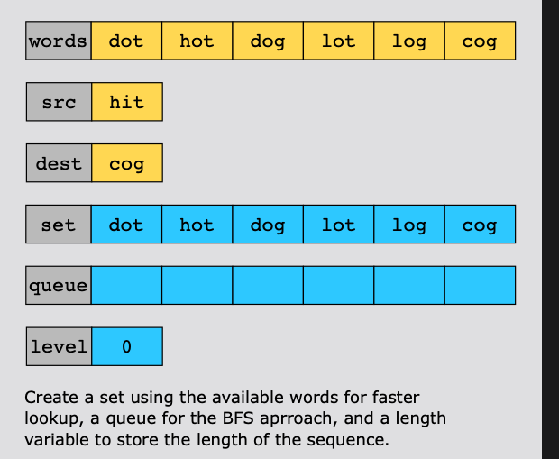
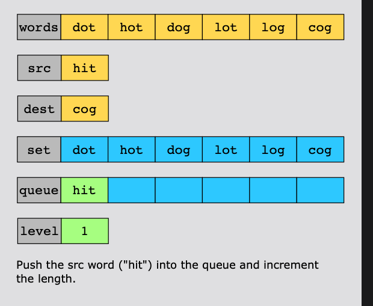
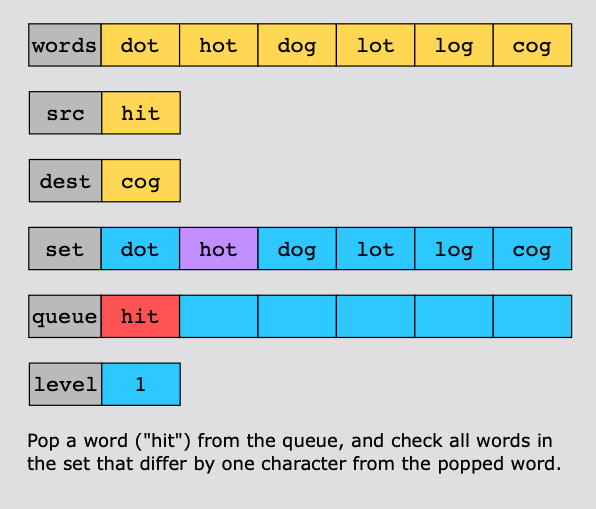
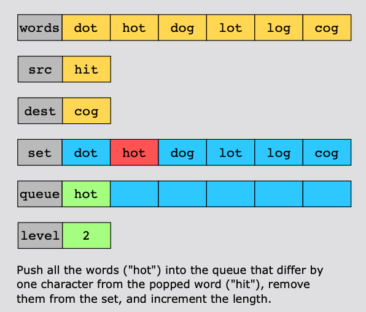
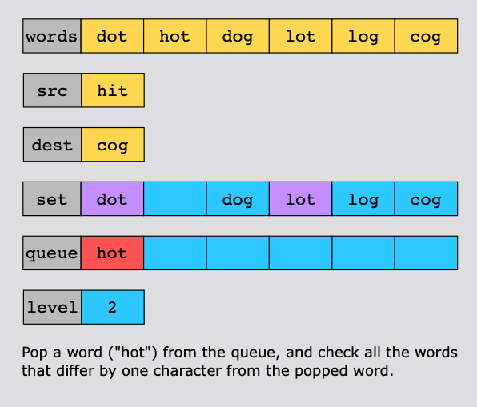
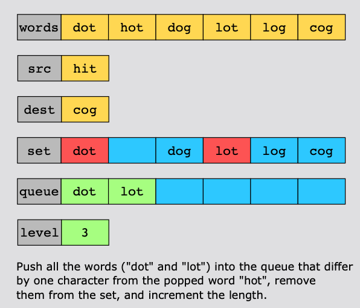
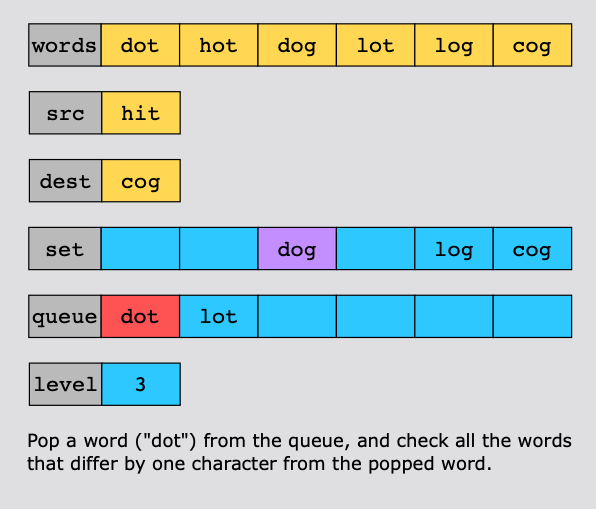
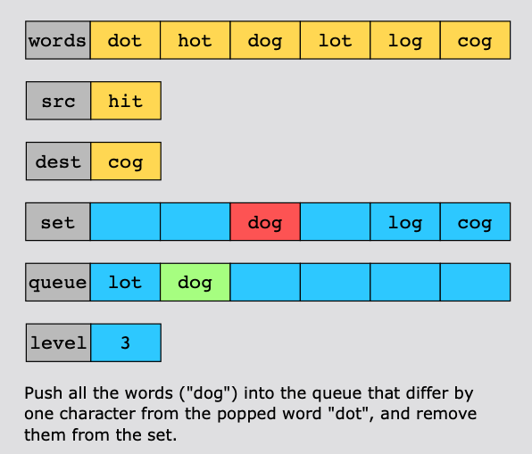
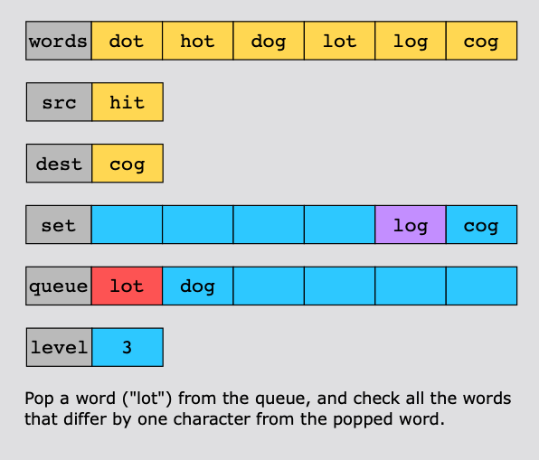
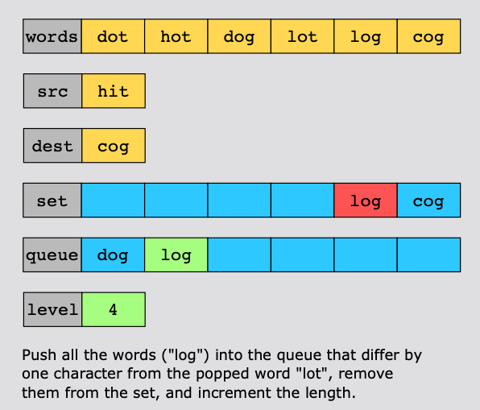
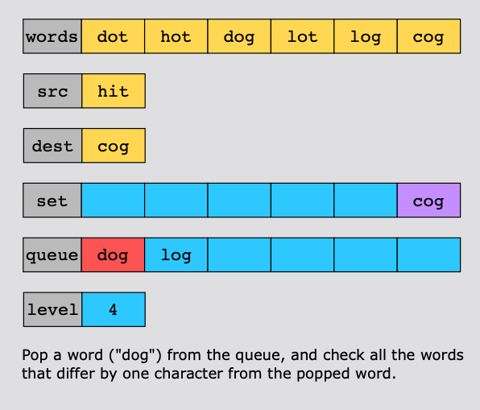
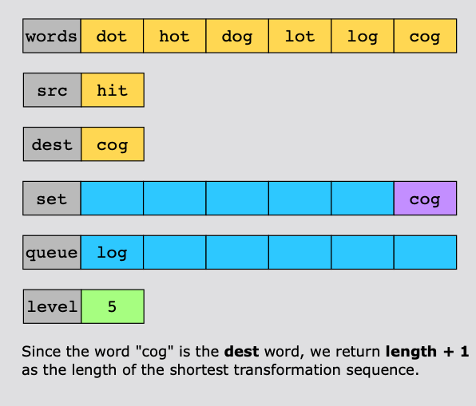


# Complexity
- Time complexity:
The time complexity of this solution is  $$O(N\xD7M)$$ , where N represents the number of words, and  M M represents the length of each word.

- Space complexity:
The space complexity of this solution is $$O(N\xD7M)$$.
# Code
```java []
class Solution {
    public int ladderLength(String beginWord, String endWord, List<String> wordList) {

        // Create a set of all words in the word list for quick lookup.
        Set<String> wordSet = new HashSet<>();

        // Flag to check if the endWord is present in the word list.
        Boolean isPresent = false;

        // Add all words from the word list to the set.
        wordSet.addAll(wordList);

        // Check if the endWord is in the word list.
        for (String currWord : wordList) {   
            if (endWord.equals(currWord)) {
                isPresent = true;
                break; // If found, break out of the loop.
            }
        }

        // If endWord is not in the list, return 0 as there's no valid transformation.
        if (!isPresent) return 0;

        // Use a queue to perform BFS (Breadth-First Search).
        Queue<String> wordQueue = new LinkedList<>();

        // Start BFS with the beginWord.
        wordQueue.add(beginWord);

        // Distance from the beginWord (initially 0).
        int distance = 0;

        // BFS loop: continue until the queue is empty.
        while (!wordQueue.isEmpty()) {
            int size = wordQueue.size();
            distance++; // Increment distance at each level of BFS.

            // Process each word in the current level.
            while (size-- != 0) {
                String currWord = wordQueue.poll(); // Get the front word from the queue.

                // Try changing each character in the current word.
                for (int i = 0; i < currWord.length(); i++) {
                    char[] temp = currWord.toCharArray(); // Convert the word to a character array.

                    // Replace the character at index i with every letter from 'a' to 'z'.
                    for (char j = 'a'; j <= 'z'; j++) {
                        temp[i] = j;

                        String newWord = new String(temp); // Form a new word.

                        // If the new word matches the endWord, return the distance + 1.
                        if (newWord.equals(endWord)) return distance + 1;

                        // If the new word is in the word set, it's a valid transformation.
                        if (wordSet.contains(newWord)) {
                            wordQueue.add(newWord); // Add it to the queue for further exploration.
                            wordSet.remove(newWord); // Remove it from the set to avoid revisiting.

                            // Print the new word being added to the queue (for debugging).
                            System.out.println(newWord);
                        }
                    }
                }
            }
        }

        // If no transformation sequence leads to the endWord, return 0.
        return 0;
    }
}

```
```C++ []
 // Create a set of all words in the word list for quick lookup.
        unordered_set<string> wordSet(wordList.begin(), wordList.end());

        // Check if endWord is in the word list. If not, return 0.
        if (wordSet.find(endWord) == wordSet.end()) return 0;

        // Use a queue to perform BFS (Breadth-First Search).
        queue<string> wordQueue;
        wordQueue.push(beginWord);

        // Distance from the beginWord (initially 0).
        int distance = 1;

        while (!wordQueue.empty()) {
            int size = wordQueue.size();
            distance++;  // Increase distance at each level of BFS

            while (size-- > 0) {
                string currWord = wordQueue.front();
                wordQueue.pop();

                // Try changing each character of the current word
                for (int i = 0; i < currWord.length(); i++) {
                    string temp = currWord;

                    for (char j = 'a'; j <= 'z'; j++) {
                        temp[i] = j;

                        // If the new word matches the endWord, return the distance
                        if (temp == endWord) return distance;

                        // If the new word is in the set, add it to the queue and remove it from the set
                        if (wordSet.find(temp) != wordSet.end()) {
                            wordQueue.push(temp);
                            wordSet.erase(temp);
                        }
                    }
                }
            }
        }

        return 0; // Return 0 if no transformation sequence is found
```
```javascript []
// Create a set of all words in the word list for quick lookup.
    const wordSet = new Set(wordList);

    // If endWord is not in the word list, return 0.
    if (!wordSet.has(endWord)) return 0;

    // Use a queue to perform BFS (Breadth-First Search).
    const wordQueue = [beginWord];

    // Distance from the beginWord (initially 1).
    let distance = 1;

    while (wordQueue.length > 0) {
        let size = wordQueue.length;
        distance++;  // Increase distance at each level of BFS

        while (size-- > 0) {
            const currWord = wordQueue.shift();

            // Try changing each character of the current word
            for (let i = 0; i < currWord.length; i++) {
                for (let j = 0; j < 26; j++) {  // Try all lowercase letters
                    const temp = currWord.slice(0, i) + String.fromCharCode(97 + j) + currWord.slice(i + 1);

                    // If the new word matches the endWord, return the distance
                    if (temp === endWord) return distance;

                    // If the new word is in the set, add it to the queue and remove it from the set
                    if (wordSet.has(temp)) {
                        wordQueue.push(temp);
                        wordSet.delete(temp);
                    }
                }
            }
        }
    }

    return 0;  // Return 0 if no transformation sequence is found
```
```python []
# Create a set of all words in the word list for quick lookup.
        wordSet = set(wordList)

        # If endWord is not in the word list, return 0.
        if endWord not in wordSet:
            return 0

        # Use a queue to perform BFS (Breadth-First Search).
        wordQueue = deque([beginWord])

        # Distance from the beginWord (initially 1).
        distance = 1

        while wordQueue:
            size = len(wordQueue)
            distance += 1  # Increase distance at each level of BFS

            for _ in range(size):
                currWord = wordQueue.popleft()

                # Try changing each character of the current word
                for i in range(len(currWord)):
                    for j in range(26):  # Try all lowercase letters
                        temp = currWord[:i] + chr(ord('a') + j) + currWord[i+1:]

                        # If the new word matches the endWord, return the distance
                        if temp == endWord:
                            return distance

                        # If the new word is in the set, add it to the queue and remove it from the set
                        if temp in wordSet:
                            wordQueue.append(temp)
                            wordSet.remove(temp)

        return 0  # Return 0 if no transformation sequence is found
```
```Go []
    // Create a set of all words in the word list for quick lookup.
    wordSet := make(map[string]struct{})
    for _, word := range wordList {
        wordSet[word] = struct{}{}
    }

    // If endWord is not in the word list, return 0.
    if _, exists := wordSet[endWord]; !exists {
        return 0
    }

    // Use a queue to perform BFS (Breadth-First Search).
    wordQueue := list.New()
    wordQueue.PushBack(beginWord)

    // Distance from the beginWord (initially 1).
    distance := 1

    for wordQueue.Len() > 0 {
        size := wordQueue.Len()
        distance++  // Increase distance at each level of BFS

        for i := 0; i < size; i++ {
            currWord := wordQueue.Remove(wordQueue.Front()).(string)

            // Try changing each character of the current word
            for j := 0; j < len(currWord); j++ {
                temp := []rune(currWord)

                for k := 'a'; k <= 'z'; k++ {  // Try all lowercase letters
                    temp[j] = k

                    newWord := string(temp)

                    // If the new word matches the endWord, return the distance
                    if newWord == endWord {
                        return distance
                    }

                    // If the new word is in the set, add it to the queue and remove it from the set
                    if _, exists := wordSet[newWord]; exists {
                        wordQueue.PushBack(newWord)
                        delete(wordSet, newWord)
                    }
                }
            }
        }
    }

    return 0  // Return 0 if no transformation sequence is found

```