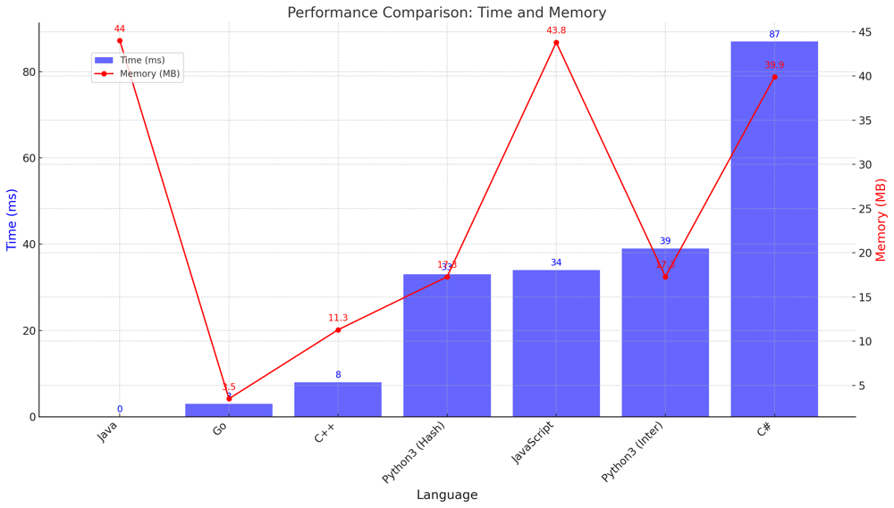

# ✅ 97.92% Hash Table & Linked List

**Author:** vanAmsen
**Votes:** 458
**Link:** [https://leetcode.com/problems/copy-list-with-random-pointer/solutions/4003262/](https://leetcode.com/problems/copy-list-with-random-pointer/solutions/4003262/)

---

# Interview Guide - Copying a Linked List with Random Pointers: A Dual-Approach Analysis

## Introduction & Problem Understanding

The problem at hand involves creating a deep copy of a given singly-linked list where each node has a `next` pointer and an additional `random` pointer. The `random` pointer could point to any node within the list or be `null`. The deep copy should have brand new nodes with the same `next` and `random` pointers as the original list.

### Key Concepts and Constraints

1. **Node Anatomy**:  
   Each node in the list has an integer value, a `next` pointer pointing to the subsequent node, and a `random` pointer that could point to any node in the list or be `null`.

2. **Deep Copy**:  
   We are required to return a deep copy of the list, meaning that the new list should consist of entirely new nodes that don't refer to nodes in the original list.

3. **Memory Efficiency**:  
   While one approach uses $$ O(n) $$ additional memory, the other achieves the task without extra memory, using only $$ O(1) $$ extra space.

## Strategies to Tackle the Problem

1. **Hash Map Method**:  
   This approach leverages a hash map to store the mapping between each node in the original list and its corresponding node in the copied list.

2. **Interweaving Nodes Method**:  
   This approach cleverly interweaves the nodes of the copied list with the original list, using the structure to adjust the `random` pointers correctly, and then separates them.

---

# Live Coding Hash & More:
https://youtu.be/eplAWtfkz5o?si=6OwomT_z5ClgyhUc

## Solution #1: Hash Map Method

### Intuition and Logic Behind the Solution

The basic idea is to traverse the list twice. In the first pass, we create a new node for each node in the original list and store the mapping in a hash map. In the second pass, we set the `next` and `random` pointers for each new node based on the hash map.

### Step-by-step Explanation

1. **Initialization**: 
    - Create an empty hash map, `old_to_new`, to store the mapping from old nodes to new nodes.

2. **First Pass - Node Creation**:  
    - Traverse the original list and for each node, create a corresponding new node.
    - Store the mapping in `old_to_new`.

3. **Second Pass - Setting Pointers**:  
    - Traverse the original list again.
    - For each node, set its corresponding new node's `next` and `random` pointers based on the hash map.

### Complexity Analysis

- **Time Complexity**: $$ O(n) $$ \u2014 Each node is visited twice.
- **Space Complexity**: $$ O(n) $$ \u2014 To store the hash map.

---

## Solution #2: Interweaving Nodes Method

### Intuition and Logic Behind the Solution

The crux of this method is to interweave the nodes of the original and copied lists. This interweaving allows us to set the `random` pointers for the new nodes without needing additional memory for mapping.

### Step-by-step Explanation

1. **Initialization and Interweaving**:  
    - Traverse the original list.
    - For each node, create a corresponding new node and place it between the current node and the current node's `next`.

2. **Setting Random Pointers**:  
    - Traverse the interweaved list.
    - For each old node, set its corresponding new node's `random` pointer.

3. **Separating Lists**:  
    - Traverse the interweaved list again to separate the old and new lists.

### Complexity Analysis

- **Time Complexity**: $$ O(n) $$ \u2014 Each node is visited multiple times but it's still linear time.
- **Space Complexity**: $$ O(1) $$ \u2014 No additional memory is used for mapping; we only allocate nodes for the new list.

Both methods provide a deep copy of the original list but differ in their use of additional memory. The choice between them would depend on the specific requirements of your application.

# Performance

| Language  | Time (ms) | Memory (MB) |
|-----------|-----------|-------------|
| Java      | 0 ms      | 44 MB       |
| Go        | 3 ms      | 3.5 MB      |
| C++       | 8 ms      | 11.3 MB     | 
| Python3 (Hash)   | 33 ms     | 17.3 MB     |
| JavaScript| 34 ms     | 43.8 MB     | 
| Python3 (Inter)   | 39 ms     | 17.3 MB     |
| C#        | 87 ms     | 39.9 MB     | 




# Code #1 Hash Map
``` Python []
class Solution:
    def copyRandomList(self, head: 'Optional[Node]') -> 'Optional[Node]':
        if not head:
            return None
        old_to_new = {}
        
        curr = head
        while curr:
            old_to_new[curr] = Node(curr.val)
            curr = curr.next
        
        curr = head
        while curr:
            old_to_new[curr].next = old_to_new.get(curr.next)
            old_to_new[curr].random = old_to_new.get(curr.random)
            curr = curr.next
            
        return old_to_new[head]
```
``` C++ []
class Solution {
public:
    Node* copyRandomList(Node* head) {
        if (!head) return nullptr;
        
        unordered_map<Node*, Node*> old_to_new;
        
        Node* curr = head;
        while (curr) {
            old_to_new[curr] = new Node(curr->val);
            curr = curr->next;
        }
        
        curr = head;
        while (curr) {
            old_to_new[curr]->next = old_to_new[curr->next];
            old_to_new[curr]->random = old_to_new[curr->random];
            curr = curr->next;
        }
        
        return old_to_new[head];
    }
};
```
``` Java []
public class Solution {
    public Node copyRandomList(Node head) {
        if (head == null) return null;
        
        HashMap<Node, Node> oldToNew = new HashMap<>();
        
        Node curr = head;
        while (curr != null) {
            oldToNew.put(curr, new Node(curr.val));
            curr = curr.next;
        }
        
        curr = head;
        while (curr != null) {
            oldToNew.get(curr).next = oldToNew.get(curr.next);
            oldToNew.get(curr).random = oldToNew.get(curr.random);
            curr = curr.next;
        }
        
        return oldToNew.get(head);
    }
}
```
``` JavaScript []
/**
 * @param {Node} head
 * @return {Node}
 */
var copyRandomList = function(head) {
    if (!head) return null;
    
    const oldToNew = new Map();
    
    let curr = head;
    while (curr) {
        oldToNew.set(curr, new Node(curr.val));
        curr = curr.next;
    }
    
    curr = head;
    while (curr) {
        oldToNew.get(curr).next = oldToNew.get(curr.next) || null;
        oldToNew.get(curr).random = oldToNew.get(curr.random) || null;
        curr = curr.next;
    }
    
    return oldToNew.get(head);
};
```
``` C# []
public class Solution {
    public Node CopyRandomList(Node head) {
        if (head == null) return null;
        
        Dictionary<Node, Node> oldToNew = new Dictionary<Node, Node>();
        
        Node curr = head;
        while (curr != null) {
            oldToNew[curr] = new Node(curr.val);
            curr = curr.next;
        }
        
        curr = head;
        while (curr != null) {
            oldToNew[curr].next = curr.next != null ? oldToNew[curr.next] : null;
            oldToNew[curr].random = curr.random != null ? oldToNew[curr.random] : null;
            curr = curr.next;
        }
        
        return oldToNew[head];
    }
}
```
``` Go []
func copyRandomList(head *Node) *Node {
    if head == nil {
        return nil
    }

    oldToNew := make(map[*Node]*Node)

    curr := head
    for curr != nil {
        oldToNew[curr] = &Node{Val: curr.Val}
        curr = curr.Next
    }

    curr = head
    for curr != nil {
        oldToNew[curr].Next = oldToNew[curr.Next]
        oldToNew[curr].Random = oldToNew[curr.Random]
        curr = curr.Next
    }

    return oldToNew[head]
}
```

# Code #2 Interweaving Nodes
``` Python []
class Solution:
    def copyRandomList(self, head: 'Optional[Node]') -> 'Optional[Node]':
        if not head:
            return None
        
        curr = head
        while curr:
            new_node = Node(curr.val, curr.next)
            curr.next = new_node
            curr = new_node.next
            
        curr = head
        while curr:
            if curr.random:
                curr.next.random = curr.random.next
            curr = curr.next.next
        
        old_head = head
        new_head = head.next
        curr_old = old_head
        curr_new = new_head
        
        while curr_old:
            curr_old.next = curr_old.next.next
            curr_new.next = curr_new.next.next if curr_new.next else None
            curr_old = curr_old.next
            curr_new = curr_new.next
            
        return new_head
```
``` Go []
func copyRandomList(head *Node) *Node {
        if head == nil {
        return nil
    }
    
    curr := head
    for curr != nil {
        new_node := &Node{Val: curr.Val, Next: curr.Next}
        curr.Next = new_node
        curr = new_node.Next
    }
    
    curr = head
    for curr != nil {
        if curr.Random != nil {
            curr.Next.Random = curr.Random.Next
        }
        curr = curr.Next.Next
    }
    
    old_head := head
    new_head := head.Next
    curr_old := old_head
    curr_new := new_head
    
    for curr_old != nil {
        curr_old.Next = curr_old.Next.Next
        if curr_new.Next != nil {
            curr_new.Next = curr_new.Next.Next
        } else {
            curr_new.Next = nil
        }
        curr_old = curr_old.Next
        curr_new = curr_new.Next
    }
    
    return new_head
}
```
``` C++ []
/*
// Definition for a Node.
class Node {
public:
    int val;
    Node* next;
    Node* random;
    
    Node(int _val) {
        val = _val;
        next = NULL;
        random = NULL;
    }
};
*/

class Solution {
public:
    Node* copyRandomList(Node* head) {
                if (!head) return nullptr;
        
        Node* curr = head;
        while (curr) {
            Node* new_node = new Node(curr->val);
            new_node->next = curr->next;
            curr->next = new_node;
            curr = new_node->next;
        }
        
        curr = head;
        while (curr) {
            if (curr->random) {
                curr->next->random = curr->random->next;
            }
            curr = curr->next->next;
        }
        
        Node* old_head = head;
        Node* new_head = head->next;
        Node* curr_old = old_head;
        Node* curr_new = new_head;
        
        while (curr_old) {
            curr_old->next = curr_old->next->next;
            curr_new->next = curr_new->next ? curr_new->next->next : nullptr;
            curr_old = curr_old->next;
            curr_new = curr_new->next;
        }
        
        return new_head;       
    }
};
```
``` Java []
public class Solution {
    public Node copyRandomList(Node head) {
        if (head == null) return null;
        
        Node curr = head;
        while (curr != null) {
            Node new_node = new Node(curr.val, curr.next);
            curr.next = new_node;
            curr = new_node.next;
        }
        
        curr = head;
        while (curr != null) {
            if (curr.random != null) {
                curr.next.random = curr.random.next;
            }
            curr = curr.next != null ? curr.next.next : null;
        }
        
        Node old_head = head;
        Node new_head = head.next;
        Node curr_old = old_head;
        Node curr_new = new_head;
        
        while (curr_old != null) {
            curr_old.next = curr_old.next.next;
            curr_new.next = curr_new.next != null ? curr_new.next.next : null;
            curr_old = curr_old.next;
            curr_new = curr_new.next;
        }
        
        return new_head;
    }
}
```

# Live Coding Interweaving & More
https://youtu.be/DH0HDU4ScYY?si=P-P1Er3P8q5XekTU

### Reflections on Copying Lists with Random Pointers

#### Hash Map Method:
Clear and simple, this method uses extra memory to map each node from the original to the copied list. It's straightforward but can be memory-inefficient.

#### Interweaving Nodes Method:
Sleek and space-efficient, this in-place method interweaves new nodes within the existing structure before making them their own list. It's elegant but requires careful attention.

This problem isn't just coding; it's a deep dive into data structures and algorithms. Whether you prefer the clarity of Hash Map or the finesse of Interweaving Nodes, each sharpens your algorithmic skill set. Embrace the challenge! \uD83C\uDF1F\uD83D\uDE80
