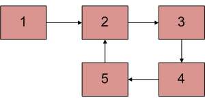

# ✅ C++ || Easy To Understand || 2 Pointer || Fast & Slow

**Author:** knockcat
**Votes:** 696
**Link:** [https://leetcode.com/problems/linked-list-cycle/solutions/1829489/](https://leetcode.com/problems/linked-list-cycle/solutions/1829489/)

---

# 141. Linked List Cycle
**KNOCKCAT**

```
1. Easy C++
2. Line by Line Explanation with Comments.
3. Detailed Explanation \u2705
4. Linked list problem, 2 pointer , fast slow / turtle hare algorithm.
5. Please Upvote if it helps\u2B06\uFE0F
6. Link to my Github Profile contains a repository of Leetcode with all my Solutions. \u2B07\uFE0F
	// \uD83D\uDE09If you Like the repository don't foget to star & fork the repository\uD83D\uDE09
```

[LeetCode](https://github.com/knockcat/Leetcode)          **LINK TO LEETCODE REPOSITORY**

Please upvote my comment so that i get to win the 2022 giveaway and motivate to make such discussion post.
**Happy new Year 2023 to all of you**
**keep solving keep improving**
Link To comment
[Leetcode Give away comment](https://leetcode.com/discuss/general-discussion/2946993/2022-Annual-Badge-and-the-Giveaway/1734919)

**EXPLANATION**
* **Floyd\u2019s Cycle-Finding Algorithm** // fast slow approach // 2 pointers // **"tortoise and the hare algorithm"**
* Approach: This is the **fastest method** and has been described below:  

* **Traverse linked list** using **two pointers**.
* Move **one pointer(slow_p) by one** and another **pointer(fast_p) by two.**
* If t**hese pointers meet at the same node** then **there is a loop**. If **pointers do not meet** then **linked list doesn\u2019t have a loop.**



*Above linked list has a loop as node 5 is connected to node 2 foming a Cycle.*

**The algorithm can be reffered to as a real life scenario ->**

Suppose there are **two people running on a track** one with a **speed x** and another with a **speed 2x** (twice of first) now it's clear that **person 2 is faster**.
Now **assume the track to  be circular** and now since peson 2 will have faster speed so it is very sure that **person two will meet person 1 or he will overtake him**.

Now the **above scenario is similar to our problem statement** where given ***linkedlist is the track*** and if the linked list would have a cycle it would be same as the circular track and the above conditon will definitely meet,  i.e person 2 will overtake or meet person one.

**person 1 is slow pointer** here and moving by 1 node at a time and **person 2 is fast pointer** here moving with 2 nodes at a time. So they will meet definitely at some point **if the linkedlist contains a cycle** that is our **fast and slow pointer reference will become equal** or they point at same memory location.

**CODE WITH EXPLANATION**

* Time Complexity : O(N)
* Space Complexity : O(1)
```
class Solution {
public:
    bool hasCycle(ListNode *head) {
	
		// making two pointers fast and slow and assignning them to head
        ListNode *fast = head;
        ListNode *slow = head;
        
		// till fast and fast-> next not reaches NULL
		// we will increment fast by 2 step and slow by 1 step
        while(fast != NULL && fast ->next != NULL)
        {
            fast = fast->next->next;
            slow = slow->next;
            
			
			// At the point if fast and slow are at same address
			// this means linked list has a cycle in it.
            if(fast == slow)
                return true;
        }
        
		// if traversal reaches to NULL this means no cycle.
        return false;
    }
};
```