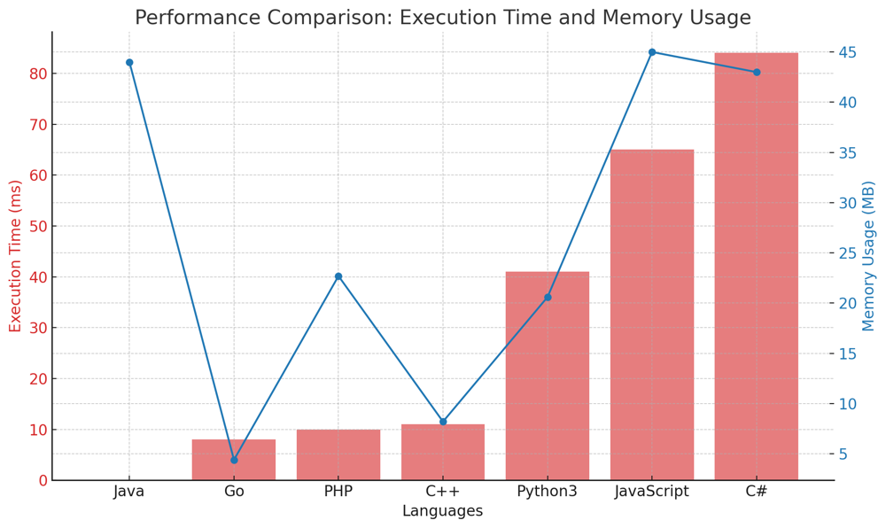
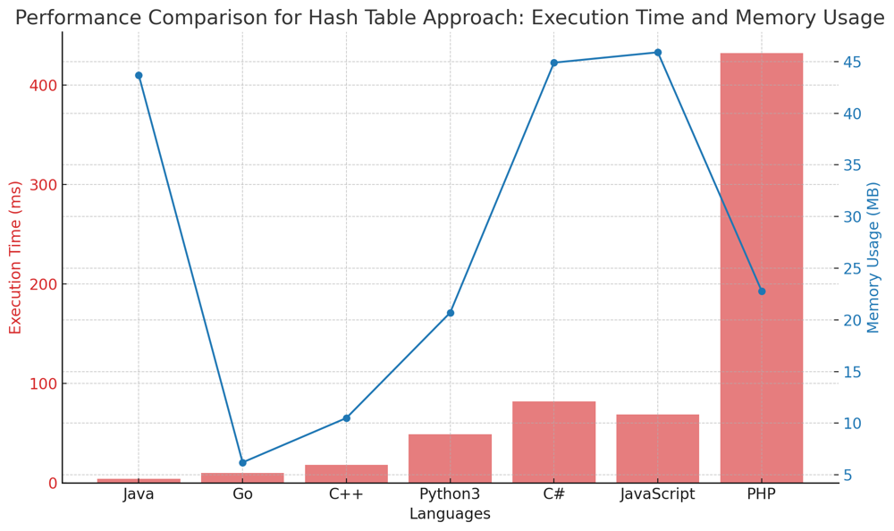

# ✅ 99.68% Two-Pointer & Hash Table

**Author:** vanAmsen
**Votes:** 302
**Link:** [https://leetcode.com/problems/linked-list-cycle/solutions/3999014/](https://leetcode.com/problems/linked-list-cycle/solutions/3999014/)

---

# Interview Guide - Detecting Cycles in a Linked List: A Dual-Approach Analysis

## Introduction & Problem Understanding

Detecting cycles in a linked list is a classic problem that tests a developer's ability to understand and manipulate data structures. In this problem, you are given the head of a singly-linked list. The objective is to determine whether the list contains a cycle. A cycle exists if a node in the list can be visited more than once by following the `next` pointers continuously.

### Key Concepts and Constraints

1. **Node Anatomy**:  
   Each node in the list contains an integer value and a `next` pointer that points to the subsequent node in the list.

2. **Cycle Detection**:  
   The primary task is to identify whether a cycle exists within the list. If a cycle is detected, the function should return `True`. Otherwise, it should return `False`.

3. **Memory Efficiency**:  
   The question poses an implicit challenge: Can you solve it using $$ O(1) $$ memory, meaning constant extra space?

## Strategies to Tackle the Problem

1. **Hash Table Method**:  
This approach involves storing visited nodes in a hash table. During traversal, if a node is encountered that already exists in the hash table, a cycle is confirmed.

2. **Two-Pointers Method (Floyd's Cycle-Finding Algorithm)**:  
Also known as the "hare and tortoise" algorithm, this method employs two pointers that move at different speeds. If there is a cycle, the fast pointer will eventually catch up to the slow pointer, confirming the cycle's existence.

---

# Live Coding 2 Solution & More
https://youtu.be/ew-E3mHOBT0?si=DTvrijJplAk7XV1w

## Solution #1: Hash Table Method

### Intuition and Logic Behind the Solution

The basic idea here is to traverse the list and keep a record of the nodes we've visited so far. If at any point we encounter a node that we've already visited, we can conclude that there is a cycle in the list.

### Step-by-step Explanation

1. **Initialization**: 
    - Create an empty set, `visited_nodes`, to keep track of the nodes that have been visited.

2. **Traversal and Verification**:  
    - Traverse the list starting from the head node.
    - At each node, check whether it already exists in `visited_nodes`.
    - If it does, return `True` as a cycle is detected.
    - Otherwise, add the node to `visited_nodes`.

### Complexity Analysis

- **Time Complexity**: $$ O(n) $$ \u2014 Each node is visited once.
- **Space Complexity**: $$ O(n) $$ \u2014 To store visited nodes.

---

## Solution #2: Two-Pointer Method (Floyd's Cycle-Finding Algorithm)

### Intuition and Logic Behind the Solution

Also known as the "hare and tortoise" algorithm, this method uses two pointers that traverse the list at different speeds. The slow pointer moves one step at a time, while the fast pointer moves two steps. If there is a cycle, the fast pointer will eventually catch up to the slow pointer.

### Step-by-step Explanation

1. **Initialization**:  
   - Initialize two pointers, `slow_pointer` and `fast_pointer`, both pointing to the head node initially.

2. **Cycle Detection**:  
   - Traverse the list until the `fast_pointer` or its `next` becomes `None`.
   - Update `slow_pointer` and `fast_pointer` as follows:
        - `slow_pointer = slow_pointer.next`
        - `fast_pointer = fast_pointer.next.next`
   - If `slow_pointer` and `fast_pointer` meet at some point, return `True`.

### Complexity Analysis

- **Time Complexity**: $$ O(n) $$ \u2014 In the worst-case scenario, each node is visited once.
- **Space Complexity**: $$ O(1) $$ \u2014 Constant space is used.

---


# Performance

### Two-Pointers

| Language  | Execution Time (ms) | Memory Usage (MB) |
|-----------|---------------------|-------------------|
| Java      | 0                   | 44                |
| Go        | 8                   | 4.4               |
| PHP       | 10                  | 22.7              |
| C++       | 11                  | 8.2               |
| Python3   | 41                  | 20.6              |
| JavaScript| 65                  | 45                |
| C#        | 84                  | 43                |



### Hash Table

| Language  | Execution Time (ms) | Memory Usage (MB) |
|-----------|---------------------|-------------------|
| Java      | 4                   | 43.7              |
| Go        | 10                  | 6.2               |
| C++       | 18                  | 10.5              |
| Python3   | 49                  | 20.7              |
| C#        | 82                  | 44.9              |
| JavaScript| 69                  | 45.9              |
| PHP       | 432                 | 22.8              |




# Code Two-Pointer
``` Python []
class Solution:
    def hasCycle(self, head: Optional[ListNode]) -> bool:
        slow_pointer = head
        fast_pointer = head
        while fast_pointer and fast_pointer.next:
            slow_pointer = slow_pointer.next
            fast_pointer = fast_pointer.next.next
            if slow_pointer == fast_pointer:
                return True
        return False
```
``` C++ []
class Solution {
public:
    bool hasCycle(ListNode *head) {
        ListNode *slow_pointer = head, *fast_pointer = head;
        while (fast_pointer != nullptr && fast_pointer->next != nullptr) {
            slow_pointer = slow_pointer->next;
            fast_pointer = fast_pointer->next->next;
            if (slow_pointer == fast_pointer) {
                return true;
            }
        }
        return false;
    }
};
```
``` Java []
public class Solution {
    public boolean hasCycle(ListNode head) {
        ListNode slow_pointer = head, fast_pointer = head;
        while (fast_pointer != null && fast_pointer.next != null) {
            slow_pointer = slow_pointer.next;
            fast_pointer = fast_pointer.next.next;
            if (slow_pointer == fast_pointer) {
                return true;
            }
        }
        return false;
    }
}
```
``` C# []
public class Solution {
    public bool HasCycle(ListNode head) {
        ListNode slow_pointer = head, fast_pointer = head;
        while (fast_pointer != null && fast_pointer.next != null) {
            slow_pointer = slow_pointer.next;
            fast_pointer = fast_pointer.next.next;
            if (slow_pointer == fast_pointer) {
                return true;
            }
        }
        return false;
    }
}
```
``` Go []
func hasCycle(head *ListNode) bool {
    slow_pointer, fast_pointer := head, head
    for fast_pointer != nil && fast_pointer.Next != nil {
        slow_pointer = slow_pointer.Next
        fast_pointer = fast_pointer.Next.Next
        if slow_pointer == fast_pointer {
            return true
        }
    }
    return false
}
```
``` JavaScript []
/**
 * @param {ListNode} head
 * @return {boolean}
 */
var hasCycle = function(head) {
    let slow_pointer = head, fast_pointer = head;
    while (fast_pointer !== null && fast_pointer.next !== null) {
        slow_pointer = slow_pointer.next;
        fast_pointer = fast_pointer.next.next;
        if (slow_pointer === fast_pointer) {
            return true;
        }
    }
    return false;
};
```
``` PHP []
class Solution {
    function hasCycle($head) {
        $slow_pointer = $head;
        $fast_pointer = $head;
        while ($fast_pointer !== null && $fast_pointer->next !== null) {
            $slow_pointer = $slow_pointer->next;
            $fast_pointer = $fast_pointer->next->next;
            if ($slow_pointer === $fast_pointer) {
                return true;
            }
        }
        return false;
    }
}
```
# Code Hash Table
``` Python []
class Solution:
    def hasCycle(self, head: Optional[ListNode]) -> bool:
        visited_nodes = set()
        current_node = head
        while current_node:
            if current_node in visited_nodes:
                return True
            visited_nodes.add(current_node)
            current_node = current_node.next
        return False                                                                 
```
``` Go []
func hasCycle(head *ListNode) bool {
    visited_nodes := make(map[*ListNode]bool)
    current_node := head
    for current_node != nil {
        if visited_nodes[current_node] {
            return true
        }
        visited_nodes[current_node] = true
        current_node = current_node.Next
    }
    return false
}
```
``` C++ []
class Solution {
public:
    bool hasCycle(ListNode *head) {
        std::unordered_set<ListNode*> visited_nodes;
        ListNode *current_node = head;
        while (current_node != nullptr) {
            if (visited_nodes.find(current_node) != visited_nodes.end()) {
                return true;
            }
            visited_nodes.insert(current_node);
            current_node = current_node->next;
        }
        return false;
    }
};
```
``` Java []
public class Solution {
    public boolean hasCycle(ListNode head) {
        HashSet<ListNode> visited_nodes = new HashSet<>();
        ListNode current_node = head;
        while (current_node != null) {
            if (visited_nodes.contains(current_node)) {
                return true;
            }
            visited_nodes.add(current_node);
            current_node = current_node.next;
        }
        return false;
    }
}
```
``` C# []
public class Solution {
    public bool HasCycle(ListNode head) {
        HashSet<ListNode> visited_nodes = new HashSet<ListNode>();
        ListNode current_node = head;
        while (current_node != null) {
            if (visited_nodes.Contains(current_node)) {
                return true;
            }
            visited_nodes.Add(current_node);
            current_node = current_node.next;
        }
        return false;
    }
}
```
``` PHP []
class Solution {
    function hasCycle($head) {
        $visited_nodes = [];
        $current_node = $head;
        while ($current_node !== null) {
            if (in_array($current_node, $visited_nodes, true)) {
                return true;
            }
            $visited_nodes[] = $current_node;
            $current_node = $current_node->next;
        }
        return false;
    }
}
```
``` JavaScript []
/**
 * @param {ListNode} head
 * @return {boolean}
 */
var hasCycle = function(head) {
    let visited_nodes = new Set();
    let current_node = head;
    while (current_node !== null) {
        if (visited_nodes.has(current_node)) {
            return true;
        }
        visited_nodes.add(current_node);
        current_node = current_node.next;
    }
    return false;
};
```

# Live Coding with Comments
https://youtu.be/aGbOOAKkhNo?si=IoPNL49uVessMpCv

# Reflections on Cycle Detection

Both the Hash Table and Two-Pointers methods offer compelling strategies for detecting cycles in linked lists.

1. **Hash Table Method**:  
   Intuitive and adaptable, though potentially memory-intensive.
   
2. **Two-Pointers Method**:  
   A marvel of memory efficiency, but perhaps less straightforward to the uninitiated.

Navigating this problem is a dive into data structure nuances and algorithmic elegance. Whether you appreciate the directness of the Hash Table or the finesse of Two-Pointers, each method champions a facet of computational acumen. This isn't just a problem; it's a step in honing algorithmic artistry. Embrace the challenge! \uD83D\uDE80\uD83C\uDF1F