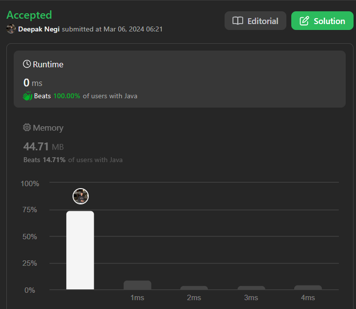

# Detecting Cycle in a Singly Linked List | | 100% Beats | | Two Pointer | | Java | | C++ | | Python ✅

**Author:** Hunter_0718
**Votes:** 10
**Link:** [https://leetcode.com/problems/linked-list-cycle/solutions/4829834/](https://leetcode.com/problems/linked-list-cycle/solutions/4829834/)

---



# Intuition
To detect a cycle in a linked list, we can use the "two-pointer" technique. We initialize two pointers, `fast` and `slow`, both starting from the head of the linked list. The `fast` pointer moves two steps at a time, while the `slow` pointer moves one step at a time. If there's a cycle, eventually both pointers will meet at some node within the cycle.

# Approach
1. Initialize two pointers `fast` and `slow` to the head of the linked list.
2. Iterate through the linked list with `fast` moving two steps at a time and `slow` moving one step at a time.
3. If `fast` and `slow` pointers meet at some point, there's a cycle in the linked list. Return `true`.
4. If `fast` reaches the end of the list (i.e., `null`), there's no cycle. Return `false`.

# Complexity
- Time complexity: O(n), where n is the number of nodes in the linked list. Both pointers traverse at most n steps.
- Space complexity: O(1), no extra space is used apart from a constant amount of memory for the two pointers.

```C++ []
/**
 * Definition for singly-linked list.
 * struct ListNode {
 *     int val;
 *     ListNode *next;
 *     ListNode(int x) : val(x), next(NULL) {}
 * };
 */
class Solution {
public:
    bool hasCycle(ListNode *head) {
        ListNode *fast = head; // Initialize fast pointer to head
        ListNode *slow = head; // Initialize slow pointer to head
        while (fast != NULL && fast->next != NULL) { // Traverse the list until fast pointer reaches end or NULL
            fast = fast->next->next; // Move fast pointer two steps ahead
            slow = slow->next; // Move slow pointer one step ahead
            if (fast == slow) { // If fast meets slow, there is a cycle
                return true;
            }
        }
        return false; // If fast reaches NULL, there is no cycle
    }
};

```
```java []
/**
 * Definition for singly-linked list.
 * class ListNode {
 *     int val;
 *     ListNode next;
 *     ListNode(int x) {
 *         val = x;
 *         next = null;
 *     }
 * }
 */
public class Solution {
    public boolean hasCycle(ListNode head) {
        ListNode fast = head; // Initialize fast pointer to head
        ListNode slow = head; // Initialize slow pointer to head
        while (fast != null && fast.next != null) { // Traverse the list until fast pointer reaches end or NULL
            fast = fast.next.next; // Move fast pointer two steps ahead
            slow = slow.next; // Move slow pointer one step ahead
            if (fast == slow) { // If fast meets slow, there is a cycle
                return true;
            }
        }
        return false; // If fast reaches NULL, there is no cycle
    }
}

```
```python []
class Solution:
    def hasCycle(self, head: ListNode) -> bool:
        fast = head # Initialize fast pointer to head
        slow = head # Initialize slow pointer to head
        while fast and fast.next: # Traverse the list until fast pointer reaches end or NULL
            fast = fast.next.next # Move fast pointer two steps ahead
            slow = slow.next # Move slow pointer one step ahead
            if fast == slow: # If fast meets slow, there is a cycle
                return True
        return False # If fast reaches NULL, there is no cycle

```
```c []
/**
 * Definition for singly-linked list.
 * struct ListNode {
 *     int val;
 *     struct ListNode *next;
 * };
 */
bool hasCycle(struct ListNode *head) {
    struct ListNode *fast = head; // Initialize fast pointer to head
    struct ListNode *slow = head; // Initialize slow pointer to head
    while (fast != NULL && fast->next != NULL) { // Traverse the list until fast pointer reaches end or NULL
        fast = fast->next->next; // Move fast pointer two steps ahead
        slow = slow->next; // Move slow pointer one step ahead
        if (fast == slow) { // If fast meets slow, there is a cycle
            return true;
        }
    }
    return false; // If fast reaches NULL, there is no cycle
}

```
```Kotlin []
/**
 * Example:
 * var li = ListNode(5)
 * var v = li.`val`
 * Definition for singly-linked list.
 * class ListNode(var `val`: Int) {
 *     var next: ListNode? = null
 * }
 */

class Solution {
    fun hasCycle(head: ListNode?): Boolean {
        var fast = head // Initialize fast pointer to head
        var slow = head // Initialize slow pointer to head
        while (fast != null && fast.next != null) { // Traverse the list until fast pointer reaches end or NULL
            fast = fast.next!!.next // Move fast pointer two steps ahead
            slow = slow!!.next // Move slow pointer one step ahead
            if (fast == slow) { // If fast meets slow, there is a cycle
                return true
            }
        }
        return false // If fast reaches NULL, there is no cycle
    }
}

```
```JavaScript []
/**
 * Definition for singly-linked list.
 * function ListNode(val) {
 *     this.val = val;
 *     this.next = null;
 * }
 */
var hasCycle = function(head) {
    let fast = head; // Initialize fast pointer to head
    let slow = head; // Initialize slow pointer to head
    while (fast !== null && fast.next !== null) { // Traverse the list until fast pointer reaches end or NULL
        fast = fast.next.next; // Move fast pointer two steps ahead
        slow = slow.next; // Move slow pointer one step ahead
        if (fast === slow) { // If fast meets slow, there is a cycle
            return true;
        }
    }
    return false; // If fast reaches NULL, there is no cycle
};

```


# Dry Run
Let's dry run the code with the input `[3, 2, 0, -4]`:

- Initially, `fast` and `slow` point to the head of the linked list.
- Iteration 1:
  - `fast` moves two steps ahead (`3 -> 0`).
  - `slow` moves one step ahead (`3 -> 2`).
- Iteration 2:
  - `fast` moves two steps ahead (`0 -> -4`).
  - `slow` moves one step ahead (`2 -> 0`).
- Iteration 3:
  - `fast` moves two steps ahead (`-4 -> null`).
  - `slow` moves one step ahead (`0 -> -4`).
- At this point, `fast` reaches the end of the list, indicating there's  cycle.
- Return `true`.