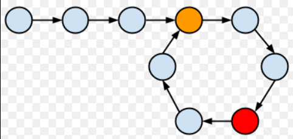
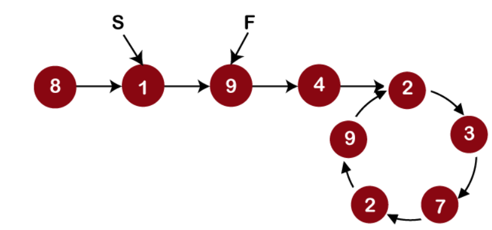
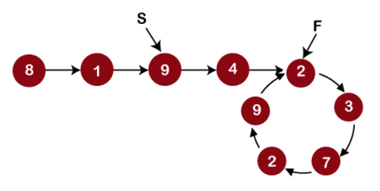
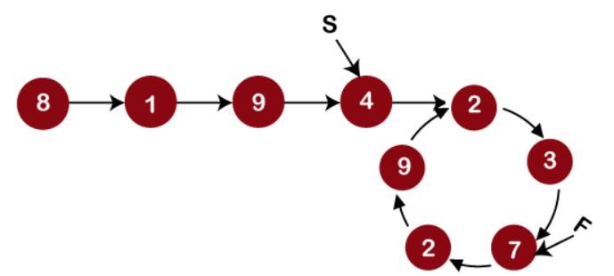
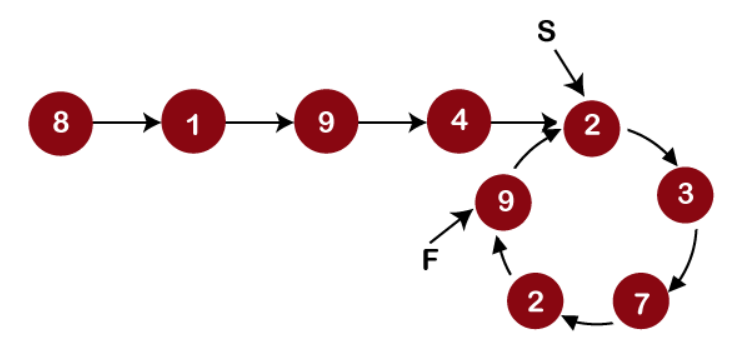
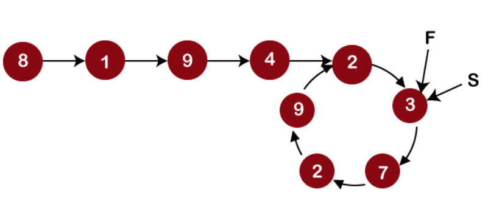

# Easy & Beginner friendly solution || Using two pointer approach || Time - O(n)& Space- O(1) || Gits✅

**Author:** GiteshSK_12
**Votes:** 7
**Link:** [https://leetcode.com/problems/linked-list-cycle/solutions/4660634/](https://leetcode.com/problems/linked-list-cycle/solutions/4660634/)

---

**Guys if you like the solution and explanation then upvote me**


# Approach
In the given question, we are provided with the head of a linked list, and our task is to determine whether a cycle is present or not.

**What is cycle in Linklist -** A cycle in a linked list is a condition in which the linked list does not have an end. From the picture below, we can see that the tail is pointing to some other node in the linked list.


**Solution -**
To solve this question we will use two pointer approach (slow and fast).
- **Step 1 -** We will check weather the head or head.next of linklist is null. If it is null we will return false because in two node no cycle can form. 
`if(head == null || head.next == null)return false;`

- **Step 2 -** Then initialize two pointers fast and slow. Initially, both the pointers point to the first node in the linked list.
`ListNode slow = head , fast = head;`
- **Step 3 -** Move slow pointer by one Node and fast pointer by two Node. 




- **Step 4 -** If both the poiters point to same Node it means cycle exist and we will return true.


# Complexity
- Time complexity: O(n)

- Space complexity: O(1)

# Code
```C []
/**
 * Definition for singly-linked list.
 * struct ListNode {
 *     int val;
 *     struct ListNode *next;
 * };
 */
bool hasCycle(struct ListNode *head) {
    if(head == NULL || head->next == NULL)return false;
    struct ListNode *fast = head , *slow = head;
    while(fast != NULL && fast->next != NULL){
        if(slow == NULL)return false;
        slow = slow->next;
        fast = fast->next->next;
        if(fast == slow)return true;
    }
    return false;
}
```
```C++ []
/**
 * Definition for singly-linked list.
 * struct ListNode {
 *     int val;
 *     ListNode *next;
 *     ListNode(int x) : val(x), next(NULL) {}
 * };
 */
class Solution {
public:
    bool hasCycle(ListNode *head) {
        if(head == NULL || head->next == NULL)return false;
        ListNode *fast = head , *slow = head;
        while(fast != NULL && fast->next != NULL){
            if(slow == NULL)return false;
            slow = slow->next;
            fast = fast->next->next;
            if(fast == slow)return true;
        }
        return false;
    }
};
```
```Java []
/**
 * Definition for singly-linked list.
 * class ListNode {
 *     int val;
 *     ListNode next;
 *     ListNode(int x) {
 *         val = x;
 *         next = null;
 *     }
 * }
 */
public class Solution {
    public boolean hasCycle(ListNode head) {
        ListNode slow = head , fast = head;
        if(head == null || head.next == null)return false;
        while(fast != null && fast.next != null){
            slow = slow.next;
            fast = fast.next.next;
            if(slow == fast)return true;
        }
        return false;
    }
}
```
```C# []
/**
 * Definition for singly-linked list.
 * public class ListNode {
 *     public int val;
 *     public ListNode next;
 *     public ListNode(int x) {
 *         val = x;
 *         next = null;
 *     }
 * }
 */
public class Solution {
    public bool HasCycle(ListNode head) {
        ListNode slow = head , fast = head;
        if(head == null || head.next == null)return false;
        while(fast != null && fast.next != null){
            slow = slow.next;
            fast = fast.next.next;
            if(slow == fast)return true;
        }
        return false;
    }
}
```
```javascript []
/**
 * Definition for singly-linked list.
 * function ListNode(val) {
 *     this.val = val;
 *     this.next = null;
 * }
 */

/**
 * @param {ListNode} head
 * @return {boolean}
 */
var hasCycle = function(head) {
    let slow = head;
    let fast = head;
    if (head === null || head.next === null) return false;
    while (fast !== null && fast.next !== null) {
        slow = slow.next;
        fast = fast.next.next;
        if (slow === fast) return true;
    }
    return false;
};
```
```python []
# Definition for singly-linked list.
# class ListNode(object):
#     def __init__(self, x):
#         self.val = x
#         self.next = None

class Solution(object):
    def hasCycle(self, head):
        """
        :type head: ListNode
        :rtype: bool
        """
        if head == None or head.next == None:return False
        slow = head
        fast = head
        while fast != None and fast.next != None:
            slow = slow.next
            fast = fast.next.next
            if fast == slow: return True
        return False 
        
```
```ruby []
# Definition for singly-linked list.
# class ListNode
#     attr_accessor :val, :next
#     def initialize(val)
#         @val = val
#         @next = nil
#     end
# end

# @param {ListNode} head
# @return {Boolean}
def hasCycle(head)
    return false if head.nil? || head.next.nil?
    fast, slow = head, head
    while !fast.nil? && !fast.next.nil?
        slow = slow.next
        fast = fast.next.next
        return true if fast == slow
    end
    false
end
```
# Thank you guys for watching solution if the solution and explanation was help full then Upvote.

