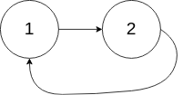

# [142. Linked List Cycle II](https://leetcode.com/problems/linked-list-cycle-ii/)

| Category | Difficulty | Likes | Dislikes |
| :------: | :--------: | :---: | :------: |
| Algorithms | Medium | 14875 | 1072 |

**Tags:** [`hash-table`](https://leetcode.com/tag/hash-table), [`linked-list`](https://leetcode.com/tag/linked-list), [`two-pointers`](https://leetcode.com/tag/two-pointers)

**Companies:** `amazon`, `google`, `microsoft`, `facebook`, `american-express`, `tiktok`, `apple`, `vmware`

## Description

Given the `head` of a linked list, return *the node where the cycle begins. If there is no cycle, return *`null`.

There is a cycle in a linked list if there is some node in the list that can be reached again by continuously following the `next` pointer. Internally, `pos` is used to denote the index of the node that tail's `next` pointer is connected to (**0-indexed**). It is `-1` if there is no cycle. **Note that** `pos` **is not passed as a parameter**.

**Do not modify** the linked list.

 

**Example 1:**


```

Input: head = [3,2,0,-4], pos = 1
Output: tail connects to node index 1
Explanation: There is a cycle in the linked list, where tail connects to the second node.

```

**Example 2:**


```

Input: head = [1,2], pos = 0
Output: tail connects to node index 0
Explanation: There is a cycle in the linked list, where tail connects to the first node.

```

**Example 3:**


```

Input: head = [1], pos = -1
Output: no cycle
Explanation: There is no cycle in the linked list.

```

 

**Constraints:**

	- The number of the nodes in the list is in the range `[0, 10^4]`.

	- `-10^5 <= Node.val <= 10^5`

	- `pos` is `-1` or a **valid index** in the linked-list.

 

**Follow up:** Can you solve it using `O(1)` (i.e. constant) memory?

---

**Links:** [Submissions](https://leetcode.com/problems/linked-list-cycle-ii/) | [Solutions](https://leetcode.com/problems/linked-list-cycle-ii/)
