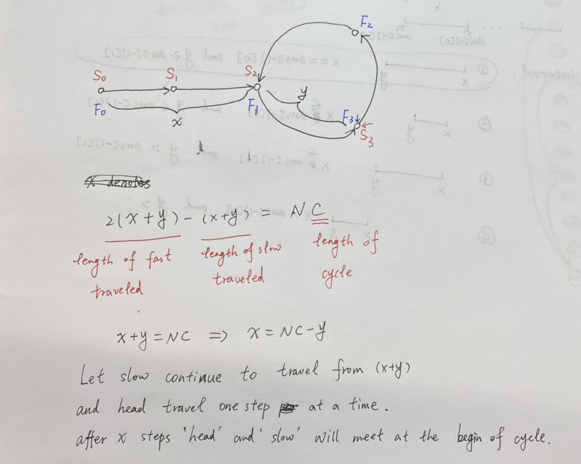

# ✅ [C++/Java/Python] Slow and Fast || Image Explanation || Beginner Friendly

**Author:** linfq
**Votes:** 1128
**Link:** [https://leetcode.com/problems/linked-list-cycle-ii/solutions/1701128/](https://leetcode.com/problems/linked-list-cycle-ii/solutions/1701128/)

---

**PLEASE UPVOTE if you like** \uD83D\uDE01 **If you have any question, feel free to ask.** 


* `slow` moves 1 step at a time, `fast` moves 2 steps at a time.
* when `slow` and `fast` meet each other, they must be on the cycle
	* `x` denotes the length of the linked list before starting the circle
	* `y` denotes the distance from the start of the cycle to where `slow` and `fast` met 
	* `C` denotes the length of the cycle
	* when they meet, slow traveled `(x + y)` steps while `fast` traveled `2 * (x + y)` steps, and the extra distance `(x + y)` must be a multiple of the circle length `C`
		* note that `x`, `y`, `C` are all lengths or the number of steps need to move. 
		* `head`, `slow`, `fast` are pointers. 
		* `head` moves `x` steps and arrives at the start of the cycle.
* so we have `x + y = N * C`, let `slow` continue to travel from `y` and after `x` more steps, `slow` will return to the start of the cycle.
* At the same time, according to the definition of x, `head` will also reach the start of the cycle after moving `x` steps.
* so if `head` and `slow` start to move at the same time, they will meet at the start of the cycle, that is the answer.

```
Time  Complexity: O(N)
Space Complexity: O(1)
```

**Python**
```
class Solution(object):
    def detectCycle(self, head):
        slow = fast = head
        while fast and fast.next:
            slow, fast = slow.next, fast.next.next
            if slow == fast: break
        else: return None  # if not (fast and fast.next): return None
        while head != slow:
            head, slow = head.next, slow.next
        return head
```

**C++**
```
class Solution {
public:
    ListNode *detectCycle(ListNode *head) {
        ListNode *slow = head, *fast = head;
        while (fast && fast->next) {
            slow = slow->next;
            fast = fast->next->next;
            if (slow == fast) break;
        }
        if (!(fast && fast->next)) return NULL;
        while (head != slow) {
            head = head->next;
            slow = slow->next;
        }
        return head;
    }
};
```

**Java**
```
public class Solution {
    public ListNode detectCycle(ListNode head) {
        ListNode slow = head, fast = head;
        while (fast != null && fast.next != null) {
            slow = slow.next;
            fast = fast.next.next;
            if (slow == fast) break;
        }
        if (fast == null || fast.next == null) return null;
        while (head != slow) {
            head = head.next;
            slow = slow.next;
        }
        return head;
    }
}
```

**PLEASE UPVOTE if you like** \uD83D\uDE01 **If you have any question, feel free to ask.**