# 🔥🔥 Explicación y Resolución Del Ejercicio En Español Java | Python | PHP | JavaScript | C++  🔥🔥

**Author:** hermescoder02
**Votes:** 5
**Link:** [https://leetcode.com/problems/linked-list-cycle-ii/solutions/4757653/](https://leetcode.com/problems/linked-list-cycle-ii/solutions/4757653/)

---

# Lectura

*Ciclo de una lista enlazada II(Java, Python, PHP, C++, Javascript)*

Dada una lista enlazada, devuelve el nodo donde comienza el ciclo, y si no hay, retorna nulo.

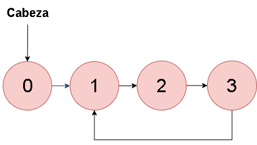


# Video

https://youtu.be/rFb9wCzdZQw?si=VOrBQklTBfsZ2JZy

Si te gust\xF3 el contenido \xA1te invito a suscribirte!:
\u2705https://www.youtube.com/@hermescoder?sub_confirmation=1

# Pasos para realizar el algoritmo:

**1.-** Se crean dos punteros, lento y r\xE1pido, que se inicializan al mismo nodo que la cabeza de la lista.

**2.-** Se ejecuta un bucle mientras r\xE1pido y su siguiente posici\xF3n no sean null.

**3.-** Dentro del bucle, se avanza un paso con lento y dos pasos con r\xE1pido esto se hace hasta que lleguen al mismo nodo.

**4.1.-** Se reinicia lento a la cabeza de la lista.

**4.2.-**  Se avanza con lento y r\xE1pido al mismo tiempo hasta que se encuentren de nuevo. Este va a ser el inicio del ciclo

**4.3.-**  Se retorna el puntero lento, que es el puntero del inicio del ciclo.

# C\xF3digo 

```Java []
public class Solution {
  public ListNode detectCycle(ListNode cabeza) {
    //paso#1
    ListNode lento = cabeza;
    ListNode rapido = cabeza;
 
    //paso#2
    while (rapido != null && rapido.next != null) {
 
      //paso#3  
      lento = lento.next;
      rapido = rapido.next.next;
 
      //paso#4
      if (lento == rapido) {
 
        //paso#4.1  
        lento = cabeza;
        //paso#4.2
        while (lento != rapido) {
          lento = lento.next;
          rapido = rapido.next;
        }
 
        //paso#4.3
        return lento;
      }
    }
 
    //paso#5
    return null;
  }
}
```

```PHP []
/**
 * Definition for a singly-linked list.
 * class ListNode {
 *     public $val = 0;
 *     public $next = null;
 *     function __construct($val) { $this->val = $val; }
 * }
 */
 
class Solution {
    /**
     * @param ListNode $head
     * @return ListNode
     */
    function detectCycle($cabeza) {
        // Paso #1
        $lento = $cabeza;
        $rapido = $cabeza;
 
        // Paso #2
        while ($rapido != null && $rapido->next != null) {
            // Paso #3
            $lento = $lento->next;
            $rapido = $rapido->next->next;
 
            // Paso #4
            if ($lento === $rapido) {
                // Paso #4.1
                $lento = $cabeza;
 
                // Paso #4.2
                while ($lento !== $rapido) {
                    $lento = $lento->next;
                    $rapido = $rapido->next;
                }
 
                // Paso #4.3
                return $lento;
            }
        }
 
        // Paso #5
        return null;
    }
}
```

```Python []
# Definition for singly-linked list.
    # class ListNode(object):
    #     def __init__(self, x):
    #         self.val = x
    #         self.next = None
     
    class Solution(object):
        def detectCycle(self, head):
            # Paso #1
            lento = head
            rapido = head
     
            # Paso #2
            while rapido is not None and rapido.next is not None:
                # Paso #3
                lento = lento.next
                rapido = rapido.next.next
     
                # Paso #4
                if lento == rapido:
                    # Paso #4.1
                    lento = head
     
                    # Paso #4.2
                    while lento != rapido:
                        lento = lento.next
                        rapido = rapido.next
     
                    # Paso #4.3
                    return lento
     
            # Paso #5
            return None
```

```C++ []
/**
 * Definition for singly-linked list.
 * struct ListNode {
 *     int val;
 *     ListNode *next;
 *     ListNode(int x) : val(x), next(NULL) {}
 * };
 */
class Solution {
 public:
  ListNode *detectCycle(ListNode *head) {
    // Paso #1
    ListNode *lento = head;
    ListNode *rapdio = head;
 
    // Paso #2
    while (rapdio != nullptr && rapdio->next != nullptr) {
      // Paso #3
      lento = lento->next;
      rapdio = rapdio->next->next;
 
      // Paso #4
      if (lento == rapdio) {
        // Paso #4.1
        lento = head;
 
        // Paso #4.2
        while (lento != rapdio) {
          lento = lento->next;
          rapdio = rapdio->next;
        }
 
        // Paso #4.3
        return lento;
      }
    }
 
    // Paso #5
    return nullptr;
  }
};
```

```JavaScript []
/**
    * Definition for singly-linked list.
    * function ListNode(val) {
    *     this.val = val;
    *     this.next = null;
    * }
    */
    
   /**
    * @param {ListNode} head
    * @return {ListNode}
    */
   var detectCycle = function(head) {
       // Paso #1
     let lento = head;
     let rapido = head;
    
     // Paso #2
     while (rapido !== null && rapido.next !== null) {
       // Paso #3
       lento = lento.next;
       rapido = rapido.next.next;
    
       // Paso #4
       if (lento === rapido) {
         // Paso #4.1
         lento = head;
    
         // Paso #4.2
         while (lento !== rapido) {
           lento = lento.next;
           rapido = rapido.next;
         }
    
         // Paso #4.3
         return lento;
       }
     }
    
     // Paso #5
     return null;
    
   };
```


# Imagenes de la Explicaci\xF3n

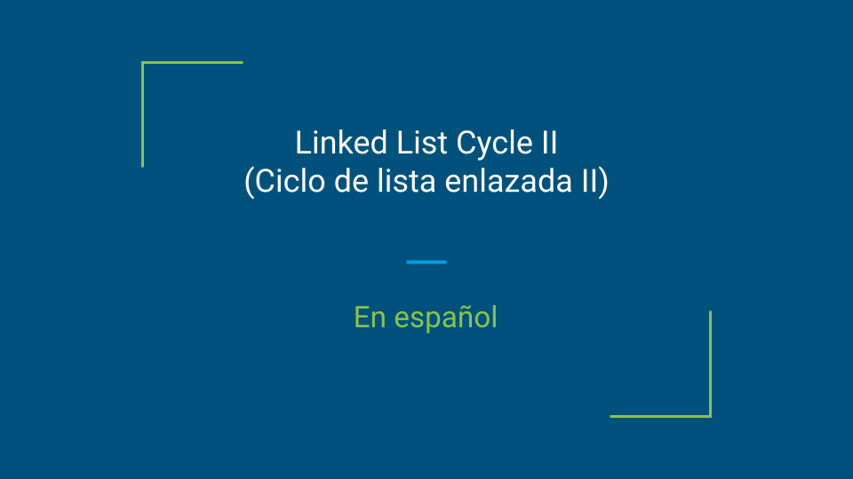

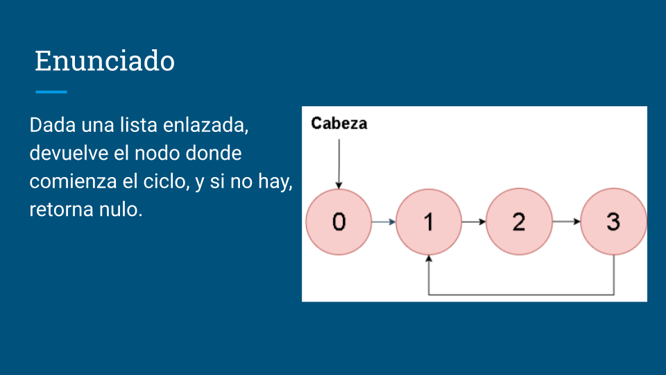

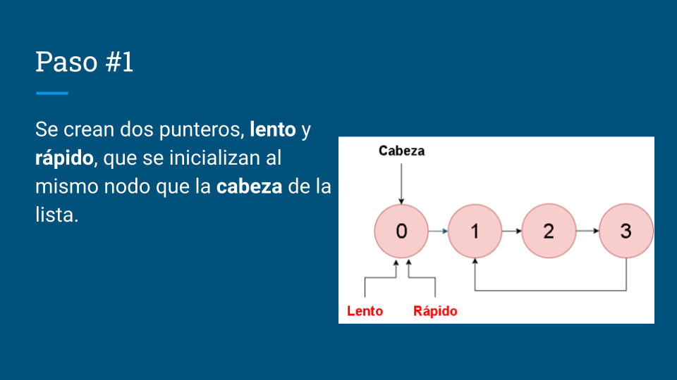

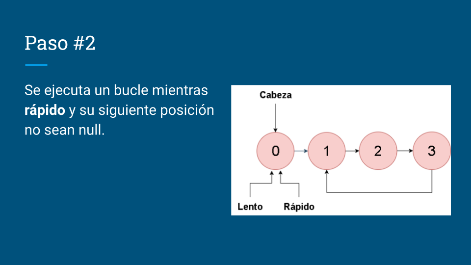

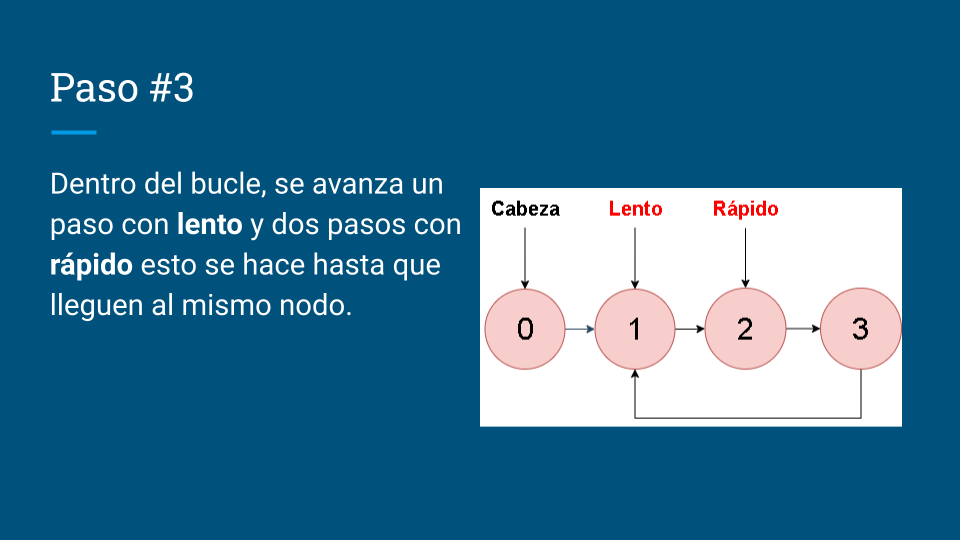

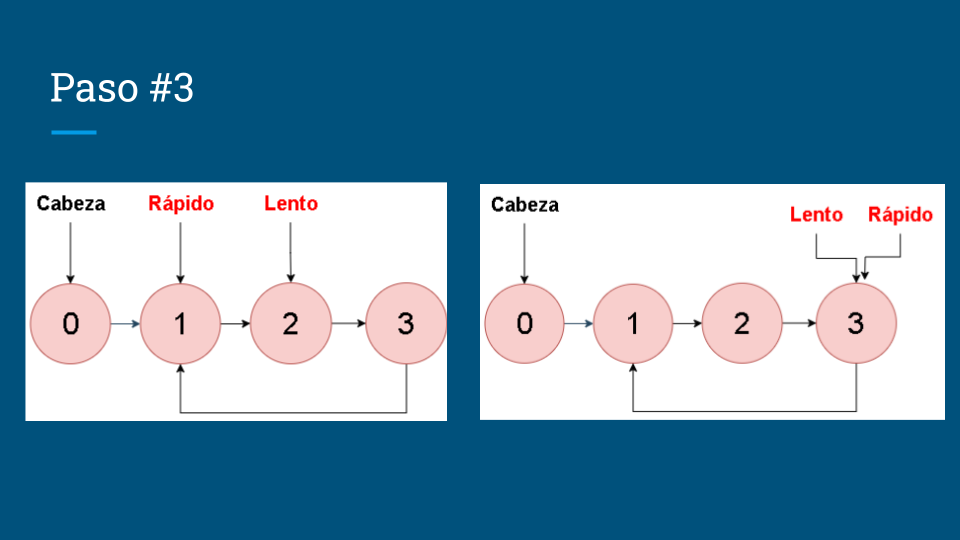

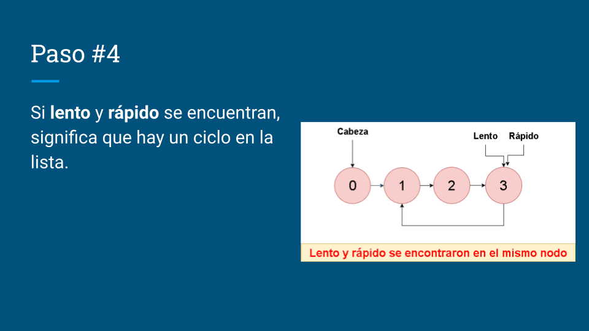

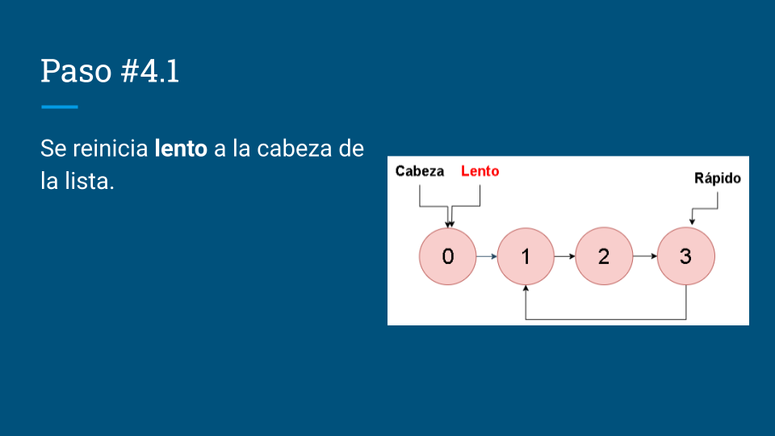

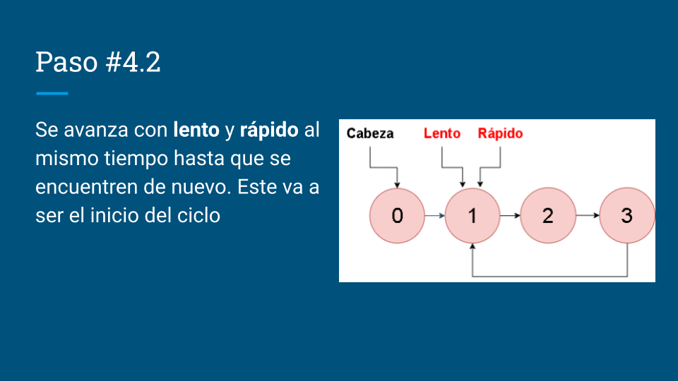

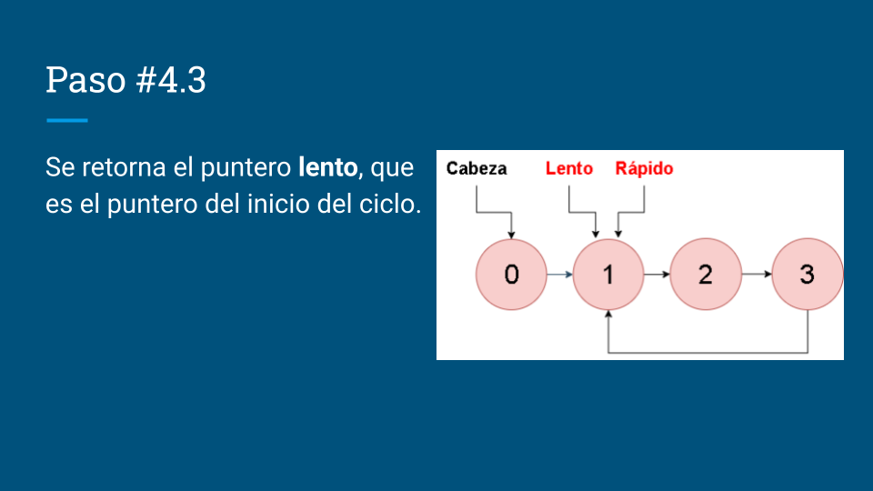
