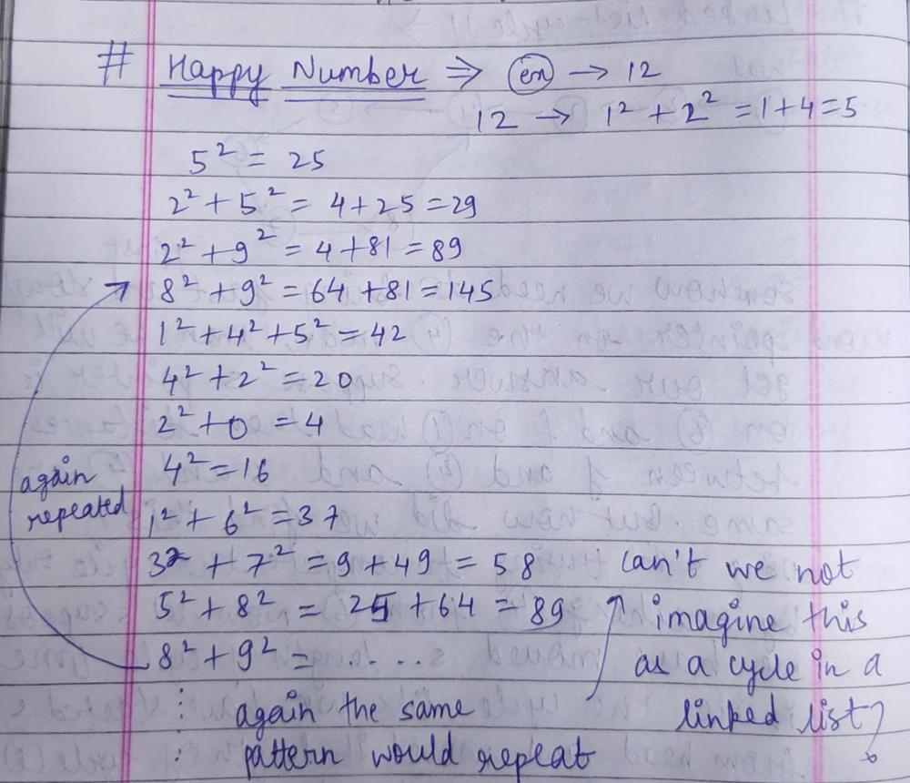
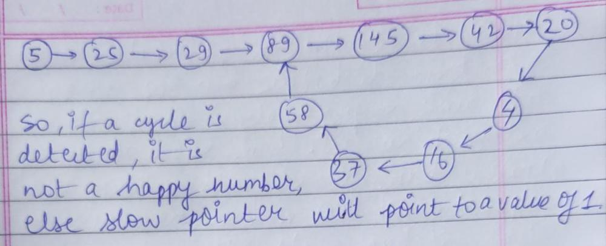

# EASY JAVA SOLUTION || TWO POINTERS || FLOYD'S TORTOISE AND HARE || DETAILED EXPLANATION

**Author:** 202151174
**Votes:** 656
**Link:** [https://leetcode.com/problems/happy-number/solutions/3767573/](https://leetcode.com/problems/happy-number/solutions/3767573/)

---

# Intuition
<!-- Describe your first thoughts on how to solve this problem. -->
Floyd's tortoise and hare method will be used, because this has something to do with a cycle.

# Approach
<!-- Describe your approach to solving the problem. -->






# Complexity
- Time complexity: O(N)
<!-- Add your time complexity here, e.g. $$O(n)$$ -->

- Space complexity: O(1)
<!-- Add your space complexity here, e.g. $$O(n)$$ -->

# Code
```
import java.util.LinkedList;

class Solution {
    public boolean isHappy(int n) {
        
        int slow = n;
        int fast = n;
//while loop is not used here because initially slow and 
//fast pointer will be equal only, so the loop won't run.
        do {
//slow moving one step ahead and fast moving two steps ahead

            slow = square(slow);
            fast = square(square(fast));
        } while (slow != fast);

//if a cycle exists, then the number is not a happy number
//and slow will have a value other than 1

        return slow == 1;
    }
    
//Finding the square of the digits of a number

    public int square(int num) {
        
        int ans = 0;
        
        while(num > 0) {
            int remainder = num % 10;
            ans += remainder * remainder;
            num /= 10;
        }
        
        return ans;
    }
}
```


