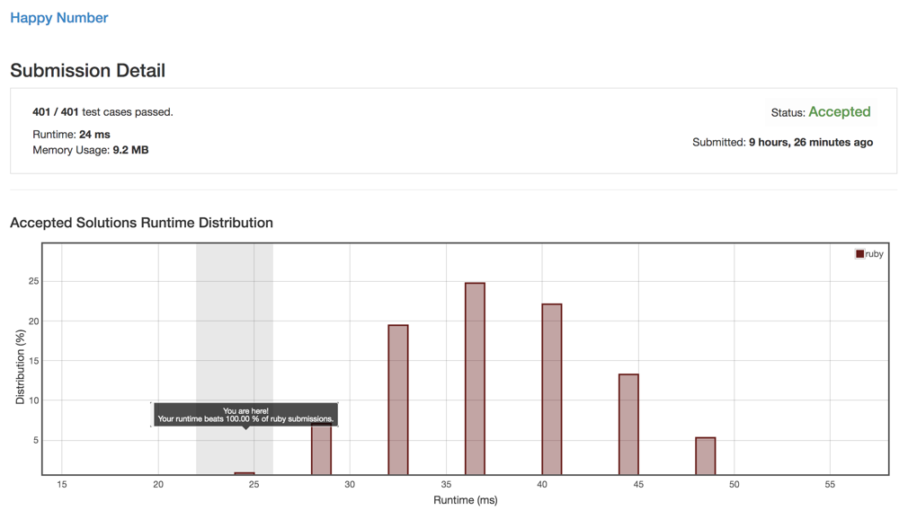

# Ruby really simple solution 24ms

**Author:** user8707V
**Votes:** 3
**Link:** [https://leetcode.com/problems/happy-number/solutions/560873/](https://leetcode.com/problems/happy-number/solutions/560873/)

---

Runtime: 24 ms
Memory Usage: 9.2 MB

```
# @param {Integer} n
# @return {Boolean}
def is_happy(n)
  touched = []
  res = n

  loop do
    res = res.digits.sum { |el| el * el }
    
    return false if touched.include?(res)
    return true if res == 1
    
    touched << res
  end
end
```


